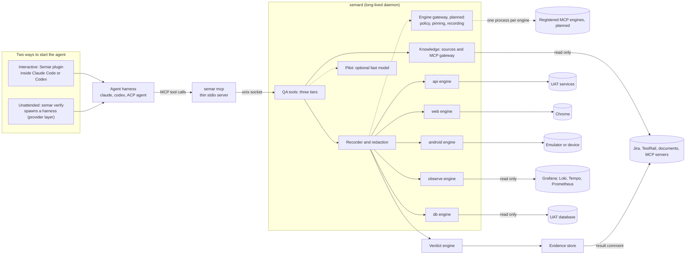

# Semar technical requirements

* **Status:** Draft 1. The model-free core (Plan 01), the plan from a diff and its providers, documents, and progress (Plans 12 to 15), the trial run (Plan 16), fixtures (Plan 17), API journeys (Plan 18), the coverage ledger (Plan 19), and the exports (Plan 20) are implemented.
* **Author:** azhar
* **Date:** 2026-11-14
* **Related:** [product requirements](PRD.md), [user scenarios](USER_SCENARIOS.md), [test workflow](WORKFLOW.md), [workflow diagram](workflow.html), [the main scenario as a page](scenario.html)

**Test data on UAT (2026-11-14):** Semar does change test data on UAT, through the application and as a test account. [What a test may change](#what-a-test-may-change) sets the limits.

**Updated 2026-11-17:** This update adds designs. Parts of them are now built, and each section says which. Each part says what is not verified.

* The promise and four layers in the [summary](#summary-of-the-design), and decisions T61 to T76.
* [Test obligations and the coverage ledger](#test-obligations-and-the-coverage-ledger): every use case that needs testing ends in a state, or on a short list for a person, with the reason. Built in Plan 19, from the sources that exist today. Obligations from acceptance criteria, the feature map, and past defects, and obligations proposed by the planner, are not built.
* [Fixtures](#fixtures): reviewed preparation flows across services. They replace the fragments of [Plan 11](implementation/11-configuration.md) for preparation steps. Built in Plan 17 for one repository and one machine. The Arazzo format, the Postman and HAR imports, and packs are not built.
* [Trial run](#trial-run): the read-only steps of a plan are sent once before the plan is final. Built in Plan 16.
* [Journeys](#journeys): product flows across services and surfaces, on one target manifest. They replace the narrow journey of [Plan 10](implementation/10-android.md). Built in Plan 18 for API legs and in Plan 22 for web legs. Android legs are not built.
* [Screens and UI legs](#screens-and-ui-legs): how an agent authors a UI leg and how Semar replays it. Not built.
* [Engines and the gateway](#engines-and-the-gateway): existing MCP servers as engines, behind one gateway that records every call. Not built.
* [Packs and the registry](#packs-and-the-registry) and [Dashboard views](#dashboard-views). Not built. [Standards and interchange](#standards-and-interchange): the CTRF, JUnit XML, and SARIF exports are built in Plan 20. The schemas, the imports, the Arazzo format, and signed bundles are not built.
* New types in the [domain model](#planned-types-for-obligations-fixtures-journeys-and-engines), new pipeline steps, configuration files, commands, threats, packages, tests, milestone items, spikes S15 to S19, and items under [Not verified](#not-verified). The types, files, commands, and tests of the built parts are built. The rest are planned.

## Current scope and role contract

The [current PRD scope](PRD.md#current-scope) supersedes earlier platform and mandatory-QA assumptions: API, web, and native Android are the initial product scope; native iOS follows. Grafana and databases are evidence connectors, not application surfaces. API-only increments are pilots; they do not complete the requested initial scope.

Dispatch by adapter capability and declared project surfaces. A missing required Android capability is `not_run`/blocked readiness, while a product that has no Android app can record `not_applicable` with a reason. Native testing must identify the app artifact and emulator/device; mobile web emulation cannot fulfill a native check.

A business journey may span several adapters. Keep a journey ID and target manifest above the per-surface scenarios, with explicit dependency/capture bindings and fixture leases across API, web, and Android steps. Do not infer a connected journey pass from independent scenarios that happened to pass on different resources or builds. [Journeys](#journeys) specifies the journey file, the target manifest, the bindings between legs, and the leases. Reserve iOS as a future capability without pretending Android scripts or evidence establish iOS correctness.

Authorization uses capabilities such as `confirm_intent`, `review_evidence`, and `authorize_release`, mapped to existing team members. No hardcoded `qa` account or TestRail source is required. Reused approved checks can receive a policy-based assessment; new intent follows authenticated confirmation. Solo author confirmation is recorded as `author_confirmed`, separate from independent review, with the release restrictions in the PRD.

Adapter selection remains subject to contract tests. Validate whether an adapter supplies isolation, replay, and action-level evidence before choosing reuse, daemon integration, or a fork.

This document says how Semar meets the product requirements. It names what was verified, what was read from documentation, and what is still unproven. The [spikes](#spikes-before-milestone-1) section lists every unproven claim that the design depends on.

## Summary of the design

The draft proposes a Go core with API, web, and Android execution adapters and optional Grafana/database evidence connectors. iOS is a later execution adapter. The standalone runner and managed/private execution modes share contracts; the cloud control plane requires additional boundaries. Two choices shape the design:

* **Agent harnesses.** Semar starts an installed harness and reads its events through one provider layer. See [Provider layer](#provider-layer).
* **One tool layer.** A long-lived daemon owns the connections, a thin MCP server exposes them, and the tools come in three tiers. The web engine is built in process on a Chrome DevTools Protocol library, and it is built (Plan 22). See [QA tool layer](#qa-tool-layer).

Semar has seven parts:

1. **QA tool layer.** The daemon `semard` and the thin MCP server `semar mcp`. Every action the agent takes on a surface goes through this layer.
2. **Engines.** One per surface: `api`, `web`, and `android`. Two more read evidence only: `observe` for Grafana and `db` for the UAT database. The daemon owns them. Planned: an engine can also be an existing MCP server that the person registers, reached only through the [gateway](#engines-and-the-gateway).
3. **Recorder.** Stores every action and its result, redacted. It sits inside the daemon, between the tools and the engines.
4. **Verdict engine.** A pure function from recorded evidence to an outcome.
5. **Evidence store.** A git branch that holds runs, confirmations, and sign-offs.
6. **Provider layer.** Starts an installed agent harness as a child process for unattended runs.
7. **Knowledge layer.** Presents the team's sources as one read-only knowledge base: Jira, TestRail, documents, Semar's own history, and any MCP server.



The main agent works in three activities: Plan, Author, and Explore. Replay, Observe, Verdict, and every regression run never call a model, neither the main agent nor the pilot.

Dashed lines in the diagram are planned and not built.

**The promise.** Semar does not guarantee that all behaviour is correct. Testing shows defects and cannot prove that none exist. Semar guarantees three things:

1. Nothing that needs testing is silently skipped. Every use case that needs testing ends in a state with evidence, or on a short list for a person, with the reason. See [Test obligations and the coverage ledger](#test-obligations-and-the-coverage-ledger).
2. Every pass has evidence that a person can open and check.
3. The false-pass rate is measured. `semar sample` checks a random sample of passes, and the detection check runs on the seeded-defect sample app before each release. See [Marking a wrong result and sampling passes](#marking-a-wrong-result-and-sampling-passes).

**Four layers of content (the repository and the journeys are built, the registry is planned).** Semar merges what it tests from four layers. Today it reads the repository layer and the journeys of the repository, and no organisation registry or pack:

| Layer | Holds | Owner |
| --- | --- | --- |
| Semar core | The formats, the engines, and generic packs: access checks, pagination, idempotent create, and the API security probes | The project, open source |
| Organisation registry | Fixtures, named checks, screens, journeys, and adapter profiles for the company's services, versioned and reviewed | A platform or QA team |
| Repository | Scenarios and fixtures specific to one service | The service team |
| Journeys | Product flows across services and surfaces, in the organisation repository or in the repository of a single-repository product | A named product or QA owner |

The precedence is repository, then organisation, then built-in. [Packs and the registry](#packs-and-the-registry) gives the merge rules, and [Journeys](#journeys) the journey format. This content layering is separate from the core, policy, and adapter layers of [Architecture for adoption](#architecture-for-adoption), which stay as they are.

**The gateway (planned).** Semar does not build every surface engine itself. It can use an existing MCP server as an engine. During a verification run the agent sees one MCP server, `semar`. Semar applies policy to each call, forwards it to the engine, and records it. A call that Semar did not see cannot become evidence, so the agent has no direct path to an engine. Semar adds what an engine does not provide: recording, verdicts computed by code, the effects policy, replay, fixtures, and journeys. See [Engines and the gateway](#engines-and-the-gateway).

### Two ways to start the agent

| | Interactive | Unattended |
| --- | --- | --- |
| Who starts it | A developer or QA engineer, inside their own Claude Code or Codex session with the Semar plugin installed | `semar verify`, from a terminal or a pipeline job |
| How the agent gets the tools | The plugin's MCP configuration starts `semar mcp` | The provider layer injects `semar mcp` into the harness it spawns |
| Agent's other tools | Whatever the user's session allows, including a shell | None. No shell, no network, no write tool |
| Use | Exploring, writing and repairing scripts, debugging a failure | Planning and script writing for many tickets without a person present |
| Label in the report | `interactive` | `restricted` |

Both use the same daemon, tools, recorder, and verdict engine. The run of record is always the model-free replay, so the way the script was written does not change how the verdict is computed. Semar is both a skill inside the user's own agent and a harness that drives agents, over one tool layer.

## Architecture for adoption

Semar must fit a company that uses other tools than the first adopter does. The design has three layers:

| Layer | What it holds | Who changes it |
| --- | --- | --- |
| The fixed core | Outcomes, verdict rules, the recorder, redaction, the effects policy, the evidence format, and the activity log | Nobody, per company. A "passed" means the same thing everywhere |
| Policy | Risk rules, test depth, which sources need confirmation, exit criteria, who may confirm and sign off, and link rules for tickets | The company, under `policy:` in `.semar/semar.yaml` |
| Adapters | Every outside system: the tracker, the code host, observability, test management, data stores, sign-in, secrets, model providers, the evidence store, and notifications | The company, by choosing an adapter with `kind:`, or by adding one |

An adapter can be built in, served by an MCP server through a mapping in configuration, or written by the company as a command that reads one JSON request and writes one JSON response. A missing optional system never stops a run: the feature that needs it is skipped, and the report says what was not checked.

The [implementation guide](implementation/README.md#architecture-for-adoption) lists every port with its adapters, the rules that each adapter follows, and the levels at which a company can adopt Semar. The configuration example in this document predates the `kind:` and `policy:` conventions in places. The implementation specifications are right where they differ.

## Configuration over code

A developer or a QA engineer changes what Semar tests by editing files under `.semar/`. Nobody needs the Go code for a new use case. Code holds mechanisms, and the files hold the use cases.

| File | Holds |
| --- | --- |
| `.semar/semar.yaml` | Hosts, accounts, limits, policy, providers, agents, assignments, and adapters |
| `.semar/map.yaml` | Features, entry points, and "must never" rules |
| `.semar/scenarios/` | One Gherkin `.feature` file per scenario |
| `.semar/fragments/` | Steps that several scenarios share |
| `.semar/data/<env>.yaml` | Named test data per environment |
| `.semar/checks.yaml` | Named checks |
| `.semar/probes/` | Security probes. Semar's own probes ship in the same format |
| `.semar/agents/<name>.md` | Extra guidance for one agent |
| `.semar/fixtures/<id>.yaml` | Built in Plan 17. Reviewed preparation flows. See [Fixtures](#fixtures) |
| `.semar/journeys/<id>.yaml` | Built in Plans 18 and 22 for API legs and web legs. Product flows across services. See [Journeys](#journeys) |
| `.semar/obligations/*.yaml` | Built in Plan 19. The use cases of a change. See [Test obligations and the coverage ledger](#test-obligations-and-the-coverage-ledger) |
| `.semar/screens/<app>.yaml` | Planned. Screen objects for UI legs. See [Screens and UI legs](#screens-and-ui-legs) |
| `.semar/packs.lock` | Planned. The exact versions and digests of the packs the repository names. See [Packs and the registry](#packs-and-the-registry) |

For preparation steps, a fixture replaces the fragment of Plan 11. A fragment stays for steps that several scenarios share and that make a product claim. A fixture is a fragment that has `find`, `create`, `cleanup`, `outputs`, and a lease.

Files are expanded to plain scenarios before the core sees them. The expectation hash is computed on the expanded form, so a change to a shared fragment lapses the confirmation and the script of every scenario that uses it.

`semar validate` checks every file and reports each problem with the file, the line, and a suggestion. Every command validates before it runs. Each file kind has a published schema, so that an editor completes and checks it.

Three things stay in code, because they are what makes a result mean the same everywhere: the verdict rules, the fixed invariants, and who may label an expected result. Configuration can add a rule. It cannot remove one of these.

[Plan 11](implementation/11-configuration.md) specifies the formats and the rules.

## Key decisions

| # | Decision | Alternative rejected | Reason |
| --- | --- | --- | --- |
| T1 | Go, one static binary, macOS and Linux | Node or Python | Your instruction. A single binary also suits a tool that QA installs |
| T2 | A provider is an agent harness, not a model API | Direct calls to vendor APIs | Your instruction ("use Harness"). Semar then holds no model credentials, and new vendors arrive through harness configuration |
| T3 | Driver kind and instance are separate | One fixed entry per harness | One driver can serve several accounts or endpoints. This is how DeepSeek is reached |
| T4 | Semar spawns the harness command-line tool directly | The Claude Agent SDK | The SDK exists for TypeScript and Python only. The SDK itself runs the `claude` binary |
| T5 | Codex is driven with `codex exec --json` | `codex app-server` | `codex --help` marks `app-server` as experimental. Semar's jobs are one-shot and need no interactive approvals |
| T6 | The agent returns structured results by calling an MCP tool (`qa_submit_plan`, `qa_submit_script`) | Each harness's own structured-output flag | One mechanism works on every harness. Semar validates the payload and returns errors to the agent in the same turn |
| T7 | Only actions that go through Semar's tools count as evidence. In an unattended job the agent's shell, network, and write tools are also switched off | Trust the agent to report what it did | Product rules 1 and 6. The recorder and the credentials stay in the daemon |
| T8 | Three separate objects: Scenario (a Gherkin file that people confirm), Script (a YAML file that the agent writes), Run (executed by the runner) | One file that holds both expectations and requests | The agent can then repair a request without being able to change an expected result. The file that people confirm reads as the Gherkin that QA engineers know, and holds no request ([Plan 24](implementation/24-gherkin-scenarios.md)) |
| T9 | The API engine is a native Go HTTP client | An existing HTTP test tool as a child process | The recorder, trace-ID injection, credential injection, and redaction all sit in the HTTP client. Owning the client is less code than wrapping another tool |
| T10 | The web engine is an in-process Chrome DevTools Protocol client built on chromedp, in `internal/engine/web` (Plan 22, D1). The Android engine is chosen by spike S7 | Another tool's engine by import, by its daemon, or by a copy. Test files of an existing runner, run as child processes | One maintained library gives real input events, the accessibility tree, request interception, and screenshots, with no second process. A snapshot-and-locator engine lets Semar act step by step like a person, and lets it record each action. A test-file runner only reports at the end |
| T11 | The shared record is an orphan git branch in the service repository | A server with a database, or object storage | Works on any code host, needs nothing to operate, and is browsable in the code host's web interface |
| T12 | Confirmation and sign-off identity comes from the code host | Names typed into a file | The code host already authenticates people |
| T13 | A long-lived daemon owns every connection, and the MCP server is a thin client of it | One process per tool call, or state inside the MCP server | Sign-in, an open app, and a warm emulator persist across tool calls and across agent sessions |
| T14 | Every UI surface offers three tiers: `run` by a fast pilot, primitives by the main agent, and `batch` with no model | Primitives only | Speed comes from handing over a whole sub-goal, not from faster single clicks. The batch tier is also the replay |
| T15 | The pilot is optional and is the one place Semar holds a model credential | No fast tier, or a required one | Semar must work with a harness login alone. Teams that want speed add a key |
| T16 | Semar ships as a plugin for the user's own agent and as an unattended command, over one tool layer | One of the two | The tool layer makes both cheap |
| T17 | Exploring produces findings, never `passed` | Let the agent declare a pass after testing by hand | Product rule 2. A finding carries recorded actions that a person can replay |
| T18 | A feature map in the repository links features, entry points, and source files. Plan and regression both read it | Derive entry points from the diff alone on every run | A changed shared function then maps to every endpoint that calls it, and coverage becomes a number |
| T19 | Code checks every claim in a plan that code can check: cited lines exist, targets exist in the route index, ticket quotes exist | Trust the plan as written | A model can cite a path or a line that does not exist |
| T20 | The regression suite fills by promotion on sign-off. A regression run replays scripts and calls no model | A separate hand-written suite, or an agent run per night | No extra work to grow the suite, no model cost per run, and no AI credential in the pipeline |
| T21 | A bootstrap scenario is labelled `baseline`, and its pass is reported as "unchanged", not "correct" | Treat recorded behaviour as the expected result | Recorded behaviour includes today's defects |
| T22 | The database is an evidence source of last resort, read through four read-only layers. The database enforces the first two | Let the agent run SQL with an ordinary account | Your instruction. A defect in Semar then cannot write to UAT |
| T23 | People decide in the merge request, and pipeline jobs start every run | Each person runs commands | Your instruction to keep effort low |
| T24 | Only `diff` and `baseline` expectations need a person's confirmation by default | Confirm every expectation | Fewer questions. The cost is that a wrong ticket sentence passes unchallenged, so teams can add `ticket` |
| T25 | The ticket is the unit of work, and a change with no ticket is blocked | Allow a run with no ticket | Your instruction. It also settles where a result is posted and how the roll-up groups |
| T26 | Code posts the result comment from recorded actions. The agent holds no tracker credential | Let the agent write and post the comment | The comment then says what ran, and a prompt injection cannot post to Jira |
| T27 | All knowledge sources are read-only and are presented through one search. Results are cached, not copied into a second database of record | Sync every source into a local store that Semar owns | Each source stays the system of record, and stale copies do not pile up |
| T28 | An MCP tool reaches the agent only when configuration lists it by name | Pass every tool of a configured server | A server's read-only mark is a hint. An unlisted tool could write |
| T29 | A memory note needs a person's approval before it joins the knowledge base | Let the agent write its own memory | Untrusted text could otherwise persist into every later run |
| T30 | A plan must cite earlier testing and give a decision per item | Leave it to the agent whether to look | Reuse beats a new draft, and a QA-written case with no scenario shows a gap |
| T31 | Code builds the change set of a ticket from merge requests, commits, and tracker links, and shows how each link was found | Let the agent decide which changes belong to a ticket | A wrong link is then visible and repeatable, and the agent cannot leave a change out |
| T32 | Semar compares the ticket view with the build view of what changed on UAT | Trust the ticket list | Code reaches UAT without a ticket, and two tickets change the same function. Neither shows in a per-ticket view |
| T33 | Every behaviour hunk has a scenario or an `uncovered` flag with a reason | Count scenarios | A plan can have many scenarios and still skip the riskiest change |
| T34 | A test changes UAT data only through the application, as a test account, and only when the environment sets `effects.mode: test_data` | A read-only UAT, or no stated limit | Your decision of 2026-11-14. A read-only UAT cannot test a login or a refund. With no stated limit, nothing stops a real payment or a real SMS |
| T35 | Code assigns the `person` label and owns the invariant list. The agent can submit `ticket`, `testcase`, `diff`, and `baseline` only | Let the agent label each expected result | The two labels that need no confirmation are then out of the agent's reach |
| T36 | Every step with an expected result is bound to one recorded action that matches the step's hint | Let any recorded result satisfy a check | A check could otherwise pass on a different request |
| T37 | One outcome per scenario, with every matching reason listed | Separate result dimensions for execution, assertion, evidence, and applicability | One word is what a person reads. The reasons keep the facts that the word hides |
| T38 | Access checks are part of every plan, and the report states what was checked | Leave access to another tool, or run a scanner | A change that works for the wrong user is a functional defect. Scanning needs its own permission |
| T39 | A sign-off is checked against the build on UAT each time it is read | Lapse only when a newer run exists | A redeploy with no rerun would otherwise leave a sign-off that looks valid |
| T40 | The agent is the tester, in three passes: scenarios, explore, and security. Code still computes every outcome | Let the agent report pass or fail | Your instruction that the agent tests like a QA engineer. A model verdict cannot detect a wrong pass |
| T41 | The recorder writes an activity log entry for every action, with a verb, the object touched, and the agent's reason | Keep only raw exchanges and a transcript | Your instruction. A developer can read what was done on UAT, and the data ledger comes from the same entries |
| T42 | Security testing is a fixed list of probe kinds that the agent drives. A finding is confirmed only when code can check it | Run a scanner, or let the agent report security results freely | A scanner tests what it knows, not what changed. A free report is an opinion |
| T43 | Every direct connection to a data store is read-only: PostgreSQL, MySQL, Elasticsearch, and OpenSearch | Read-only for SQL only | Your instruction. Writes go through the application only |
| T44 | Semar is written from scratch and copies no third-party code | Copy or wrap an existing testing agent | This keeps the license choice (Apache-2.0) free |
| T45 | Each web auth profile has its own Chrome profile. A person signs in there once, and later runs reuse the session | Use the developer's everyday Chrome, or sign in from scratch on every run | Your instruction. Chrome also refuses remote debugging on its default profile since version 136 |
| T46 | Sign-in with Google is done by a person, once, in an ordinary window. A test sign-in in the UAT build serves pipelines. Scripted Google pages are the last route | Script Google's pages as the main route | Google may block a browser that software controls. Semar does not work around that |
| T47 | The agent names a secret, and Semar types it, only into an input field on a listed host. A fixed OTP code may be written in the configuration file | Give the agent the values, or forbid a fixed code in the file | Product rule 6. A fixed UAT code is a test constant and you asked for it in the configuration |
| T48 | Two kinds of provider: agent harnesses, and decision models that Semar calls directly | Treat every vendor as an agent provider | A decision model returns choices with probabilities and cannot drive an agent. Anthropic, OpenAI, and DeepSeek can |
| T49 | Each job has a model role, and each role names its provider. The decision roles are optional | One provider for everything, or a fixed dependency on one vendor | Planning needs the strongest model, and picking the next click needs the fastest. A team must be able to run with what it has |
| T50 | A decision model gives hints, rankings, and proposals with a probability. It never sets an outcome | Let the fast model judge results | The same reason as for the agent, and a fast model errs more often |
| T51 | Most security probes are variations of a recorded request, built and checked by code | The agent composes every probe request | Hundreds of small requests are slow and costly through an agent, and the variations replay with no model |
| T52 | Semar imports existing MCP configurations, and a listed tool states its use and its effect | A separate setup per connection, or pass every tool through | Your instruction. Teams already run MCP servers for Jira and Grafana |
| T53 | The workflow has fixed gates: risk sets depth, an entry check comes before any model call, and exit criteria give a readiness line | Let the agent choose depth and order in each run | A tester's discipline has to hold on every run, not only when the agent thinks of it |
| T54 | Wrong results are recorded as marks, and passes are sampled at random by code | Trust the pass rate | A pass rate says nothing about false passes. A sample that a person chooses is biased |
| T55 | A fixed core, company policy in configuration, and an adapter for every outside system. An adapter is built in, mapped to an MCP server, or an external command with a JSON protocol | Build for the first adopter's tools and let others fork | Your instruction that other companies can adopt Semar. The core stays fixed so that an outcome means the same everywhere |
| T56 | Each kind of adapter has a conformance test kit, and adapters are registered in one file with no `init()` | Trust each adapter's own tests | An adapter written outside Semar can be proven, and the adapters in a binary are one readable list |
| T57 | Use cases are files under `.semar/`. Code holds mechanisms, and Semar's own defaults ship in the same file formats | A constant or a branch in Go for each use case | Your instruction that developers and QA never need the code |
| T58 | Files are expanded to plain scenarios before the core sees them, and the expectation hash covers the expanded form | Teach the verdict engine about cases and fragments | The core stays small, and a change to a shared file lapses what depends on it |
| T59 | Models are named agents, and fixed jobs are assigned to them in configuration, with fallback between jobs, backups per agent, pools, and panels | A fixed set of roles in code | Your instruction |
| T60 | Where a job is a choice, the decision provider is asked first, and a company can add its own questions | Use an agent for every question | Your instruction to use the fast, cheap model wherever it fits. No answer sets an outcome |
| T61 | Each use case that needs testing is an obligation, and code computes one of five states for it from the outcomes of the scenarios and journeys that cover it. The ledger sits above the six scenario outcomes | Count scenarios and outcomes only | A plan can look complete while a use case has no state. This extends T33 and PRD decisions D25 and D54. See [Test obligations and the coverage ledger](#test-obligations-and-the-coverage-ledger) |
| T62 | Test data and preconditions are fixtures: named, reviewed flows with `find`, `create`, `until`, `outputs`, and `cleanup`. A scenario names a fixture under `given` and never holds the flow. For preparation steps, a fixture replaces the fragment of Plan 11 | The planner writes setup steps in each scenario, or a fragment holds them | The planner reads one repository and cannot know another service's calls. "Take the first item of a list" fails on an empty environment. See [Fixtures](#fixtures) |
| T63 | The fixture file is compatible with Arazzo workflows, with Semar's find, create, cleanup, lease, and effects under `x-semar` keys. Spike S15 checks the mapping | Semar's own YAML only | Other tools can then read fixtures. Whether Arazzo keeps find before create, cleanup, and a lease is not verified. If it does not fit, Semar keeps its own YAML and offers an import |
| T64 | A fixture that cannot give its state ends the scenario `blocked`, naming the fixture and the step, never `failed`. A fixture whose scheduled health run fails gives `blocked: fixture unhealthy` | Report a preparation failure as a product failure | A failure of the preparation is not evidence about the behaviour under test. This applies the existing rule for a setup step |
| T65 | After the plan passes validation, Semar sends the read-only steps once against the environment and returns request problems to the planner, inside the three attempts. A trial result never counts as a pass and never changes an expected result | Meet the environment first at `semar run` | A wrong path or an empty capture then shows in the plan, not in the run. A response shows what the service does, not what it should do. See [Trial run](#trial-run) |
| T66 | A journey is a file of legs with explicit bindings, run against one target manifest, and code computes its outcome: `passed`, `failed`, `blocked`, `stale`, or `not_run`. The first failing leg is named, and later legs are `not_run` | Plan 10's journey: an ordered list of scenario IDs and shared names | A journey must not depend on another repository's scenarios, and a pass is valid only on the manifest it ran on. See [Journeys](#journeys) |
| T67 | Legs run one at a time, in the order that `needs` gives, with file order breaking ties. A wait polls a condition with a timeout and never sleeps | Run independent legs in parallel, or sleep a fixed time | The first failing leg is then well defined and the result repeats. A fixed sleep is either too short or wastes time |
| T68 | A UI leg has two phases. The agent authors it once, and Semar replays it with no model. Screen objects (`kind: Screens`) give screens and elements stable names that a person approves | The model acts on every replay, or steps refer to positions and visible text | Replay must repeat and cost no model call. Screen objects are the Page Object pattern of QA practice. See [Screens and UI legs](#screens-and-ui-legs) |
| T69 | During a verification run the agent sees one MCP server, `semar`. The gateway applies policy to each engine call, forwards it, and records it as an `Action` | Let the agent reach an engine's MCP server directly | A call that Semar did not see cannot become evidence (product rule 1). This extends T28 and PRD decision D44. See [Engines and the gateway](#engines-and-the-gateway) |
| T70 | Engines and registries are configured only in the person's own Semar home, never in the repository under test. An engine runs at an exact version, and a changed tool description denies the tool until a person approves it again | Read engines from `.semar/`, or accept a version range | The repository is untrusted, which is the existing rule for providers. A tool description can change after approval |
| T71 | A surface engine sits behind an engine adapter interface. Adapter profiles map one MCP server's tools to Semar's actions. T10 stands for the web, which Plan 22 builds in process. Spike S7 compares the Android candidates, mobile-mcp, Maestro, and Appium, through the same interface | Pick one engine per surface now | No candidate is verified. One interface lets the spikes compare them on the same tests, and lets a team change engines without changing scenarios |
| T72 | Where an adapter supports a native replay format, the stored script may be that native artifact, and Semar still binds each expected result to a recorded action. Spike S17 checks it | Store only Semar's own script format | A team can then run the same flow without Semar. Whether the binding survives a native artifact is not verified |
| T73 | Packs come from a registry that is a git repository. `semar pack add` pins an exact version and writes a lock file with a digest. Precedence is repository, then organisation, then built-in. The registry address comes from the person's home | Copy shared fixtures into each repository, or float on the newest pack | Shared fixtures are defined once. Git gives review and history. A run must say which pack versions it used. See [Packs and the registry](#packs-and-the-registry) |
| T74 | The dashboard is a view and an approval interface. Git stays the source of truth | Keep catalogues, approvals, or results in a dashboard database | A second record drifts from the files. See [Dashboard views](#dashboard-views) |
| T75 | Semar publishes its scenario, fixture, journey, screens, evidence, and verdict formats as versioned JSON Schemas with a conformance suite. It exports CTRF, JUnit XML, and SARIF, and every import is a draft that a person reviews | Private formats, and imports that count at once | Another tool can implement the formats and be checked. Semar does not claim to be a standard. See [Standards and interchange](#standards-and-interchange) |
| T76 | `lease: exclusive` reserves an account or a record for one run at a time. On one machine the lease is a file lock. The lease across several machines is an open question | No reservation, or a lock in the git repository | Two runs that change one account or record break each other. Git cannot lock. See [Fixtures](#fixtures) |

## Domain model

These types are the centre of the design. Everything else reads or writes them.

```go
// A Scenario is what people confirm. It lives in the service repository.
type Scenario struct {
	ID          ScenarioID
	Title       string
	Ticket      TicketRef
	Change      ChangeRef // repository and merge request
	Intent      string    // "Before X, now Y"
	Surface     Surface   // api | web | android
	Targets     []Entry   // every URL, path, or screen the scenario touches
	Links       []ItemRef // TestRail cases and earlier tickets this scenario came from
	AuthProfile string
	Steps       []Step
}

type Step struct {
	ID     StepID
	Action string        // plain English: "Create an order above the limit"
	Setup  bool          // true for a step that only prepares data
	Hint   *RequestHint  // method and path template. The agent chooses the values, and code checks that the recorded request matches
	Expect []Expectation
}

type Expectation struct {
	Check  Check  // api: status | jsonpath | header | schema. ui: text | element | url. observe: log | trace | metric. db: query
	Source Source // ticket | testcase | person | diff | invariant | baseline
	Cite   string // for ticket and testcase: the quoted sentence and the item ID
}

// A Script is what the agent writes. It lives in the evidence store.
type Script struct {
	ScenarioID ScenarioID
	ExpectHash Hash         // hash of Intent, AuthProfile, and every step's Hint and Expectations
	Steps      []ScriptStep // one per scenario step, bound to the recorded actions that carry it out, with locators and captures
	AuthoredBy ProviderRef  // instance, model, and harness version
}

// A Run is one execution of scripts against one build.
type Run struct {
	ID        RunID
	Builds    []BuildRef // per service: commit and configuration hash, at start and at end
	Results   []ScenarioResult
	StartedBy Identity
}

type ScenarioResult struct {
	ScenarioID   ScenarioID
	Outcome      Outcome // passed | failed | blocked | inconclusive | not_run | stale
	Reasons      []Reason
	Checks       []CheckResult
	Confirmation Confirmation
	Evidence     []EvidenceRef
}
```

A fourth object, the Finding, comes from exploring. It holds a title, a description, and the recorded actions that show a suspected defect. A Finding has no outcome. A person triages it.

These rules follow from the split:

* **The expected results come from the Scenario file, never from the Script.** The verdict engine reads expectations from the Scenario and exchanges from the recorder.
* **A Script is bound to an `ExpectHash`.** When a person edits an expectation, the hash changes, the old Script no longer applies, and the confirmation lapses.
* **A Script is reusable.** A later run for the same `ExpectHash` replays the stored Script with no model call.
* **Every step with an expected result is bound to one recorded action.** A check reads the result of that action and no other. See [Recording and replay](#recording-and-replay).
* **The agent cannot write `person` or `invariant`.** Code assigns both. See [Fewer questions](#fewer-questions).
* **A setup step makes no product claim.** It carries no expected result. When it does not succeed, the scenario ends `blocked` with "setup failed".

### Scenario file

A scenario is one Gherkin file, `.semar/scenarios/<ticket>/<id>.feature`, in the service repository. Gherkin is the format that QA engineers know from Cucumber and BDD, so product and QA read the file and confirm it as it is. The file holds what a person confirms: the scenario, its steps in words, and its expected results. It holds no request, no selector, and no capture. Those are in the script, as decision T8 says, and a script stays YAML. A file holds one `Scenario`. The official Gherkin parser, `github.com/cucumber/gherkin/go`, reads it, and `domain.Scenario` stays the model inside Semar. The example uses an invented order service.

```gherkin
Feature: Refunds of an order

  @id:SHOP-482-01 @ticket:SHOP-482 @surface:api @auth:support-agent
  Scenario: Refund above the order total is rejected
    Before: a refund larger than the order total was accepted.
    Now: the API rejects it with 422 and leaves the order unchanged.

    Given Create a paid order for 100000
    # step: create-order; POST /v1/orders
    When Request a refund of 150000 for that order
    # step: refund-too-much; POST /v1/orders/{id}/refunds
    Then the status is 422
    # ticket SHOP-482: a refund above the order total must be rejected
    And $.error.code equals "REFUND_EXCEEDS_TOTAL"
    # diff
    When Read the order again
    # step: order-unchanged; GET /v1/orders/{id}
    Then $.data.refunded_total equals 0
    # ticket SHOP-482: the order must stay unchanged
```

**How a part of the scenario is written.** Gherkin has no place for some of it, and a comment line directly under the line that it describes carries that.

| Part of `domain.Scenario` | Where it is in the file |
| --- | --- |
| `title` | The name after `Scenario:` |
| `intent` | The description lines under `Scenario:`, before the first step |
| `id`, `ticket`, `surface` | The tags `@id:<id>`, `@ticket:<key>`, and `@surface:api` (or `web`, `android`). All three are required |
| `authProfile` | `@auth:<profile>`. Nothing when the profile is `default`. `@noauth` when the scenario has no profile |
| `given` | A `Given the fixture <id> as <name>` line for each entry, before the steps. `with` is a table of two columns (`\| name \| value \|`) under the line, and `lease: exclusive` ends the line with `with an exclusive lease` |
| A setup step (`setup: true`) | A `Given` line. A step that follows another `Given` or `When` line is written `And` |
| An action step | A `When` line |
| `as` of a step | The line starts `as <account>, `, as in `When as bob, Bob moves card A to Doing` |
| The `id` and the `hint` of a step | The comment under the step: `# step: <id>` for a step with no request, and `# step: <id>; <METHOD> <path template>` for one with. The ID is the name that reports, scripts, and the ledger use for the step, so it is written and never counted |
| An expected result (`expect`) | A `Then` line directly under the `When` step that it belongs to, and an `And` line for the next one |
| The `source` and the `cite` of an expected result | The comment under its `Then` line: `# <source> <cite>`, and `, by model` at the end when a model wrote it (`by: model`) |
| The Feature line | The ticket's subject, for the person who reads the file. It is not part of the scenario and not in the hash |

**The sentence of a `Then` line.** There is one form for each subject and operator. A value is a JSON literal, so a string is in double quotes.

| Check | Sentence |
| --- | --- |
| The status | `the status is 422` |
| Equals | `$.error.code equals "REFUND_EXCEEDS_TOTAL"` |
| Not equals | `$.error.code does not equal "X"` |
| Contains | `$.error.message contains "total"` |
| Exists | `$.data.id exists`, and `$.data.id does not exist` |
| Greater, less | `$.data.total is greater than 0`, and `is less than 100` |
| Count | `$.data.items has 3 items`, and `has 1 item` |
| Equals a value at another path | `$.a equals the value at $.b` |
| A header | `the header Location contains "/v1/"`. A header takes the operators of a path |
| An element of a web page | `the element todo-first equals "{{b_title}}"`. An element takes equals, does not equal, contains, exists, and has N items |

The subject of a path check starts with `$`, so a path with spaces is allowed: Semar takes the first split that leaves a sentence that reads. A line that is none of these forms is an error that names the line and lists the forms.

**What the reader does.** It is strict, as the YAML reader was, and every error starts with the file and the line. It refuses a tag that is not listed, a second Scenario, a Background, a Rule, Examples, a doc string, a table anywhere but under a fixture line, a step with no `# step:` comment, an expected result with no source comment, a `Then` that has no `When` above it, a language other than English, and a number that a 64-bit float cannot hold exactly. A comment that is not in one of these places is ignored, so a person can add notes.

**What the file keeps exactly.** The writer and the reader are one pair: what `Render` writes, `Parse` reads back as the same scenario, with the same expectation hash. So a YAML scenario file that `semar scenarios convert` turns into a `.feature` file keeps every confirmation and every stored script. A few texts need care, and the writer says in a plain sentence which field it cannot carry:

* A line of the intent that starts like part of the scenario, such as `Given a paid order`, a `#`, an `@`, a `|`, or `Scenario:`, is written with a backslash in front, and the reader takes the backslash off. A line that starts with a backslash is written with two.
* An intent that ends with one line break, as a YAML `>` block does, is written with the tag `@intent-newline`, because Gherkin drops the blank lines at the end of a description. The tag keeps the hash. Remove it when you next edit the intent.
* The title, the action, the cite, and the names are one line each and have no space at either end, because Gherkin trims them.

The hash of the expected results covers what it always covered: the intent, the auth profile, each step's ID, setup flag, hint, `as`, and expected results, and `given`. The Feature line, the title, and the wording of a step are left out, so rewording them lapses no confirmation.

Who confirmed the scenario is not written in the file. Semar reads the confirmation from the code host or the evidence store at run time, so the agent and the author cannot write it. `semar review` prints the file as it is, with the source and the cite of each expected result in the comment under it, and then the results that need a person.

**Converting older files.** Scenario files were YAML until [Plan 24](implementation/24-gherkin-scenarios.md). Semar reads `.feature` files only, and a `.yaml` or `.yml` file under `.semar/scenarios` is an error that says "scenario files are Gherkin now: run semar scenarios convert". The command converts every such file in place, deletes the YAML file, and refuses to overwrite a `.feature` file.

### Planned types for obligations, fixtures, journeys, and engines

The types for fixtures and journeys are built. They are in `internal/domain` (`fixture.go` and `journey.go`), with small differences from the sketches below that [Plan 17](implementation/17-fixtures.md) and [Plan 18](implementation/18-journeys.md) give exactly. `Param.Default` is a pointer, a journey leg has no `Given` of its own, the manifest holds services only, and a journey result also keeps the manifest at the end and the fixture records. The obligation types are built in a package of their own, `internal/obligation`, with other fields than the sketch below (no `Feature`, no `Identity` type, and a `Gap` text): see [Plan 19](implementation/19-coverage-ledger.md). The sketches for screens, engines, and packs are planned and not built. All of these reuse the built types where they can: `domain.Outcome`, `domain.Step`, `domain.APIRequest`, `domain.Capture`, `domain.Check`, `domain.BuildRef`, `domain.Reason`, `domain.Hash`, and the `Action` and `Locator` of [Recording and replay](#recording-and-replay).

A Scenario gains one field. Everything else in it stays.

```go
type Scenario struct {
	// ... the fields above
	Given []Given // built in Plan 17. The states the scenario needs, each from a fixture
}

// A Given names a fixture and the name its outputs take in the scenario.
type Given struct {
	Fixture FixtureID         // order.paid
	As      string            // order. The script reads {{order.id}}
	With    map[string]string // values for the fixture's params
	Lease   LeaseMode         // "" | exclusive
}
```

```gherkin
Given the fixture order.paid as order
When Read the paid order
# step: read-order; GET /v1/orders/{id}
```

The script sends `{{order.id}}`.

**Obligations and the ledger.** An obligation state is its own type. It never replaces a scenario outcome.

```go
type ObligationID string // SHOP-482/AC-1, refunds/refund-owner

type Obligation struct {
	ID       ObligationID
	Title    string           // one use case, in a QA engineer's words
	Source   ObligationSource // criterion | diff | knowledge | testcase | feature_map | defect
	Cite     string           // the quoted text and the item ID, checked by code like a ticket quote
	Ticket   TicketRef
	Feature  FeatureID
	Covers   []ScenarioID
	Journeys []JourneyID
	Manual   *ManualReason // set when it cannot be automated
	Deferral *Deferral
}

type ObligationState string // verified | failed | blocked | needs_a_person | deferred

type ManualReason struct {
	Kind string // physical_device | third_party_otp | judgement | other
	Text string
}

type Deferral struct {
	By      Identity // from the code host
	Reason  string
	Expires time.Time
}

// ManualResult is what a person recorded for a needs_a_person obligation.
type ManualResult struct {
	Result string // passed | failed
	By     Identity
	At     time.Time
	Notes  string
}

type LedgerEntry struct {
	Obligation ObligationID
	State      ObligationState
	Reasons    []domain.Reason // the missing piece for blocked, the failing scenario for failed
	Manual     *ManualResult   // counted apart and labelled "checked by a person"
}
```

**Fixtures.** A fixture step is an API request with captures, the same shape a script step has today.

```go
type FixtureID string // order.paid

type Fixture struct {
	ID          FixtureID
	Description string           // the planner reads this, the params, and the outputs. Nothing else
	Version     string           // semantic version. Every run records it
	Owner       string
	Params      map[string]Param // name to default
	Find        []FixtureStep    // reads only
	Create      []FixtureStep    // runs only when Find gives nothing
	Outputs     []string         // capture names the scenario may read
	Cleanup     []FixtureStep    // runs for what Create made, also after a failure
	Lease       LeaseMode        // the default for a Given that names none
}

type FixtureStep struct {
	Request  domain.APIRequest // Service names the service. Its auth profile comes from configuration
	Captures []domain.Capture
	Until    *Until            // poll this request until the condition holds
}

// Until is a wait on a condition. A fixed sleep has no type.
type Until struct {
	JSONPath string
	Equals   any
	Timeout  time.Duration // required
	Every    time.Duration // the first interval. Doubles up to 15s
}

type LeaseMode string // "" | exclusive

type Param struct{ Default string }
```

**Journeys.** A journey outcome is a separate type from the six scenario outcomes. A leg ends in a scenario outcome.

```go
type JourneyID string
type LegID string

type Journey struct {
	ID          JourneyID
	Title       string
	Owner       string      // a named product or QA owner
	Criticality string      // critical | standard
	Given       []Given
	Legs        []Leg
	Invariants  []Invariant
}

type Leg struct {
	ID      LegID
	Surface domain.Surface // api | web | android
	Service string         // for an api leg
	App     string         // for a UI leg: the app whose screens it uses
	Needs   []LegID
	Wait    *Until         // poll the leg's last read until the condition holds
	Given   []Given
	Steps   []domain.Step
	Outputs []string       // capture names later legs read as 
}

// Invariant holds what only a journey can see.
type Invariant struct {
	Equal []string // templates such as {{place.total}}. All must be equal
}

type JourneyOutcome string // passed | failed | blocked | stale | not_run

// Manifest is what a journey result is valid for.
type Manifest struct {
	Services []domain.BuildRef // every service a leg calls, from its build probe
	Web      *domain.BuildRef  // the web build, when a leg is on the web
	Mobile   *AppBuild         // package, version, and commit, when a leg is on Android
	Hash     domain.Hash       // SHA-256 of the canonical form
}

type AppBuild struct{ Package, Version, Commit string }

type LegResult struct {
	Leg     LegID
	Outcome domain.Outcome
	Reasons []domain.Reason
}

type JourneyResult struct {
	Journey      JourneyID
	Manifest     Manifest
	Outcome      JourneyOutcome
	FirstFailing LegID
	Legs         []LegResult
	Invariants   []InvariantResult
	Reasons      []domain.Reason
}
```

**Screens.**

```go
type ElementID string // order-total

type Screens struct {
	App           string
	Screens       map[string]map[ElementID]ElementLocator // screen name to its elements
	Interruptions []Interruption                          // known dialogs that replay dismisses
}

// ElementLocator is how replay finds an element again. It feeds the recorder's Locator.
type ElementLocator struct {
	AccessibilityID string
	ResourceID      string
	Role            string
	Name            string // accessible name
	Text            string
}

type Interruption struct {
	ID      string         // permission-location, update-prompt
	When    ElementLocator // how to recognise it
	Dismiss ElementLocator // what to tap or click
}
```

**Engines and packs.**

```go
// Engine is one registered MCP server. It is read from the person's Semar home only.
type Engine struct {
	ID        string
	Surface   domain.Surface
	Command   []string  // the process to start, as an argument list
	URL       string    // or a server that already listens on 127.0.0.1
	Version   string    // exact. "latest" and ranges are refused
	Profile   string    // an AdapterProfile, by pack name and ID
	Network   []string  // hosts the engine process may reach
	Approvals []ToolApproval
}

type ToolApproval struct {
	Tool            string
	DescriptionHash domain.Hash // SHA-256 of the tool's name, description, and input schema
	By              Identity
	At              time.Time
}

// AdapterProfile maps one MCP server's tools to Semar's actions.
type AdapterProfile struct {
	ID       string
	Server   string              // the server name the engine reports
	Versions []string            // exact versions the profile was tested with
	Surface  domain.Surface
	Tools    map[string]ToolMap  // Semar action (snapshot, click, type, tap, ...) to a tool
	Snapshot string              // how the profile reads roles and names from a snapshot
}

type ToolMap struct {
	Tool    string
	Effect  EffectClass        // read | write | destructive
	Args    map[string]string  // Semar argument to tool argument
	HostArg string             // an argument that holds a URL, checked against the host allowlist
}

type EffectClass string

// Pack is a versioned set of content in a registry.
type Pack struct {
	Name     string // acme/orders
	Version  string
	Owner    string
	Fixtures []FixtureID
	Checks   []string
	Screens  []string
	Journeys []JourneyID
	Profiles []string
}

// LockEntry is one line of .semar/packs.lock.
type LockEntry struct {
	Name     string      // acme/orders
	Version  string      // exact: 1.2.3
	Commit   string      // the registry commit of that version
	Digest   domain.Hash // SHA-256 over the pack's files, in path order
}
```

## Pipeline

Each stage is a command and can run alone. `semar verify` runs stages 3 to 9 in order. When a change has no plan yet, `semar verify` runs stage 1 first.

No stage waits for a person. A scenario with an unconfirmed expected result is tested anyway and ends `inconclusive`. The verdict is a pure function of the evidence and the confirmations, so when a confirmation arrives later, Semar recomputes the outcome from the stored evidence and does not test again.

| # | Stage | Command | Uses a model | Output |
| --- | --- | --- | --- | --- |
| 1 | Plan | `semar plan` | Yes | Test plan with targets, scenario files, and recommendations |
| 1a | Trial run, built (Plan 16) | part of `semar plan`. `--no-trial` or `plan.trial: false` turns it off | No. Its problems go back to the planner | A trial result beside each read-only step in `plan.md`. See [Trial run](#trial-run) |
| 2 | Confirm | Merge request approval, or `semar review` | No | Confirmation record |
| 3 | Gate | `semar gate` | No | Build per service, or `blocked` |
| 4 | Sign in | part of `semar run`, and `semar login` for a first sign-in by a person | No | Session per auth profile. See [Signing in](#signing-in) |
| 5 | Author | `semar author` | Yes | Script per scenario |
| 6 | Run | `semar run` | No | Recorded exchanges |
| 7 | Observe | part of `semar run` | No | Log and trace findings per step |
| 8 | Verdict | part of `semar run` | No | Outcome per scenario |
| 9 | Publish | `semar publish` | No | Evidence on the branch, the report on the merge request, and a result comment on the ticket |
| 10 | Accept and sign off | `semar accept`, `semar signoff` | No | Signed records |
| 11 | Roll up | `semar rollup` | No | Table or HTML page |
| - | Explore | `semar explore` | Yes | Findings for a person to triage |
| - | Security | part of `semar verify`, or `semar explore --security` | Yes | Security findings, confirmed by code where code can check |
| - | Regression | `semar regression run` | No | Evidence and an outcome for every scenario in the suite |
| - | Journey, built for API legs and web legs (Plans 18 and 22) | `semar journey run` | No. A UI leg that needs an agent to author it is planned. A web leg is repaired with no model | An outcome per journey on one target manifest. See [Journeys](#journeys) |
| - | Ledger, built (Plan 19) | `semar status`, and the use case line in the report of `semar run`. `semar publish` is not built | No | A state per obligation, and the manual checklist. See [Test obligations and the coverage ledger](#test-obligations-and-the-coverage-ledger) |

### Where the planned parts run

The parts added on 2026-11-17 slot into the stages above without renumbering them. Items 1, 2, 4, 5, and 7 are built, and item 6 is built for API legs and web legs. The differences from the design are named in each item:

1. **Plan.** Built (Plans 17 and 19). Each scenario names its fixtures under `given`. Plan validation checks the draft as today, and also checks that every named fixture exists in the catalogue of the repository and that every output a step uses is an output of that fixture. The planner does not draft obligations. Code writes them after validation from the scenarios, the cases not drafted, the files that no scenario covers, and the document differences of the draft. A check that every obligation has a cover or a stated reason is not part of plan validation. The ledger reports it.
2. **Trial run.** Built (Plan 16). After validation passes, code resolves each fixture's `find` steps and sends the read-only steps once. Problems go back to the planner inside the same three attempts. The plan lists journeys whose legs call a route that a drafted scenario tests.
3. **Gate and sign in.** As today.
4. **Author and Run.** Built (Plan 17), in Run. Before the first step of a scenario, code resolves each `given` entry: lease, then `find`, then `create` when `find` gives nothing, then `until`. These actions are recorded in the `setup` pass. After the last step, also after a failure, code runs `cleanup` in the `cleanup` pass and releases the leases. Author is not built.
5. **Observe and Verdict.** As today. A fixture that could not give its state ends the scenario `blocked`.
6. **Journey.** Built for API legs (Plan 18) and web legs (Plan 22). A journey runs alone with `semar journey run`. It does not run after the scenarios of the same `semar run`. Code forms the target manifest, runs the legs in `needs` order, checks the invariants, and reads the manifest again at the end.
7. **Ledger.** Built (Plan 19). After the verdicts, code derives each obligation's state from the outcomes of the scenarios and journeys that cover it. `semar status` prints the states and the manual checklist, and the report of `semar run` opens with one line. `semar publish` is not built.

### Plan

Input: the ticket, the diff, the merge request description, the feature map, earlier testing from the knowledge sources, and a read-only checkout of the repository. A change with no ticket stops here.

Output: a test plan that names every target, the scenario files, and recommendations. [Planning from a change](#planning-from-a-change) describes how.

The agent job gets the harness's own read-only file tools, the `kb_*` tools, and two more Semar tools: `qa_context` and `qa_submit_plan`. In an unattended job it has no shell, no network, and no write tool. Semar validates the submitted plan. A validation error goes back to the agent as the tool result, for at most three attempts.

The change is not deployed at merge request time, so the agent executes nothing in this stage. The [trial run](#trial-run), built in Plan 16, is the one exception: code, not the agent, sends the read-only steps once to the build that the environment runs, and never a write. With `--no-trial`, with `plan.trial: false`, or when the trial is skipped, `semar plan` sends no request.

### Gate

Each service declares a build probe. Semar reads the deployed commit and checks that the merged commit is an ancestor of it with `git merge-base --is-ancestor`. Ancestry leaves three gaps, and the gate closes each one:

* **Reverts.** A reverted change is still an ancestor. For each `behaviour` hunk, Semar checks that the changed lines still exist at the deployed commit. A ticket whose hunks are gone is `not_deployed`, with the reason "the change is no longer in the deployed code".
* **Mixed builds.** Semar reads the probe three times. When the answers differ, some replicas run another build, and the gate ends `blocked` with "more than one build is serving".
* **Flags and configuration.** A service can declare a second probe that returns its feature flags or a configuration version. Semar stores a hash of the answer with the build. For a service with no such probe, the report says "flags not recorded".

Semar reads the build and the configuration again after the run. A difference at the end makes every result `stale`.

**Health check.** Before a session starts, Semar replays the regression scenarios that are tagged `smoke`, with no model. When one fails, every ticket ends `blocked` with "UAT is unhealthy" and the failing scenario. No model is called, so a broken environment costs nothing.

### Author

The agent gets the tools of the scenario's surface, as listed in [Surfaces and tools](#surfaces-and-tools). Semar executes each action, injects the session credentials, records the action, redacts the result, and returns it to the agent.

The agent works through the scenario's steps until it can call `qa_submit_script`. Semar then replays the script with no model. The replay must reproduce the recorded results, or the tool returns the difference and the agent tries again, for at most three attempts. A scenario with no accepted script ends `blocked`.

Authoring and replay each run the scenario once, so a scenario that creates an order creates two. Each run makes its own data and never reuses the other's. Two cases need care:

* **An operation that must not repeat**, such as spending a one-time voucher. A team lists it under `effects.once`. Semar then skips the immediate replay, keeps the recorded authoring run as the result, and marks it "not replayed".
* **A write that times out.** Semar does not send it again. The step is recorded as "effect unknown" and the scenario ends `inconclusive`. The next read step, or a person, shows what happened.

The agent cannot change an expectation. When an expectation looks wrong, for example a JSON path that does not exist in the response, the agent calls `qa_flag_expectation` with a proposed correction. The scenario then ends `inconclusive` until a person confirms the corrected expectation.

### The agent's test session

The agent is the tester. For each ticket it does what a QA engineer does, in one session with three passes:

| Pass | What the agent does | What comes out |
| --- | --- | --- |
| Scenarios | Works through each planned scenario by hand: sends the requests, uses the pages, uses the app | A script per scenario, and the recorded actions that each outcome is computed from |
| Explore | Tests around the change with no script, within a time limit and an action limit | Findings |
| Security | Tries to misuse the changed entry points. See [Security testing by the agent](#security-testing-by-the-agent) | Security findings |

`semar verify` runs all three passes. `--no-explore` and `--no-security` skip one.

Every action of every pass goes into the [activity log](#activity-log). At the end the agent writes QA notes with `qa_submit_notes`: what it tested, what it could not test, and what worries it. The report shows them under "QA notes, written by AI". The notes never change an outcome.

The agent decides what to try. It does not decide the result. Code computes each outcome from what the recorder stored, so the agent cannot mark its own work as passed. See [Testing practices built into Semar](#testing-practices-built-into-semar).

### Run, observe, and verdict

The replay runs each script as a batch through the surface engine. The recorder stores every action. The observe engine reads logs and traces for each step. The verdict engine computes the outcome. Scenarios for different tickets run in parallel, bounded by a worker limit. Steps inside one scenario run in order.

## Planning from a change

Plan turns a diff into a test plan that names every URL, path, and screen it will test, says why, and adds the agent's recommendations. The agent proposes. Code checks each claim that code can check.

### From a ticket to its code changes

A ticket holds no code. Before the agent can plan, Semar must work out which code changes belong to the ticket. Code does this, not the agent, and the plan shows how each change was found so that a person can see a wrong link.

```go
type ChangeSet struct {
	Ticket   TicketRef
	Parts    []ChangePart // one per repository
}

type ChangePart struct {
	Repo     RepoRef
	Requests []MergeRequestRef
	Commits  []CommitRef
	FoundBy  []LinkKind  // tracker_link | request_title | request_description | branch_name | commit_message
	Deployed DeployState // deployed | partly | not_deployed
	Hunks    []Hunk
}

type Hunk struct {
	ID       HunkID      // file, line range, and content hash
	File     string
	Symbol   string      // the enclosing function, when it can be told
	Kind     HunkKind    // behaviour | refactor | config | migration | test | docs | generated
	Overlaps []TicketRef // other tickets in the same deploy that changed the same lines or function
}
```

Semar builds the change set in four steps:

1. **Find the merge requests.** In every repository that the configuration lists, Semar asks the code host for merge requests whose title, description, or source branch contains the ticket key. It also reads the development links on the Jira ticket when Jira has them. A ticket often spans several repositories: a backend, a web app, and an Android app.
2. **Find loose commits.** Semar searches the commit messages on the deployed branch for the ticket key. This catches a follow-up fix that someone pushed without a merge request.
3. **Check what is deployed.** For each merge request, Semar checks that its merge commit is in the build that UAT runs. A ticket with one part deployed and one not is `partly` deployed, and the plan says which part is missing.
4. **Take the diff and split it into hunks.** Semar uses the diff of each merge as the code host reports it. The agent reads the repository at the deployed commit, not at the merge request's head, so it sees the code as it runs on UAT, including later changes by other tickets.

Code assigns the kinds `test`, `docs`, `generated`, `config`, and `migration` from file paths. The agent assigns `behaviour` or `refactor` to the remaining hunks. That call can be wrong, so a `refactor` hunk is never dropped. It gets a neighbour scenario, which checks that behaviour did not change.

A ticket for which Semar finds no code change ends `blocked` with the reason "no code change found for this ticket". The change may live in a feature flag or another system, and a person must say so. The person says so with `semar verify --ticket SHOP-500 --no-code "flag refund_v2 turned on"`. Semar then plans from the ticket text and the feature map, with an empty change set that names the declared change. Every expected result must come from the ticket, a test case, or a person, because there is no diff to read.

### The build view

The ticket view answers "what did this ticket change". The build view answers "what changed on UAT". Semar computes both and compares them, because they can disagree.

For each service, Semar lists every commit between the last build it verified and the build that UAT runs now. It then sorts the commits by ticket key.

| Finding | Meaning | Where it appears |
| --- | --- | --- |
| Commits of a ticket you asked for | Expected | In that ticket's change set |
| Commits of a ticket you did not ask for | That ticket is also on UAT and nobody is verifying it | "Also on UAT, not verified" |
| Commits with no ticket key | Code reached UAT with no ticket | "Changes with no ticket", with author and message |
| Two tickets changed the same lines or the same function | Each ticket can pass alone and still break the other | `Overlaps` on the hunk, and a double-check flag |

`semar verify --new` uses the build view to choose the tickets: it verifies every ticket that has new commits on UAT since the last verified build. A developer then does not need to list ticket keys, and a pipeline job after a deploy needs no arguments.

### Feature map

The feature map is a file in the repository, `.semar/map.yaml`. It lists each feature, the entry points that reach it, and the source files behind it. Plan uses it to turn changed files into affected entry points. Regression uses it to measure coverage.

```yaml
features:
  - id: refunds
    title: Order refunds
    owners: [team-payments]
    entries:
      - { surface: api, method: POST, path: "/v1/orders/{id}/refunds", auth: required, owner: true }
      - { surface: api, method: GET, path: "/v1/orders/{id}/refunds" }
      - { surface: web, path: "/orders/:id/refund" }
      - { surface: android, screen: RefundActivity }
      - { surface: job, name: refund-settlement-worker }
    sources: ["internal/refund/**", "web/src/pages/orders/refund/**"]
    rules:
      - { id: refund-owner, mustNever: A customer refunds an order of another customer }
      - { id: refund-total, mustNever: The refunded total of an order exceeds its paid total }
```

`semar map` drafts the file once. The agent reads the repository with read-only tools: route registrations, OpenAPI files, page routes, Android manifests, and job registrations. A person corrects the draft in a merge request. After that, Plan proposes a map change whenever a diff adds or removes an entry point, so the map is maintained as a side effect of normal work.

`semar map --check` is plain code. It reports OpenAPI paths that the map does not list, and source patterns that match no file.

A feature also keeps a short list of things that must never happen. A person writes or confirms each rule once. The planner can propose a rule, which then appears as a yes or no question. Security probes check the confirmed rules on every later ticket that touches the feature, so nobody answers the same question twice.

### Risk and test depth

A QA engineer tests a payment change harder than a label change. Code sets a risk level for each ticket from facts in the change set, and the level sets the depth of testing.

| Level | Set when | Scenarios | Explore | Security | Confirmation |
| --- | --- | --- | --- | --- | --- |
| Low | The change has no `behaviour` hunk, touches no high-risk path, and overlaps no other ticket | The changed behaviour and the neighbour. At most 4 | Off | Access checks | The default sources |
| Standard | Everything else | All kinds. At most 8 | 10 minutes | Access checks and probes 1 to 9 | The default sources |
| High | A hunk under a `risk.paths` pattern, a migration, an overlap with another ticket, or more than 10 affected entry points | All kinds. At most 12 | 20 minutes | Access checks, every probe kind that is turned on, and every "must never" rule of the feature | Expected results from the ticket also need a person who is not the author |

The planner can raise the level, with a reason that the plan shows. It cannot lower it. A person can set the level with `--depth`. The plan states the level and why at the top.

### Nine steps

| # | Step | Done by | Checked by code |
| --- | --- | --- | --- |
| 1 | Find the ticket. Stop when the change has none | Code | The ticket exists in the tracker |
| 2 | Build the change set: the merge requests, commits, and hunks that belong to the ticket, in every repository | Code | Each link names how it was found. At verify time, each merge commit is in the deployed build. At merge request time nothing is deployed, so the change set is the merge request's own diff |
| 3 | Compare with the build view: other tickets on UAT, commits with no ticket, and overlaps | Code | Not applicable |
| 4 | Build the impact map: each affected entry point and the code path that leads to it | Agent | Every cited file and line exists. The first reference of each chain lies inside a hunk of the change set. Every entry point exists in the feature map or an OpenAPI file, or is flagged `unlisted` |
| 5 | Look up earlier testing for each affected feature, and decide for each item: reuse, adapt, or set aside | Agent | Every cited item exists in its source under the cited ID |
| 6 | Draft scenarios for each affected entry point that earlier testing does not already cover. Each scenario cites the hunks that motivate it | Agent | The scenario schema. Every cited hunk exists. Every `ticket` and `testcase` expectation quotes text that exists in its source |
| 7 | Rank the scenarios by risk and keep the top ones | Agent ranks, code cuts | The cap, 8 per change by default. Scenarios past the cap are listed as "not selected", never dropped silently. A scenario for a `high_risk` hunk and an access check are never cut |
| 8 | Compute change coverage and the double-check list | Code, with risk and scope flags from the agent | Every `behaviour` hunk has a scenario or an `uncovered` flag with a reason |
| 9 | Write recommendations | Agent | None. Recommendations are advice and are labelled as written by AI |

[From a ticket to its code changes](#from-a-ticket-to-its-code-changes) describes steps 2 and 3. [Knowledge and earlier testing](#knowledge-and-earlier-testing) describes step 5. [Change coverage](#change-coverage) describes step 8.

### Impact map

```go
type Impact struct {
	Entry   Entry     // surface plus method and path, screen, or job
	Feature FeatureID
	Reach   Reach     // direct | indirect | unknown
	Chain   []CodeRef // file and line, from the changed line up to the entry point
}
```

| Reach | Meaning | Example |
| --- | --- | --- |
| `direct` | The changed line is inside the entry point's own handler | The refund handler changed |
| `indirect` | The changed line is reached from the entry point through a chain of calls | A shared pricing function changed, and three endpoints call it |
| `unknown` | The agent cannot trace the change to an entry point | A configuration value, a migration, or a library upgrade |

A change with `unknown` reach is never hidden. The plan lists it under "could not be traced" with the features that use the changed file, and recommends the regression scenarios for those features.

### Scenarios for one entry point

For each affected entry point the agent drafts scenarios of five kinds, in this order of priority:

1. **The changed behaviour.** What the diff makes different, on the main path.
2. **The boundary.** The value at which the changed condition flips.
3. **The refusal.** An input the change should now reject, or still reject.
4. **The neighbour.** Behaviour of the same entry point that the diff should not have changed.
5. **Access.** Who must not be able to do this. See [Access checks](#access-checks).

Each scenario lists its targets, so a reader sees which URLs it will call before anything runs.

### Access checks

A change can work for the right user and also work for the wrong one. For each affected entry point that needs sign-in, Semar adds up to three short scenarios:

| Check | Request | Expected result | Where the expected result comes from |
| --- | --- | --- | --- |
| No sign-in | The same request with no credentials | Refused with 401 or 403 | A fixed rule, when the feature map marks the entry point `auth: required` |
| Another user's object | The request as a second test account, on an object that the first account owns | Refused with 403 or 404 | A fixed rule, when the feature map marks the entry point `owner: true` |
| Lower role | The request as an account with a lower role | What the ticket or the code says that role may do | `ticket` or `diff`, so the usual confirmation applies |

The agent drafts the `auth` and `owner` fields of the feature map from the code, and people correct them.

These rules apply:

* An access check needs a second test account. Without one, the plan lists the check as "not run: no second test account", and the report repeats it.
* A refusal status is not enough for a write. The scenario reads the object again and checks that it did not change.
* Semar scans every recorded response for values that match its secret patterns, such as a token or a password hash, and reports a match as a finding.
* The report states what was checked, for example "Access checks: 6 run, 0 findings, 2 not run". It never states that a change is secure.

Access checks are a fixed list and need no model. [Security testing by the agent](#security-testing-by-the-agent) goes further.

### Security testing by the agent

A QA engineer who tests security tries things: another ID, a missing token, a field that the form does not show. The agent does the same in the security pass, on the entry points that the change affects.

The agent chooses what to try. The kinds of probe are fixed, so that a person can read what the agent may do before it runs:

| # | Probe | What the agent tries | Code confirms the finding when |
| --- | --- | --- | --- |
| 1 | Another user's object | IDs that belong to the second test account, and IDs next to its own | A 2xx response returns the other account's object, or a readback shows that the object changed |
| 2 | A function above the role | An admin or staff entry point as an ordinary account, and other methods on the same path | A 2xx response on an entry point that the feature map limits to a higher role |
| 3 | Sign-in handling | No token, an expired token, a token changed by one character, the token of a signed-out session | A 2xx response on an entry point marked `auth: required` |
| 4 | Fields the client should not set | Extra fields in a write, such as `role`, `price`, `owner_id`, or `status` | A readback shows that the field took the sent value |
| 5 | Input handling | Quote characters, markup, path fragments, very long values, negative numbers, and wrong types in each input | A 5xx response, a database error text in the body, or the markup returned unescaped in a page |
| 6 | Too much data | Reads the full response of each affected entry point | The body holds a value that matches a secret pattern, or a field that the feature map marks private |
| 7 | Business rules | The same request twice, a step skipped, a used OTP or one-time link again, a negative or zero amount | A readback shows that the effect happened twice, or happened without the skipped step |
| 8 | Error text | Forces errors on the affected entry points | The body holds a stack trace, a file path, or a query text |
| 9 | Browser protections | Reads the response headers and cookie flags of affected pages | A session cookie without `HttpOnly` or `Secure`, or no content security policy on a page with a form |
| 10 | Request limits | A short burst on sign-in, OTP, and password reset | No refusal after the configured number of tries |

Each probe is a set of recorded actions, like any other test. It has one of two results:

* **Confirmed.** The condition in the last column holds. Code checked it, so the finding counts as a `failed` scenario for the ticket. Its script joins the regression suite once the defect is fixed.
* **Suspected.** The agent reports something that code cannot check. It is a finding for a person to triage, and it never changes an outcome.

Code enforces these limits:

* Probes run only on a `kind: test` environment, on listed hosts, as test accounts, and never on an operation in `effects.deny`.
* A probe changes only objects that the run created, in its own account or in the second test account.
* Each entry point has a request budget, 40 by default.
* Probe 10 is off by default, because a burst can lock a test account. `security.burst` sets the number of tries.
* On a `read_only` environment only probes 3, 6, 8, and 9 run, and only on reads.
* Semar runs no load test and no automated scanner. A scanner such as Nuclei or ZAP can be added later as a separate tool that a team turns on. Its findings would be suspected until a recorded action shows them.

The report states what was done, for example "Security testing: 9 probe kinds on 4 entry points, 212 requests, 1 confirmed, 2 suspected, 1 kind not run (request limits are turned off)". It never states that a change is secure. Ten probe kinds on the changed entry points are not a security review of the whole system.

**Most probes are variations of a recorded request.** The scenario pass leaves a recorded, working request for each affected entry point. For probes 1 to 6 and 8, code builds the variations: the same request with no token, with the other account's token, with the other account's ID, with one extra field, or with one marker in one input. Code sends them with no model, inside the request budget, and checks the condition in the table. When a decision model is configured, it ranks the responses that look unlike the baseline, and the tester reads those first. The tester's own turns go to probe 7, to the feature's "must never" rules, and to whatever the variations turned up. The same variations replay with no model in a regression run.

### Coverage of the ticket's criteria

A ticket that has acceptance criteria gets a second coverage table, beside the one for code. Code splits the criteria into numbered items, `AC-1`, `AC-2`, by the ticket's own list markers. The agent links each scenario to the items it tests, and code inverts the list:

```text
SHOP-482 criteria
AC-1  A refund above the order total is rejected         scenarios 1, 2
AC-2  The order stays unchanged after a rejected refund  scenario 1
AC-3  The customer gets an email about the rejection     none: email leaves the test environment
```

A criterion with no scenario goes on the double-check list with the reason. A ticket with no criteria gets no table, and the plan says "the ticket has no acceptance criteria" at the top.

The two tables answer different questions. The code table asks whether every change was tested. The criteria table asks whether everything that was asked for was tested.

### Planning one criterion at a time

The planner of the sections above is one job that explores the repository with read tools, finds the routes, and writes every scenario. That needs a strong model. `semar plan` takes the criteria pipeline when a ticket of the change has acceptance criteria. It changes the shape of the job so that a small, cheap model can do it: code does the research, a job answers one closed question, code checks the answer, and only a failed answer goes to a bigger model. [Plan 25](implementation/25-small-models.md) holds the decisions and the measurements, and [Plan 27](implementation/27-first-run.md) the default, the fixtures, and the cost limit.

```text
ticket file ─► criteria ─► packet (code) ─► job, no tools ─► answer ─► check (code) ─┬─► draft
                                                  ▲                                  │ problem
                                                  └──── one correction, then ◄───────┘
                                                        the next model of the ladder
```

* **Packet.** For each criterion, code builds the text and the cite of the criterion, the operations of the API document that the ticket reaches (by a route or an operationId in the diff or in the ticket, or by a router registration of a changed file whose handler the diff changes, and the operations that share a word of their path), each with its path parameters, query parameters, body fields with types, and response fields, the diff of the ticket's files within a byte budget, the fixtures with their outputs, the accounts with their descriptions, and the scenarios that exist. An operation without an operationId gets a stable name made from its method and path.
* **Job.** One job for each criterion, with no tools, at most two turns, in an empty directory, four at a time. Claude Code runs with an empty tool list, Codex with its command tools off, and an API kind offers only the tool that returns the answer.
* **Answer.** The schema of the answer is made from the packet. The answer is exactly one of `scenario`, `manualCheck`, and `notDrafted`. A step chooses its operation, its account, and its fixture from enums, and its path parameters, query parameters, and body fields from what the operation declares, with the type that the document gives each body value in words. A step that expects a status of 400 to 499 may send another type or leave a required field out, because that is how a validation rule is tested. A check is a structured Then line: a subject (`status`, `jsonpath`, `header`), an operator of the existing set, and a value. The answer has no method, no path, no host, and no cite. Code writes the method, the hint, and the path from the operation, and fixes the cite to the line of the criterion.
* **Check.** Code validates each answer: the schema, that each body field, query parameter, and path parameter exists in the operation, that each required one is given, that a value has its type, that a response field of a check or a capture is declared, that a path parameter is a capture, a fixture output, or `missing-{{run.id}}`, and then the rules of the whole draft for the one scenario (titles, step IDs, variables used after they are captured, the cites). Each problem is a sentence that names the place, such as `field amountt does not exist in post_v1_orders_orderId_refunds; its fields are amount, reason`.
* **Correction and ladder.** A failed answer goes back once to the same model with the same packet, its own answer, and the problems. If that fails, the same job runs on the next model of the ladder, fresh. A criterion that no model answers stays unaccounted, and the ledger keeps it as a gap.
* **Fixture.** An answer of the kind `needsFixture` names a fixture: an ID, one sentence on the state, and the outputs. After the criteria jobs, code runs one job with no tools for each distinct fixture, at most 5. Its packet holds the operations of the API documents, first those of the criteria that need it, at most 40. The answer is a closed schema of `create` steps, `outputs`, and `cleanup` steps, each step naming an operation, its path parameters, body fields, and captures. Code fills in the methods and paths, checks the answer with the checks of a criterion and the rules of a fixture file, and on a test environment whose effects policy allows writes runs the fixture once, with its cleanup, through the same engine, policy, and recorder as a scenario. What the run found goes back to the model in the same bounds as any problem. The file is written to `.semar/fixtures/<id>.yaml` with `owner: semar` and is not approved. The criteria that needed it are planned again once with it in their packets.
* **Cost limit.** `plan.maxCost` of the person's providers file, or `--max-cost`, is compared with the sum of the costs that the providers reported, before each job starts. At the limit no new job starts, the jobs that run finish, and each criterion that was not reached is a `notDrafted` entry that says so. The single pipeline is compared between attempts.
* **Merge.** Code puts the accepted answers into the same draft that the single planner returns, in ticket and line order, with the kind of each ticket decided by code, and runs the same validation, trial, and criteria accounting. A trial problem goes back to the criterion that owns the scenario, once.
* **Reuse.** The accepted answers are written to `answers.json` in the plan directory with the hash of each packet. A later plan reuses an answer whose packet hash is the same, after the checks run again.

An acceptance criterion may be a numbered line or a group of Given, When, and Then lines under the heading "Acceptance criteria". The second form is easier for a small model, and plan.md says so when a ticket has only prose.

### Values that follow the run, and a second plan

Built in Plans [31](implementation/31-dates-that-follow-the-run.md), [32](implementation/32-review-shows-what-is-sent.md), and [33](implementation/33-plan-again.md).

* **Date variables.** A script, an expected value, a fixture parameter, a journey leg, and a web text may hold `{{date.today}}`, `{{date.plus7d}}`, `{{datetime.minus1d}}`, `{{local.now}}`, and the like. `script.Resolve` gives a name its value: the map of variables first, then a date variable computed from the time inside `run.id`. `date` and `local` use the zone of the machine, and `datetime` is UTC.
* **No value that expires.** `plan.Validate` refuses a typed-in date that is less than 3650 days from `Input.Now`, unless the ticket file names the day. The criteria pipeline refuses a typed-in ID in a query parameter or a top-level body field of a step that expects no refusal. `record.Build` refuses a recording that still names a run.
* **Review.** `semar review` loads the stored script and the last run with the same expectation hash. It prints what each step sends, and next to each expected result what that run observed. `plan.md` prints what each step sends and no value of a response.
* **A second plan.** `plan.Classify` gives each criterion one state from the obligations of earlier plans: kept, new, or changed. A kept criterion makes no packet. The plan reports the tests of a changed or removed criterion and removes nothing.

### Change coverage

Every scenario cites the hunks that motivate it. Code inverts that list: for each hunk in the change set, which scenarios cover it. A `behaviour` hunk that no scenario cites is uncovered, and the plan says so.

This is planned coverage. A citation shows that a scenario was written for a hunk. It does not show that the request ran that code. After a run, the report raises a hunk to "exercised" only when the run's trace has a span in the hunk's service for the scenario's entry point. Where traces are missing, the report says "planned, not shown to have run".

```go
type Coverage struct {
	Hunk      HunkID
	Scenarios []ScenarioID
	Flags     []Flag // uncovered | high_risk | overlap | outside_ticket | unlinked
	Reason    string
}
```

The double-check list is the part of the plan a person should read first. A hunk appears on it for one of these reasons:

| Flag | Set by | Meaning |
| --- | --- | --- |
| `uncovered` | Code | A behaviour change that no scenario exercises. The reason says why: no entry point reaches it, or the scenario cap cut it |
| `high_risk` | Agent, plus path patterns from configuration | The change touches money, permissions, deletion, a migration, or concurrency. The reason names which |
| `overlap` | Code | Another ticket in the same deploy changed the same lines or function |
| `outside_ticket` | Agent | The code changes something the ticket text does not mention |
| `unlinked` | Code | The commit names no ticket |

The agent also reports the reverse of `outside_ticket`: a sentence in the ticket that describes a behaviour for which the change set has no matching code. The plan lists it as "described in the ticket, not found in the code". Either the work is missing or it lives in a repository Semar was not given.

### Limits of linking

* A commit or merge request that never mentions the ticket key cannot be linked by code. The build view lists it under "changes with no ticket", so it is visible, but someone must say which ticket it belongs to.
* One merge request that serves several tickets cannot be split by code. The agent proposes which hunks belong to which ticket, and the plan asks a person to confirm the split.
* A squash merge keeps the merge request link and loses the individual commit messages. Semar then relies on the merge request title and description.
* "The same function" is found by the enclosing symbol when a parser for the language exists, and by line ranges otherwise. Line ranges miss an overlap between two distant parts of one function.

### Recommendations

```go
type Recommendation struct {
	Kind RecKind // risk | question | manual_check | rerun | data_setup | not_testable
	Text string
	Refs []CodeRef
}
```

| Kind | What it tells the reader |
| --- | --- |
| `risk` | How risky the change is and why, for example "touches money movement and has no unit test" |
| `question` | Something only a person knows, asked as a yes or no question where possible |
| `manual_check` | A check that code cannot compute, such as how a screen looks |
| `rerun` | Existing regression scenarios that the impact map selects |
| `data_setup` | Test data the scenarios need and how to create it |
| `not_testable` | A changed area that Semar cannot reach, with the reason |

A recommendation never changes a verdict.

### The test plan

Semar posts the plan as one comment on the merge request and stores it with the run. The example uses the invented order service.

```markdown
## Semar test plan for !482 (SHOP-482)

**Behaviour.** Before: a refund larger than the order total was accepted.
Now: the API rejects it with 422 and leaves the order unchanged.

**Change set.** 2 merge requests in 2 repositories, 14 hunks, all deployed.
- orders !482, found by the Jira link: 9 hunks (6 behaviour, 3 test).
- shop-web !231, found by the branch name: 5 hunks (4 behaviour, 1 config).

| # | Target | Surface | Why it is affected | Reach | Scenarios | Risk |
| - | ------ | ------- | ------------------ | ----- | --------- | ---- |
| 1 | POST /v1/orders/{id}/refunds | api | `refund.go:42` is in this handler | direct | 3 | high |
| 2 | GET /v1/orders/{id} | api | `refunded_total` comes from the changed function | indirect | 1 | medium |
| 3 | /orders/:id/refund | web | this page calls target 1 | indirect | 1 | medium |

**Needs a yes or no (2).** These expected results came only from the code.
1. A rejected refund returns error code `REFUND_EXCEEDS_TOTAL`. Yes or no?
2. A refund equal to the order total is still accepted. Yes or no?

**Double-check (3).** Read these first.
- Uncovered: `refund_worker.go:88-104` changes the settlement retry. No entry point reaches it.
- Overlap: `refund.go:30-58` was also changed by SHOP-490 in this deploy.
- Outside the ticket: `order.go:210` changes how `refunded_total` rounds. SHOP-482 does not mention rounding.

**Also on UAT, not verified.** SHOP-501 (3 commits). **Changes with no ticket.** 1 commit, `a41c9d0`.

**Earlier testing found (3).**
- TestRail C1234 "Refund full amount", last passed 2 Oct 2026: reused, scenario selected for rerun.
- SHOP-311 "Partial refunds", tested 18 Sep 2026: adapted, the expected error code changed.
- TestRail C1240 "Refund after 30 days": no scenario covers this case. Gap.

**Recommendations (written by AI).**
- Risk, high: the change is in money movement and the diff adds no unit test.
- Rerun: 4 regression scenarios in feature `refunds`.
- Check by hand: the error message shown on the refund page.

**Not covered.** `refund-settlement-worker` has no entry point Semar can call.
Not selected: 2 lower-risk scenarios. Could not be traced: none.
```

The reader answers the yes or no items and reads nothing else unless they want to. Expected results that came from the ticket or from an invariant are not listed as questions.

## Test obligations and the coverage ledger

Built in [Plan 19](implementation/19-coverage-ledger.md), from the sources that exist today. Parts that this section describes are not built, and each is marked below. An obligation is one use case that a QA engineer would test by hand. The ledger gives each obligation exactly one state, computed by code, so that nothing that needs testing is silently skipped. The ledger sits above the six scenario outcomes and does not replace them. It extends the change coverage of [Change coverage](#change-coverage) and the criteria table of [Coverage of the ticket's criteria](#coverage-of-the-tickets-criteria) (PRD decisions D25 and D54).

### Where obligations come from

| Source | How an obligation is made | Checked by code |
| --- | --- | --- |
| The ticket's acceptance criteria | Code makes one obligation per item, `AC-1`, `AC-2`, as it splits them today | The item exists |
| Behaviour found in the diff | The planner proposes one per changed behaviour that a tester would check by hand, citing the hunks | Every cited hunk exists |
| Documents under `knowledge` | The planner proposes one per stated rule that the change touches, quoting it | The quote exists in the document |
| Existing manual test cases, imported from a tracker or a spreadsheet | The planner links an imported case to the change, or proposes an obligation from it | The case exists under the cited ID |
| The feature map | Code makes one per "must never" rule of an affected feature | The rule exists |
| Past defects and incidents | The planner proposes one per earlier defect on the affected feature | The ticket exists |

How obligations are imported from existing manual test cases, and how good the imported ones are, is an open question.

**What is built.** Code makes an obligation from what a plan already holds, with no model and no change to the planner: one for each drafted scenario (source `diff`), one for each case the planner listed as not drafted, one for each file that no scenario covers, and one for each difference that the planner reported between a document and the code (source `knowledge`). A person adds the rest by hand in `.semar/obligations/`, for example manual test cases copied from a spreadsheet, or a use case from an acceptance criterion. The planner proposes no obligation. Obligations from the acceptance criteria of a ticket, from the feature map, and from past defects are not built, and neither is the import of manual test cases. A cite for the sources `testcase`, `criterion`, and `defect` is shown and not checked by code.

### The file

The plan writes the obligations of a ticket to `.semar/obligations/<ticket>.plan.yaml`, beside the scenario files, so the same merge request reviews both. The folder is not under `.semar/scenarios/`, because every YAML file there is read as a scenario. A later plan of the same ticket adds entries and never removes or changes one. A person adds obligations in any other file of the folder:

```yaml
# .semar/obligations/SHOP-482.plan.yaml, written by semar plan
apiVersion: semar/v1
kind: Obligations
ticket: SHOP-482
obligations:
  - id: SHOP-482/scenario-SHOP-482-01
    title: Refund above the order total is rejected
    source: diff
    covers: [SHOP-482-01]
  - id: SHOP-482/not-drafted-1
    title: A refund of a paid order by another customer
    source: diff
    gap: "not drafted: needs fixture order.paid"
  - id: SHOP-482/uncovered-1
    title: Changes in internal/refund/notify.go
    source: diff
    gap: "no scenario covers internal/refund/notify.go: it only sends an email"
  - id: SHOP-482/difference-1
    title: "The document and the code differ: the status of a refund above the total"
    source: knowledge
    cite: "docs/refunds.md:14"
    manual:
      kind: judgement
      text: A person decides whether the document or the code is right
      steps:
        - "Read docs/refunds.md:14: the refusal is 409."
        - "Read internal/refund/handler.go:41: the refusal is 422."
        - Decide which one is right, and change the other, or the scenario.
      expected: The document and the code agree
      writtenBy: code
```

```yaml
# .semar/obligations/refunds.yaml, written by hand
apiVersion: semar/v1
kind: Obligations
obligations:
  - id: refunds/refund-email
    title: The customer gets an email about the rejection
    source: testcase
    cite: "TC-1042: the customer is told about the rejection by email"
    journeys: []
    manual:
      kind: other
      text: The email leaves the test environment
      steps: ["Sign in to the test mailbox of semar-qa-1.", "Find the email sent after the run."]
      expected: The customer is told about the rejection by email
      writtenBy: person
```

An entry has `covers` (scenario IDs), `journeys` (journey IDs), a `gap` (a declared reason with no cover), or a `manual` reason. A `gap` for a case not drafted or for an uncovered file gives `blocked` with that reason. The key `state` is refused: a state is computed by code and cannot be written.

A deferral and a manual result are not in these files. A person records them with `semar defer` and `semar check`, and Semar stores each as a file in the evidence store under `.semar/store/obligations/`, with the person's name and a "local, unverified identity", as it does for a confirmation. A code-host identity is not built.

### Rules

| # | Rule |
| --- | --- |
| 1 | Each obligation ends in exactly one state: `verified`, `failed`, `blocked`, `needs_a_person`, or `deferred`. Code computes it. The agent never sets a state |
| 2 | An obligation with no covering scenario or journey and no `manual` reason is a defect of the plan. Plan validation returns it to the planner inside the three attempts. If it remains, the plan lists it first on the double-check list as "use case with no test and no reason" |
| 3 | The agent may propose a `manual` reason. The plan shows each proposal as a yes or no question, because a model could otherwise mark a hard case as manual to skip it |
| 4 | A deferral needs a name, a reason, and an expiry date. An expired deferral is ignored, and the report says it expired |
| 5 | For every `needs_a_person` obligation, Semar writes a manual checklist with exact steps and expected results. The expected results come from the obligation's citation. The steps are drafted by the planner and labelled as written by AI |
| 6 | A manual result is counted apart from automated ones and labelled "checked by a person". It never counts as a scenario pass |
| 7 | The ledger never changes a scenario outcome or a journey outcome |
| 8 | Readiness reads the ledger. A `failed` or `blocked` obligation makes a ticket "not ready". A `needs_a_person` obligation with no manual result is an open item. A `deferred` obligation is listed like an accepted gap |

Rules 1, 4, 6, and 7 are built. Rules 2, 3, 5, and 8 are built in part or not built:

* **Rule 2.** The ledger lists an obligation with no cover, no `gap`, and no `manual` reason first, as "use case with no test and no reason", and its state is `blocked`. Plan validation does not return it to the planner, because the planner proposes no obligation. A `gap` is a declared reason with no cover, and it still gives `blocked`.
* **Rule 3.** Not built. The planner proposes no `manual` reason. Code writes `manual` only for a document difference, and a person writes the others by hand.
* **Rule 5.** Built in part. Every `needs_a_person` obligation has a checklist with steps and an expected result, written by code or by a person. The steps are labelled `written by code`, `written by a person`, or `written by AI`, from the file. The planner writes none, so the label `written by AI` appears only when a person puts it in a hand-written file.
* **Rule 8.** Not built, because readiness is not built.

### How code derives a state

The first matching rule gives the state. Only results on the builds that UAT runs now count, as for readiness. `semar status <name>` reads those builds and counts a result on another build as `stale`. With no environment named, and one in `semar.yaml`, it reads that one. With several and none named, it says that the builds were not read. In the report of `semar run`, the builds of that run are the current builds.

| Order | State | Condition |
| --- | --- | --- |
| 1 | `failed` | A covering scenario or journey is `failed`. A failure shows even under a deferral or a manual reason |
| 2 | `deferred` | A deferral exists and has not expired |
| 3 | `needs_a_person` | The obligation has a `manual` reason, and no scenario was linked to it with `semar check <id> --by <scenario>`. The manual result, when one exists, is shown beside the state. A `passed` result that names the builds that the environment runs now makes the state `verified`, with `checked by <user>` (Plan 26, D13) |
| 4 | `verified` | At least one scenario or journey covers it, and every covering scenario and journey is `passed`. A `passed` scenario already has confirmed expectations and evidence |
| 5 | `blocked` | Anything else. The reasons name each covering item that is not `passed`, with its outcome and its reason, or say that nothing covers it |

A pass counts only while the scenario file has the expected results that the run judged. Each scenario result stores the expectation hash, and after an edit the obligation is `blocked` with "rerun: the scenario changed". A failure shows whatever the hash is.

The five states have no word for "tested, but not decided". A covering scenario that is `inconclusive`, `stale`, or `not_run` therefore gives `blocked`, and the reason names the missing piece: a confirmation, a run on the current build, or a missing engine. The report shows the scenario outcome beside it.

The report of `semar run` is the markdown file of the run. It opens with one line, for example `42 use cases: 35 verified, 2 failed, 3 blocked, 2 need a person`, and a second line that names `semar status --ticket <key>`. The run counts every obligation whose ticket or `covers` touch a scenario of the run. A run that did not finish prints no line.

A journey that an obligation names under `journeys` counts like a scenario: its outcome comes from the stored results of `semar journey run`.

### The groups of `semar status`

`semar status` puts each use case of the change in exactly one group, so the groups add up to the total (Plan 26, D12). `failed` is `failing`. A `blocked` use case with no cover, or that lost its last test with `semar rm`, is `no test`. A `blocked` use case with a cover that needs an approval is `needs review`. One whose pass is on another build, or of a scenario that changed, is `stale`. Any other `blocked` use case stays `blocked`. `needs_a_person` is `for a person`, and a manual `failed` result puts it under `failing`. `deferred` and `verified` keep their names. A ticket of the change that has no use case is shown as `not planned`, outside the groups, and it makes the exit code 2.

The last line is `Ship: yes` when the exit code is 0, and `Ship: no` with the reasons otherwise. A use case whose every approval came from an author of a commit of the change is marked, and the mark changes no state and no code. A `retired` list on an obligation names the scenarios that `semar rm` took away, with the reason, the user, and the day.

### Manual checklist

```text
Manual checks for SHOP-482 (1)
1. SHOP-482/difference-1  The document and the code differ: the status of a refund above the total
   Why a person: A person decides whether the document or the code is right
   Steps (written by code):
     1. Read docs/refunds.md:14: the refusal is 409.
     2. Read internal/refund/handler.go:41: the refusal is 422.
     3. Decide which one is right, and change the other, or the scenario.
   Expected: The document and the code agree
   Cite: docs/refunds.md:14 (checked when the plan was made)
   Record:   semar check SHOP-482/difference-1 pass|fail --note "<what you saw>"
```

`semar status --checklist` prints it. `semar status --run <id>` prints it after the table for the results of one run.

### Failure modes

| Case | Result |
| --- | --- |
| A cited text does not exist in its source | Not checked for the sources `testcase`, `criterion`, and `defect`: the checklist says "not checked by code". The cite of a document difference was checked when the plan was made |
| A covering scenario was deleted | `blocked`, "no scenario or journey covers this" |
| A covering scenario is `stale` | `blocked`, "rerun on the current build" |
| A person records `failed` for a manual check | The state stays `needs_a_person`, `semar status` shows it under `failing` with "failed, checked by a person", and exits 1. Readiness is not built |
| A deferral expired | The deferral is ignored, the reason says it expired, and the state is derived again |
| A file under `.semar/obligations/` has a problem | `semar status` stops with exit 3 and lists each problem. No state is derived from a file that cannot be trusted |

### What is not verified

* That the obligations that code derives from a plan are the ones a QA engineer would list. They are as good as the plan's scenarios and gaps. The shadow milestone compares them.
* That the planner can propose obligations that a QA engineer would list. This is not built.
* How obligations are imported from existing manual test cases, and their quality. This is not built.

## Trial run

Built in [Plan 16](implementation/16-trial-run.md). Before it, `semar plan` sent no request, so a script first met the environment at `semar run`. The trial run sends the read-only steps of the drafted plan once, after plan validation passes, and returns request problems to the planner for repair inside the existing three attempts. It is part of `semar plan`, and a plan with `--no-trial`, with `plan.trial: false`, or with a skipped trial sends no request.

### What is sent

1. Code signs in with the auth profile of the plan, and with the auth profile of each service that a fixture of the plan calls, as the sign-in stage does. The trial uses one auth profile for the scenarios, so a scenario that needs another account is tried as that profile, and a 403 may be the reason.
2. For each scenario, code resolves the `find` steps of its fixtures. A fixture's `create` is never sent.
3. Code sends each step that a read-only copy of the environment's effects policy classes as a read: `GET` or `HEAD`, or a request listed under `effects.reads`, and not under `effects.deny`. The trial uses that copy whatever `effects.mode` the environment has. A step that matches `effects.once` is not tried. A step whose variables cannot be resolved, for example an ID that only a write would give, is "not tried".
4. Each request is recorded as an `Action` in a new `trial` pass, in a run of its own with the purpose `trial` and no scenario result, redacted like any other. `semar show <run> --activity` lists it. The existing rule that evidence counts only in its own pass keeps a trial action out of every verdict.
5. A trial sends at most 50 requests, each with a 10 second timeout, and stops after 2 minutes in all.

The change is usually not deployed at merge request time, so the trial meets the build that the environment runs now. The plan records that build beside the trial results.

### What goes back to the planner

| Trial result | Back to the planner | Shown in `plan.md` |
| --- | --- | --- |
| 405 | Yes: the method is likely wrong | Yes |
| 404 on a route that an API document had at the merge base | Yes: an ID in the path is likely wrong | Yes |
| 404 on a route that no API document has, before or after the change | Yes: the route is likely wrong | Yes |
| 404 on a route that only the API document at the head has, or with no API document | No | Under "Needs a second look": the route is not on the environment yet, or the path is wrong |
| 400 or 422 on a read | Yes: a query parameter or a header is likely wrong | Yes |
| 401 or 403 | Yes, with the auth profile name | Yes |
| A capture finds nothing | Yes | Yes |
| A 5xx response | No. It may be a defect, so a person sees it | Under "Needs a second look" |
| A refused host or a denied operation | No request is sent | "Not tried", with the reason |
| A step whose expected results include a status from 400 to 499 | No status problem and no capture problem. A refusal is often the behaviour under test | Yes |
| How a response compares with an expected result | Never. Expectations are not evaluated in a trial | No |

The planner is told the status and the capture name only. No body, header, or value of a response reaches it. After a trial, a later draft must keep the expected results of each scenario that it keeps, matched by ticket and title, or for a renamed scenario by the method and route of its first step. A change is a validation problem, and so is a new step with expected results in a kept scenario. A rename that also changes the first step escapes the match, so a scenario that was first drafted after a trial is marked in `plan.md` for a person to review.

### Rules

| # | Rule |
| --- | --- |
| 1 | Only reads are sent. Steps that write, and fixture creates, are listed as "not tried: writes" |
| 2 | A trial result is evidence about the script. It never counts as a pass and never changes an expected result. The planner cannot change an expected result because of a trial response. The expected result still comes from the diff, the ticket, a person, or a document |
| 3 | The trial is on by default when the environment, its address, and an account are configured. Otherwise Semar prints one line, for example `semar: trial run skipped: no account for support-agent: <error>`, and goes on. A production environment that `--env` did not name is skipped with one line. `semar plan --no-trial` and `plan.trial: false` turn it off, with no line, and `plan.md` says so |
| 4 | Trial problems and validation errors share the three attempts. Problems that remain after the third attempt are listed under "Problems that remain" in the "Trial run" section of `plan.md`, and the steps for a second look under "Needs a second look" in the same section. The plan is still written. When a later draft fails validation, the plan keeps the last draft that passed, with its trial results |
| 5 | Code sends the trial. The planner still has no network |

`plan.md` shows each result beside its step, with the route as the draft wrote it and never a rendered path:

```text
### SHOP-482-05 A paid order can be read

- given order (order.paid): find found a record
- read-order: GET /v1/orders/{id} answered 200, capture status found
- refund: not tried: writes
```

### Failure modes

| Case | Result |
| --- | --- |
| The environment does not answer | The trial is skipped with `the environment did not answer`, and `plan.md` says so. The plan goes on |
| Sign-in fails | The trial is skipped with one line. The trial uses one auth profile for the plan, so it is skipped for the whole plan |
| A `GET` changes state on this service | The team lists it under `effects.deny`, as today. Semar cannot detect it |

A trial never makes `semar plan` fail.

### What is not verified

* That trial problems lead the planner to a correct repair.
* That telling an added route from a wrong path by the OpenAPI document works when a service has no OpenAPI document. With no document, every 404 is a second look and none goes back to the planner.

## Fixtures

Built in [Plan 17](implementation/17-fixtures.md) for the fixtures of one repository, on one machine. Not built: the Arazzo format, the Postman and HAR imports, packs, a fixture that uses another fixture, and the dashboard views. Each is marked below. A scenario often needs data in a given state, for example a customer with a completed purchase, and creating it can involve several services. The planner reads one repository and cannot know the other services' calls. A list request followed by "take the first item" fails when the environment holds no such record.

A fixture is a named, reusable, reviewed preparation flow in `.semar/fixtures/<id>.yaml`. A fixture in a pack is planned and not built. For preparation steps it replaces the fragment of [Plan 11](implementation/11-configuration.md). A fixture is a fragment that has `find`, `create`, `cleanup`, `outputs`, and a lease.

### The file

```yaml
apiVersion: semar/v1
kind: Fixture
id: order.paid
description: A paid order that belongs to the given customer
version: 1.2.0
owner: team-orders
params: { customer: { default: "{{data.customers.default}}" } }
find:                        # reuse an existing record first
  - request: { service: orders, method: GET, path: /v1/orders, query: { status: paid, customer: "{{customer}}" } }
    captures: [{ name: id, jsonpath: "$.data[0].id" }]
create:                      # only when find gives nothing
  - request: { service: orders, method: POST, path: /v1/orders, json: { customerId: "{{customer}}", ref: "semar-{{run.id}}" } }
    captures: [{ name: id, jsonpath: "$.data.id" }]
  - request: { service: payments, method: POST, path: /v1/payments, json: { orderId: "{{id}}" } }
  - request: { service: orders, method: GET, path: "/v1/orders/{{id}}" }
    until: { jsonpath: "$.data.status", equals: paid, timeout: 90s }
outputs: [id]
cleanup:                     # in reverse order, for what was created
  - request: { service: orders, method: POST, path: "/v1/orders/{{id}}/cancel" }
```

A scenario names the state it needs and never holds the flow:

```yaml
given:
  - fixture: order.paid
    as: order
steps:
  - id: read-order
    hint: { method: GET, path: "/v1/orders/{id}" }   # the script sends {{order.id}}
```

Each service in a fixture step uses its own auth profile, set on the service in configuration (`environments.<env>.services[].authProfile`, built in Plan 17). When a service sets none, the step uses the auth profile of the scenario. A fixture holds no secret. The data set that `{{data.customers.default}}` reads is the key `environments.<env>.data`, a flat map from a dotted key to a string, built in Plan 17.

### Rules

| # | Rule |
| --- | --- |
| 1 | The planner sees only the catalogue: each fixture's id, description, parameters, and outputs. It picks one by meaning and never writes a multi-service flow |
| 2 | When no fixture gives the state a scenario needs, `plan.md` lists a "fixtures needed" entry with a proposed fixture, and the scenario goes under `notDrafted`. A person approves or rewrites the proposal |
| 3 | A fixture counts only after a person approves it, the same way an expected result is confirmed. The approval names the fixture's version and a hash of its expanded form. A change lapses the approval |
| 4 | Every run records the fixture ID, the version, the hash, whether `find` or `create` gave the state, and the outputs |
| 5 | `find` steps must be reads under the environment's effects policy. Validation refuses a `find` step that writes |
| 6 | `until` waits on a condition with a required timeout. A fixed sleep has no syntax |
| 7 | A fixture step obeys the environment's `effects` policy (`deny`, `once`, `reads`, and `mode`) exactly like a scenario step |
| 8 | Unique values use `{{run.id}}`, so two runs do not share records. Where the application lets a record carry a note or a reference, the run ID goes there, as [What a test may change](#what-a-test-may-change) says |
| 9 | A fixture may use another fixture under its own `given`, to a depth of 3. A cycle is an error that names the files |
| 10 | Fixtures that several services share are defined once in the registry, not generated in each repository. See [Packs and the registry](#packs-and-the-registry) |

Rules 1 to 8 are built. Rules 9 and 10 are not built. A `given` inside a fixture is refused in Plan 17, because nesting adds cycle checks and a cleanup order across fixtures, and the two-service flow of the example needs none of it. The registry is not built, so a fixture lives in the repository only. A person approves a fixture with `semar review <id>`. The approval names the fixture's version and a hash of every field except `apiVersion` and `kind`, and it is stored under `.semar/store/approvals/fixtures/`.

### How a fixture resolves

For each `given` entry, in file order, before the scenario's first step:

1. **Load.** Find the fixture in the catalogue of the repository. The merged catalogue of organisation packs and built-in packs is not built. Check its approval and its health on this environment.
2. **Fill the parameters.** From `with`, else the default. `{{data.x}}` comes from the environment's data set and `{{run.id}}` from the run.
3. **Lease.** When the entry or the fixture says `lease: exclusive`, take the lease. See [Leases](#leases).
4. **Find.** Send the `find` steps in order. `find` gives nothing when a step answers 404, a list is empty, or a capture matches nothing. A transport error or another status is recorded, and resolution goes on to `create`.
5. **Create.** Only when `find` gave nothing. Send the `create` steps in order, with their captures. A step with `until` is repeated: the first wait is `every` (2 seconds by default), and each next wait doubles up to 15 seconds, until the condition holds or the timeout passes.
6. **Outputs.** Expose each name in `outputs` as ``. A missing output is a failure of the fixture.
7. **Record.** Every request is an `Action` in the `setup` pass, with the fixture ID and step in the activity entry.

After the scenario's last step, also after a failure or an interrupt, cleanup runs:

1. Fixtures are cleaned up in reverse order of their `given` entries. Only a fixture that `create` resolved is cleaned up. A record that `find` reused is never cleaned up.
2. A fixture's `cleanup` steps run as written. Each is a write. It obeys the effects policy and is logged in the `cleanup` pass of the activity log.
3. A cleanup failure is recorded and never sent again. It does not change the scenario outcome. The report lists the record under "Still exists".
4. The lease is released.

A state that cannot be undone declares no cleanup. `find` then reuses records to limit growth. Cleanup of data that the application cannot delete is an open question.

### Leases

`lease: exclusive` on a `given` entry reserves the account or the record for one run at a time. The lease key is the environment, the fixture ID, and the value of the fixture's first output, so one record is leased and not one set of parameters. The lease is taken after `find` returns a record, and after `create` makes one. When `find` returns a record that another run holds, resolution treats `find` as giving nothing and goes to `create`. When the fixture has no `create`, Semar waits up to the lease wait, 2 minutes by default, and then ends the scenario `blocked` with "lease not available". This joins the existing account pool, in which parallel scenarios each take a different account.

On one machine the lease is a file lock under `leases/` in the person's Semar home, held by the running process, so a crash releases it. This is built (Plan 17). The lock on Windows was not tried on a Windows machine. With parallel runners on several machines a git repository cannot lock. The options are a lock service in the team edition, or a marker on the environment's own record with a time limit. This is an open question.

### Health

`semar fixture check` runs each fixture's `find`, `create`, and `cleanup` on a test environment, and records the result with the environment and the build in `.semar/store/fixture-health/<env>/<id>.json`. A record counts only for the fixture hash it names. A fixture whose last health run failed makes every scenario that uses it end `blocked` with "fixture unhealthy", not `failed`. This is built (Plan 17). Semar has no scheduler: a team runs the command from its own scheduler or pipeline. The dashboard view of the last time `find` and `create` worked is not built. `semar fixture list` shows the same facts.

### Format and Arazzo

Not built. Fixtures are planned to be written in a format compatible with the OpenAPI Initiative's Arazzo workflows, with Semar's own fields under `x-semar` extension keys. The built format is Semar's own YAML, as shown above, and nothing reads or writes Arazzo. The intended mapping, not verified:

| Semar field | Arazzo element, to verify in spike S15 |
| --- | --- |
| `id`, `description` | A workflow's `workflowId` and `description` |
| `params` | The workflow's `inputs` |
| `find`, `create`, `cleanup` steps | Workflow steps, with the phase in an `x-semar` key on each step |
| `request.service` | A source description per service, and the step's operation |
| `captures`, `outputs` | Step outputs and workflow outputs |
| `until` | A success criterion with a retry, if Arazzo can express a timeout |
| `version`, `owner`, `lease`, effects | `x-semar` keys |

If Arazzo does not fit, Semar keeps its own YAML and offers an import from Arazzo.

### Import

Not built. `semar fixture import postman <file>` and `semar fixture import har <file>` would write a draft fixture from a Postman collection or a HAR file. A draft never counts. A person reviews it, adds `find` and `cleanup`, and approves it. How faithful these imports are is not verified.

### Failure modes

| Case | Scenario outcome | Reason in the report |
| --- | --- | --- |
| The fixture does not exist or is not approved | `blocked` | "fixture order.paid is missing" or "is not approved" |
| The last health run failed | `blocked` | "fixture unhealthy" |
| `find` gives nothing and `create` fails | `blocked` | The fixture and the step that failed |
| `until` times out | `blocked` | The fixture, the step, and each attempt |
| A `create` write may have reached the service and its effect is unknown | `blocked` | "fixture effect unknown". Nothing is sent again, and the record is listed as possibly left |
| The environment is `read_only` and `find` gives nothing | `blocked` | "this environment is read-only" |
| A fixture step is on `effects.deny` | `blocked` | The denied operation |
| The lease is not available in time | `blocked` | "lease not available" |
| Cleanup fails | Unchanged | The record under "Still exists" in the report |

A fixture never makes a scenario `failed`, because a failed preparation is not evidence about the behaviour under test.

### What is not verified

* That Arazzo can express find before create, cleanup, and a lease. Spike S15.
* The lease strategy for several runners on several machines. Spike S18.
* How faithful Postman and HAR imports are. Spike S19.
* That every service lets a record carry the run ID.

## Journeys

Built in [Plan 18](implementation/18-journeys.md) for API legs and in [Plan 22](implementation/22-web-engine.md) for web legs. Android legs are not built, and the registry owner lookup is not built. Each is marked below. A journey is a business flow that belongs to the product, not to one service: for example a mobile app places an order, a warehouse service packs it, the web app shows it, and a billing service records it. It is the fourth layer, above scenarios. This replaces the narrow journey of [Plan 10](implementation/10-android.md), an ordered list of scenario IDs and shared names, which is a specification that is not built.

### The file

```yaml
apiVersion: semar/v1
kind: Journey
id: checkout-to-fulfilment
title: An order placed on mobile is fulfilled and shown on the web
owner: team-commerce
criticality: critical
given:
  - fixture: customer.verified
    as: customer
    lease: exclusive
legs:
  - id: place
    surface: android
    steps: [...]
    outputs: [order_id, total]
  - id: fulfil
    surface: api
    service: warehouse
    needs: [place]
    wait: { until: { jsonpath: "$.status", equals: packed }, timeout: 5m }
  - id: web
    surface: web
    needs: [fulfil]
  - id: ledger
    surface: api
    service: billing
    needs: [fulfil]
invariants:
  - equal: ["{{place.total}}", "{{ledger.total}}", "{{web.total}}"]
```

The steps of each leg are scenario steps, with hints, expected results, and source labels. UI steps use screen objects, as in [Screens and UI legs](#screens-and-ui-legs).

The built format (Plan 18) differs from this example in these ways:

* `surface` must be `api`. A file with `web` or `android` is refused when it loads, with a message that names the milestone. Screens, and a leg that needs an agent, are not built.
* An API leg's steps carry their request and captures inline: a step is a scenario step plus `request` and `captures`, because no author stage exists for API scripts.
* `given` is on the journey only. A leg's `given` is refused. A leg's session comes from its service's `authProfile`, else the journey's `authProfile`.
* A leg ID matches `^[a-z][a-z0-9_]*$`, so a hyphen is refused, because `` cannot hold one.
* A journey has at most 12 legs, 20 steps per leg, and 8 invariants.
* A leg's expected results are confirmed with the existing confirmation store, under the leg's scenario ID `<journey>.<leg>`: `semar review <id>`. A journey whose expected results nobody confirmed is `blocked`, and nothing is sent for it.

### Rules

| # | Rule |
| --- | --- |
| 1 | No service owns a journey. Semar orchestrates it, and a named product or QA owner owns it. It lives in `.semar/journeys/` of the organisation repository, or of the repository of a single-repository product |
| 2 | A journey runs against one target manifest. Its result is valid only for that manifest |
| 3 | Legs bind data by name. A later leg reads `{{place.order_id}}`. A leg may read only outputs of legs it needs, directly or through other legs. Validation refuses any other reference |
| 4 | A leg reuses fixtures and named checks. It does not depend on another repository's scenarios, so a service team can change its scenarios without breaking someone else's journey |
| 5 | A leg is run and judged like a scenario: a script per leg, the binding of each expected result to one recorded action, and the existing verdict rules. Its expected results need confirmation as usual |
| 6 | Invariants check what only a journey can see: the same value on every surface. Values compare exactly, as decimals, like every other check |
| 7 | A journey needs no ticket. Its evidence goes to the evidence branch of the repository that holds it |

### The target manifest

At the start of a journey, code forms the manifest:

1. For every service that an `api` leg names or that a fixture step calls, read the service's build probe, as the gate does.
2. For a `web` leg, read the web build from the web build probe (`web.build`, planned).
3. For an `android` leg, read the app's package, version, and commit, as Plan 10 rule R3 records them.
4. Sort the parts by name and hash the canonical form with SHA-256.

A part that cannot be read ends the journey `blocked`. Code reads the manifest again at the end. A stored result is shown as `stale` as soon as a later read of any part differs, whether or not a newer run exists, the same way a sign-off lapses. In Plan 18 the manifest holds the services only (item 1), and `semar journey list --env <name>` reads the build probes now and marks a stored result `stale`. Items 2 and 3 are not built, because no web or Android leg exists. A service with no build probe needs `--build <service>=<commit>`.

### Scheduling and waits

Legs run one at a time. The order is a topological order of `needs`, and file order breaks ties. A cycle is a validation error. A leg starts only when every leg it needs has `passed`. When a leg ends with any other outcome, the journey stops, and every leg that has not started is `not_run` with the reason "stopped after leg fulfil".

`wait` polls the leg's last step, which must be a read, after the leg's steps ran. The intervals are as for a fixture's `until`. When the timeout passes, the leg ends `failed`, and the evidence holds each attempt, as for a database check with `eventually`.

### Outcome

The first matching rule wins. Every matching reason is kept.

| Order | Outcome | Condition |
| --- | --- | --- |
| 1 | `not_run` | The journey was filtered out, or a leg's surface has no engine in this installation |
| 2 | `blocked` | The manifest could not be formed, a journey fixture or its lease failed, a leg could not start (an unhealthy fixture, a missing device), the first leg that did not pass ended `blocked` or `inconclusive`, or an invariant could not be evaluated because a value was not captured |
| 3 | `stale` | A leg ended `stale`, or the manifest at the end differs from the start |
| 4 | `failed` | The first leg that did not pass ended `failed`, or an invariant is false |
| 5 | `passed` | Every leg passed, every invariant held, and the manifest held from start to end |

A journey has no `inconclusive` outcome. A leg that ends `inconclusive`, for example because an element was not found, gives a `blocked` journey, and the reason names the leg and its reason. The report names the first failing leg in every outcome other than `passed`.

### Impact and triggers

When `semar plan` reads a change, it matches each leg's step hints against the hints of the drafted scenarios, because the impact map is not built. The plan lists the journeys whose legs call a route that a drafted scenario tests, under "Journeys to rerun", with the command to run each one. This is built (Plan 18). A journey runs on three triggers: a change that touches a leg, a release gate that runs every `critical` journey (`semar journey run --critical`), and a nightly schedule. Semar has the commands and no scheduler, so the release gate and the nightly run belong to the team's own pipeline.

A failed journey points to the owner of the failing leg's service, read from the registry. Not built, because the registry is not built.

### Practice

* Keep journeys few, and for critical flows only.
* Cover each service boundary with contract tests, for example Pact, so that journeys need not test every combination.
* Wait on conditions, never on sleeps.
* Blame the first failing leg.

### Sequence

API-only journeys come first, in M1.1, because they use the engine that exists. They are built (Plan 18). Web legs follow in M2 and are built (Plan 22), and Android legs in M3, with no change to the journey format. Android legs are not built. Until the UI engines exist, a mobile leg may be tested through the API calls that the app itself makes.

### Failure modes

| Case | Outcome |
| --- | --- |
| A build probe of a manifest part fails | `blocked`, naming the part |
| A service is redeployed during the journey | `stale` |
| The warehouse never reaches `packed` within 5 minutes | `failed` on leg `fulfil`, with each attempt. Legs `web` and `ledger` are `not_run` |
| The web leg shows another total than the billing leg | `failed`, the invariant, with the three values |
| No Android device is connected | `blocked` on leg `place` |

### What is not verified

* That journeys across real services repeat reliably enough to gate a release.
* That every service in a journey has a build probe.

## Knowledge and earlier testing

A QA engineer does not plan from the diff alone. They remember what was tested before, read the old test cases, and check earlier tickets. Semar gives the agent the same material: the sources a team lists are presented as one knowledge base, and the plan must say what earlier testing it found and how it used it.

### Sources

A team lists its sources in configuration. Every source is read-only. [Plan 14](implementation/14-knowledge-documents.md) builds the kinds `files` and `openapi`. They read from the repository only, at the commit that is planned, and never from a network. The other kinds are specified and not built.

| Kind | Reads | How | Milestone |
| --- | --- | --- | --- |
| `semar` | Semar's own past scenarios, runs, findings, and approved memory notes | The repository and the evidence branch | M1 |
| `jira` | The linked ticket, earlier tickets on the same feature, and their comments | Jira's REST interface | M1 |
| `files` | A file or a folder of documents in the repository, such as test plans or the notes of a service | The copy of the source at the head commit. Built by Plan 14 | M1 |
| `openapi` | One OpenAPI 3 or Swagger 2 document in the repository. Code compares every drafted request with it | The copy of the source at the head commit. Built by Plan 14 | M1 |
| `testrail` | Test cases, test runs, and results for the sections mapped to a feature | TestRail's REST interface | M1.1 |
| `mcp` | Anything an MCP server exposes: Confluence pages, a team memory service, another tracker | The MCP gateway below | M1.1 |

### One search over all sources

Every source returns the same shape, so the agent searches once and does not need to know where an item lives.

```go
type KnowledgeItem struct {
	Source    SourceID
	ID        string    // SHOP-311, C1234, a file path, a scenario ID
	Kind      ItemKind  // ticket | test_case | test_result | document | scenario | finding | note
	Title     string
	URL       string
	Feature   FeatureID // empty when Semar cannot place the item
	UpdatedAt time.Time
	Excerpt   string    // redacted
}
```

| Tool | What it does |
| --- | --- |
| `kb_search` | Searches every source, or the sources named in the call. Returns items with source, link, and date |
| `kb_get` | Returns the full text of one item, redacted |
| `kb_prior_tests` | Returns earlier testing for one feature or entry point |
| `kb_note` | Proposes a memory note for a person to approve |

`kb_search` asks each source and merges the answers. The daemon keeps the answers in a local cache with an expiry time, so a second search in the same run does not call the source again. `semar kb sync` fills the cache ahead of time for a pipeline job. Every item keeps its `UpdatedAt`, and the plan shows it, because an old test case can describe behaviour that has since changed.

Semar places an item in a feature in three ways, tried in order: the feature map names a TestRail section or a Jira component for the feature, the item mentions one of the feature's paths, or the item's ticket is linked to a merge request that touched the feature's source files.

### MCP gateway

The daemon can act as a client of MCP servers that the team configures, and pass selected tools on to the agent. The agent then reads Confluence or a team memory service through Semar.

* **Deny by default.** A tool reaches the agent only when configuration lists it by name. An MCP server can mark a tool as read-only, but that mark is a hint from the server and Semar does not rely on it. `semar doctor` lists each server's tools and marks so that a person can choose. Listing a tool is the team's statement that the tool only reads. Semar cannot check that.
* **Recorded and redacted.** A gateway call is recorded like any other tool call, and its result is redacted before the agent sees it.
* **Same tools in both modes.** In an unattended job the agent's only MCP server is Semar, so the gateway is how it reaches these sources. In an interactive session the user's agent may already have the same servers. Semar's plan still cites only items that Semar itself fetched, so the citations can be checked.

The server's credentials stay in the daemon.

**Engines through the same gateway (planned).** [Engines and the gateway](#engines-and-the-gateway) extends this client to surface engines. It keeps PRD decision D44 and the deny-by-default rule: a tool that no adapter profile maps stays denied. It adds an exact version pin, a hash of each tool description, and an effect class per tool. One difference is deliberate: a knowledge server may be listed under `mcpServers` in the repository, but a surface engine is registered only in the person's own Semar home.

### MCP configurations

Semar is an MCP server and an MCP client.

**As a server.** `semar mcp` serves Semar's tools over stdio, and the plugin registers it with the harness.

**As a client.** A team already has MCP servers, for example for Jira and for Grafana. Semar reads their definitions instead of asking for a second setup:

```sh
semar mcp import .mcp.json     # also reads the mcp_servers table of a Codex config.toml
semar mcp tools                # lists every tool of every server, with the server's own read-only hints
```

The import copies each server's command, URL, and the names of its environment variables into `mcpServers`. It copies no secret value. Every tool of an imported server stays denied until a person lists it.

Each listed tool states its use and its effect:

| Use | Who calls the tool | Example |
| --- | --- | --- |
| `knowledge` | The agent, while it plans and tests | A wiki search, a team memory |
| `observe` | Code after each step, and the agent | Log and trace queries of a Grafana server |
| `tracker` | Code only | Read a ticket and add Semar's result comment through an Atlassian server |
| `otp` | Code only | Read a code from a test mailbox |
| `surface` | The agent, through the recorder | An internal admin tool that prepares test data |

The effect is `read` unless the configuration says `write`. A tool that writes obeys the environment's `effects` settings and is recorded in the activity log as a write. A `tracker` tool that writes is limited to Semar's own comment, as in [What Semar may write](#what-semar-may-write).

A `surface` tool is planned to pass through the engine gateway's checks too: the description hash, the effect class, the host allowlist, and the size cap. See [Engines and the gateway](#engines-and-the-gateway).

The tracker and the observability connection can each run through an MCP server in place of Semar's own adapter. Code makes those calls. The agent still holds no credential for Jira or Grafana and never sees a `tracker` tool.

A remote MCP server that signs in through a browser needs a person once and does not suit a pipeline runner. Use a server with a token there.

### Earlier testing in a plan

```go
type PriorTest struct {
	Item     KnowledgeItem
	LastRun  *time.Time
	LastOutcome string   // as the source reports it
	Decision PriorDecision // reuse | adapt | set_aside
	Reason   string
}
```

For each affected feature the agent calls `kb_prior_tests` and must give a decision for each item it returns:

| Decision | Meaning | Effect |
| --- | --- | --- |
| `reuse` | A scenario in the regression suite already covers this | The scenario is selected for rerun. No new scenario is drafted |
| `adapt` | An existing test case covers the area, and the change alters the expected result | A new scenario is drafted and linked to the case |
| `set_aside` | The item is about something else, or is out of date | Listed with the reason, so a person can disagree |

The plan also lists gaps: test cases for the feature that no scenario covers. QA wrote those cases, so a gap is a strong hint about what the plan missed.

Code checks each citation. The item must exist in the source under the cited ID. An expected result with the source `testcase` must quote text that exists in the case.

### Memory notes

The agent learns things during a run that the next run needs: which header a service requires, how to create a paid order, which step is slow. It proposes each one with `kb_note`. A note becomes part of the knowledge base only after a person approves it, as a file under `.semar/notes/` in a merge request.

A note needs approval because a note persists. Text that reached the agent from a ticket, a page, or a response could otherwise write itself into every later run.

### Knowledge is data, not instructions

Text from a ticket, a test case, a document, or a memory note is untrusted. It can inform a plan. It cannot:

* Change an expected result without a source label and a citation that code can check.
* Change a verdict, a confirmation, or a sign-off.
* Change which hosts, tables, or tools the agent may use.

In an unattended job these limits hold even if a document contains instructions aimed at the agent, because the agent has no tool that could act on them.

## Provider layer

### Provider layer concepts

| Concept | In Semar |
| --- | --- |
| Driver kind | `DriverKind`: `claude`, `codex`, `acp`. Semar starts with three kinds. The ACP kind covers Gemini CLI, OpenCode, and any local ACP command |
| Provider instance | `InstanceConfig` in `semar.yaml`. Work is routed by instance ID |
| Session | `Instance.Run(ctx, Job)` returns a `Session`. Semar runs one-shot jobs, not interactive threads, so it needs no steering, rollback, or fork. Policy answers permission requests, not a person |
| Events | An `Event` stream. Semar keeps the events it needs for a transcript and a verdict on the job itself |
| Terminal event | A `Terminal` event with a failure class: `usage_limit`, `provider_error`, `transport_error`, `permission_error`, `validation_error`, or `unknown`. `usage_limit` carries a reset time |
| MCP endpoint | `semar mcp`, injected per job. It uses stdio, which every ACP agent must support |
| Health | `Instance.Health` and `semar doctor`. A health check never starts a model turn |
| Login | Owned by the harness. Semar has no credential store for model vendors |
| Runtime mode | One fixed mode: read-only repository, no shell, no network. Semar's jobs never need to edit code |

### Contract

```go
package provider

type DriverKind string // "claude" | "codex" | "acp"

type Driver interface {
	Kind() DriverKind
	New(cfg InstanceConfig) (Instance, error)
}

type Instance interface {
	ID() InstanceID
	Capabilities() Capabilities
	// Health must not start a model turn, start MCP servers, or trigger a login.
	Health(ctx context.Context) Health
	Run(ctx context.Context, job Job) (*Session, error)
}

type Job struct {
	Stage        Stage          // plan | author
	Prompt       string
	SystemAppend string
	Workdir      string         // repository checkout, treated as read-only
	Model        ModelSelection // model name plus options such as effort
	Tools        ToolEndpoint   // how the harness starts Semar's MCP bridge
	Limits       Limits         // max turns, timeout, max budget where supported
}

type Session struct {
	Events    <-chan Event // closed after the Terminal event
	Interrupt func(context.Context) error
}

type Capabilities struct {
	RestrictsTools bool // the driver can guarantee no shell, network, or write tools
	StdioMCP       bool
	ReportsUsage   bool
	ReportsCost    bool
}
```

Events are a closed set:

| Event | Main fields |
| --- | --- |
| `SessionStarted` | Harness version, model, tool list, MCP server status |
| `AssistantMessage` | Text |
| `ToolCall` | ID, name, input, output, status |
| `PermissionDenied` | Tool name |
| `Usage` | Input, cached input, and output tokens. Cost when the harness reports one |
| `Terminal` | Status (`completed`, `interrupted`, `failed`), failure class, message, retryable, reset time |

Semar writes every event to the run's transcript as JSON lines. A job counts as successful only when Semar received a valid `qa_submit_plan` or `qa_submit_script` call. The agent's closing text has no effect on the result.

### Claude driver

The driver spawns the installed `claude` binary. These flags exist in `claude --help` for version 2.1.323. The combination is unproven until spike S1.

```sh
claude -p \
	--output-format stream-json --verbose \
	--model "$MODEL" --max-turns "$MAX_TURNS" \
	--tools "Read,Grep,Glob" \
	--allowedTools "Read,Grep,Glob,mcp__semar__*" \
	--permission-mode dontAsk \
	--mcp-config "$MCP_JSON" --strict-mcp-config \
	--setting-sources user \
	--append-system-prompt-file "$PROMPT_FILE" \
	--no-session-persistence
```

The prompt goes in on standard input. The driver reads the stream until end of file, because events can follow the `result` message.

| Stream message | Semar event |
| --- | --- |
| `system` with subtype `init` | `SessionStarted` |
| `assistant` | `AssistantMessage`, and `ToolCall` for each tool-use block |
| `user` with a tool result | Completes the matching `ToolCall` |
| `system` with subtype `permission_denied` | `PermissionDenied` |
| `result` | `Usage`, then `Terminal`. Subtypes `error_max_turns` and `error_max_budget_usd` map to `validation_error` |

Three flags carry the isolation:

* `--tools "Read,Grep,Glob"` removes the shell, web, and edit tools from the model's context.
* `--strict-mcp-config` loads only Semar's MCP server and ignores the repository's `.mcp.json`.
* `--setting-sources user` skips project settings, so hooks in the repository under test do not run. The Claude Code docs state that a `-p` session otherwise runs a project's hooks and MCP servers even in a folder the user never trusted.

Semar must not pass `--bare`. The docs state that bare mode never reads OAuth credentials or the keychain, so a subscription login stops working. The docs also state that `--bare` "will become the default for `-p` in a future release". When that ships, subscription users need an explicit opt-out or an API key. This is a tracked risk.

### Codex driver

The driver spawns `codex exec`. These flags exist in `codex exec --help` for version 0.169.0.

```sh
codex exec --json \
	--sandbox read-only \
	--model "$MODEL" --cd "$WORKDIR" \
	-c 'mcp_servers.semar.command="semar"' \
	-c 'mcp_servers.semar.args=["mcp","--run","RUN_ID","--surfaces","api,observe"]' \
	-
```

The documented event types are `thread.started`, `turn.started`, `turn.completed`, `turn.failed`, `item.*`, and `error`. `turn.completed` carries token usage. MCP tool calls arrive as items.

Two points are inferred and not documented, and spike S2 settles them: that `-c mcp_servers.*` overrides work in `exec` mode, and that MCP tool calls proceed without an approval prompt under the read-only sandbox.

### ACP driver

The Agent Client Protocol is JSON-RPC over standard input and output. The driver spawns a configured command, for example `gemini --acp` or `opencode acp`, then:

1. Sends `initialize`. Semar does not advertise the terminal or file-write client capabilities.
2. Sends `session/new` with the working directory and Semar's MCP server in `mcpServers`. The protocol requires every agent to support stdio MCP servers.
3. Sends `session/prompt` and maps `session/update` notifications to events.
4. Answers every permission request by policy: allow Semar's tools and file reads, decline everything else.

There is no official Go SDK for ACP. The candidate is the community module `github.com/coder/acp-go-sdk`, which has a client-side connection type. Spike S3 checks it against Gemini CLI.

An ACP agent may run its own built-in tools without asking. The driver therefore reports `RestrictsTools: false` unless the instance sets a read-only launch flag that Semar knows, such as Gemini's `--approval-mode plan`. Semar refuses to run an Author job on an instance with `RestrictsTools: false` unless the user passes `--allow-weak-isolation`, and the report records that choice.

### Instances and third-party vendors

Semar never calls a vendor API for an agent. A vendor is reached in one of three ways:

| Route | Example |
| --- | --- |
| Environment overrides on a `claude` instance | DeepSeek documents an Anthropic-compatible endpoint for Claude Code: `ANTHROPIC_BASE_URL=https://api.deepseek.com/anthropic` with `ANTHROPIC_AUTH_TOKEN` set to a DeepSeek key |
| An `acp` instance that runs OpenCode | OpenCode selects models as `provider/model` |
| An `acp` instance that runs the vendor's own ACP command | Any harness that speaks ACP |

```yaml
providers:
  - id: claude
    driver: claude            # uses the login of the installed claude binary
  - id: codex
    driver: codex
  - id: deepseek
    driver: claude
    env:
      ANTHROPIC_BASE_URL: https://api.deepseek.com/anthropic
      ANTHROPIC_AUTH_TOKEN: { secret: "env:DEEPSEEK_API_KEY" }
    models: [deepseek-v4-pro]
    data: [ticket, responses, pages]   # the kinds of data this vendor may receive. Here: no source code
  - id: gemini
    driver: acp
    command: [gemini, --acp, --approval-mode, plan]
    restrictsTools: true

deciders:                         # decision models. See "Decision models"
  - id: typesafe
    driver: systemone
    endpoint: https://api.typesafe.ai/v1/systemone
    key: "keychain:semar/typesafe"
    model: decision-latest
    data: [responses, pages]

roles:
  planner:      { provider: claude, model: default }
  tester:       { provider: codex,  model: default }
  secondReader: { provider: deepseek }                # optional. Must be another vendor than the planner
  pilot:        { decider: typesafe }                 # optional
  screener:     { decider: typesafe }                 # optional
```

`default` means "do not pass a model flag". Each instance also accepts `home` (mapped to `CLAUDE_CONFIG_DIR` or `CODEX_HOME`). The path of a harness binary and its launch arguments are never read from this file, because the file belongs to the repository under test. The binary is the one on `PATH`, or the absolute path in an environment variable of the user, such as `SEMAR_CLAUDE_BIN`.

### Decision models

An agent harness is one kind of provider. A decision model is the other. It writes no text and calls no tool. It answers a fixed question about a given state, and each answer comes with a probability.

The first decision model is served by TypeSafe AI. Its documentation, read on 2026-11-14, says that the model does not generate text, write code, or hold a conversation, and that it is not a replacement for the model behind a coding agent. TypeSafe therefore cannot sit beside Anthropic, OpenAI, and DeepSeek as an agent provider. It serves the jobs where speed matters and the answer is a choice.

```go
package decide

type Decider interface {
	ID() DeciderID
	Health(ctx context.Context) Health
	// Decide answers named questions about one state. Each answer carries a probability.
	Decide(ctx context.Context, state State, questions []Question) ([]Answer, error)
}

type Question struct {
	Name    string
	Kind    QuestionKind // choice | score | probability | box
	Options []string     // for a choice
}

type Answer struct {
	Name        string
	Value       string
	Probability float64
}
```

| | Agent provider | Decision model |
| --- | --- | --- |
| How Semar reaches it | It spawns an installed harness | It calls the vendor's HTTP interface |
| Credential | The harness holds it | Semar holds a key, in the keychain |
| Returns | Text and tool calls | A choice, a score, or a box, with a probability |
| First drivers | `claude`, `codex`, `acp` | `systemone`, for `https://api.typesafe.ai/v1/systemone` |

This is the one exception to "Semar never calls a vendor API". No harness exists for a decision model.

The documented limits of this model shape the design: 64,000 tokens per request, input priced at $0.042 per million tokens with free output, and images as PNG or JPEG. TypeSafe's legal page says that the model is not trained on customer requests or responses.

### Model roles

Each job in the [test workflow](WORKFLOW.md) has a role, and each role names its provider in configuration.

| Role | Job | Kind | A fitting choice | Without it |
| --- | --- | --- | --- | --- |
| `planner` | Reads the ticket and the code. Writes the plan, the impact map, and the security plan | Agent, the strongest model available | Claude Code on Anthropic, or Codex CLI on OpenAI | Semar cannot plan |
| `tester` | The scenario pass, the explore pass, and the business-rule probes | Agent | The same, or DeepSeek through Claude Code's compatible endpoint, at lower cost | Semar cannot test |
| `secondReader` | Reads the plan and proposes missing scenarios. Advice only | Agent, from another vendor than the planner | DeepSeek, or the other of Claude and Codex | Skipped |
| `pilot` | Picks the next action on a page or a screen for a sub-goal | Decision model | The first decision model | The tester acts one step at a time |
| `screener` | Ranks, scores, and classifies. See [Screening with a decision model](#screening-with-a-decision-model) | Decision model | The first decision model | Code rules and the tester do the work |

Replay, checks, outcomes, probe variations, and publishing use no model.

No role is tied to one vendor. A team that wants the speed everywhere can add `required: true` to a role, and Semar then refuses to start that job without it.

**Data per provider.** Each provider and each decider lists the kinds of data it may receive: `code`, `ticket`, `knowledge`, `responses`, and `pages`. Semar refuses a job that would send another kind. A team can then keep source code with one vendor and let a cheaper one test.

### Agents and assignments

The fixed roles of [Model roles](#model-roles) are the default set. A company defines its own agents and assigns jobs to them in three blocks of configuration:

| Block | Answers | Example |
| --- | --- | --- |
| `providers` | Where a model comes from | Anthropic through Claude Code, OpenAI through Codex CLI, DeepSeek through a compatible endpoint, TypeSafe as a decision provider |
| `agents` | Who does a job | A name, a description, a provider and a model, options, up to 5 backups, an instruction file, limits, and parallel sessions |
| `assign` | Which agent does which job | `plan`, `test`, `security`, `plan.review`, `script.check`, `decide` |

The job names are fixed, because each is a place where the workflow calls a model. Two patterns apply:

* **A job falls back to a more general job.** `security` with no agent uses the agent of `test`.
* **An agent has ordered backups.** Semar moves to the next on a provider failure. It never uses a provider that the agent does not list.

Agents can work in parallel in three ways:

* **A pool.** One agent runs several sessions at once, each on its own test account and its own scenarios.
* **A panel.** Several agents review one plan at once, and none sees another's answer.
* **A second look.** An agent from another vendor checks each script against its scenario. An objection becomes a question for a person.

Where a job is a choice among fixed options, Semar asks the decision provider first, because it is fast and cheap, and asks an agent only when the answer is unsure. A company can add its own questions at fixed points.

No assignment changes an outcome. A panel's proposal, a second look's objection, and a decision provider's answer are advice. [Plan 06](implementation/06-providers.md) specifies the formats, and its test runs the same workflow under five assignments and compares the outcomes.

### Process lifecycle

Rules for a harness process:

* Start each harness in its own process group. On cancel, timeout, or Semar's own exit, send SIGTERM to the group, then SIGKILL after five seconds. MCP child processes die with the harness.
* Always drain standard error. Keep only the tail, and never print it to the report, because it can contain private text.
* Remove inherited model-vendor credentials from the child's environment unless the instance configured them. A stray `ANTHROPIC_API_KEY` in the shell then cannot silently change who pays.
* Classify a usage-limit failure separately and record the reset time, so the report can say "try again after 14.00" in place of "failed".

### Authentication policy

Semar runs the user's own, unmodified harness binary. Semar never reads, stores, or forwards a harness login. A user can sign the harness in with a subscription or give it an API key. Semar works with both and does not need to know which.

What the vendors say, checked on 2026-11-14:

* **Anthropic.** The [Agent SDK overview](https://code.claude.com/docs/en/agent-sdk/overview) states: "Unless previously approved, Anthropic does not allow third party developers to offer claude.ai login or rate limits for their products, including agents built on the Claude Agent SDK." The [legal and compliance page](https://code.claude.com/docs/en/legal-and-compliance) adds that developers "may not collect, store, or intermediate Claude.ai credentials or session tokens", and that the rule does not "prevent an end user from signing in to the unmodified Claude Code binary with their own Claude subscription".
* **Reading.** Semar offers no login, holds no credentials, and runs the unmodified binary, so it appears to fall inside that exception. No Anthropic text names a local tool that spawns `claude -p`. This reading is an inference, not a vendor statement. Ask Anthropic before a public release.
* **Limits.** An Anthropic support notice dated 2026-06-15 says that `claude -p` usage still draws from the subscription's limits. A developer who runs Semar on a subscription spends the same quota that the developer codes with.
* **OpenAI.** The Codex docs recommend API keys for automation and say `codex exec` reuses the saved login by default. No terms clause was found on a local program that drives a ChatGPT-plan login. The quotes were read through a summarising fetcher, so re-read the pages before relying on them.

Guidance that follows: a person on their own machine can use a subscription login. A shared runner or CI job must use an API key.

## QA tool layer

### Tool layer concepts

The tool layer is built on these concepts. The web engine of Plan 22 is built, and it runs in the process of `semar run`: it has no daemon and no tools yet.

| Concept | In Semar |
| --- | --- |
| Process chain | `harness -> semar mcp (stdio) -> semard (unix socket) -> surface engines`. The daemon owns four kinds of connection and the recorder |
| Long-lived connections | The daemon holds HTTP sessions, the Chrome connection, device connections, and the Grafana client, so tabs and logins persist across tool calls and sessions. A signed-in session is created once per auth profile and reused by every scenario |
| Tier 1, `run` | `web_run` and `android_run`, driven by a pluggable pilot: a small fast model that picks one action per step from fixed options. It is optional. The hand-back status is `needs_agent`, because the main agent is not always Claude |
| Tier 2, primitives | A `snapshot` with element refs, then `click`, `type`, `select`, `key`, and others. Android gets its own set |
| `batch` | `*_batch`, and the replay of a stored Script. A Semar Script is a stored batch |
| Values from the main agent | The main agent passes values, so the fast model never writes text. Secrets are placeholders such as `{{secret.password}}`. The daemon fills them in, so no agent sees them |
| Actionability checks | Checked before input. A click on a covered element is refused. The Android engine checks that the element is visible, enabled, and on screen |
| Hand-back | Low confidence or repeated failure hands control back with the current page |
| Dedicated Chrome profile | One profile per auth profile, separate from the user's browsing. A person signs in once, or Semar signs in with scripted steps. See [Signing in](#signing-in) |
| Checks of the setup | `semar doctor`, the sample app, and the detection check |
| Plugin packaging | An MCP server, a skill with routing rules, and a hook that installs the binary, plus an MCP configuration snippet for Codex. Semar also runs with no plugin, through the provider layer |
| What leaves the machine | `semar egress` prints it per run |

### Process model

`semard` is a background daemon. A command or an MCP server starts it when it is not running. It listens on a unix socket that only the user can read.

`semar mcp` is a thin MCP server over stdio. A harness starts one per session. It forwards each tool call to the daemon and holds no state. Credentials never enter it.

The daemon owns:

* One HTTP client and one signed-in session per auth profile.
* One Chrome DevTools Protocol connection per browser profile.
* One connection per Android emulator or device.
* The Grafana client.
* A small read-only connection pool per configured database.
* The recorder and the state of each run.

A long-lived daemon is needed because sign-in, an open app, and a warm emulator take seconds to set up, and a scenario makes many tool calls.

### Three tiers of tools

| Tier | Who decides each action | Speed | When it is used |
| --- | --- | --- | --- |
| 1. `run` | The pilot, a small fast model that picks one action per step from fixed options | Fast. A browser sub-task takes seconds, not measured here | A whole sub-goal on the web or Android: "open the refund form for order 123" |
| 2. Primitives | The main agent, one action per call | Slow. One model turn per action | When `run` hands back, or when exact control matters |
| 3. `batch` | Nobody. The steps are already known | Fastest. No model call | Known sequences, and every replay of a stored Script |

Tier 1 is an optimisation. Semar works with tiers 2 and 3 alone.

### Surfaces and tools

The tools are named `<surface>_<action>`. A harness sees only the surfaces a job needs: `semar mcp --surfaces api,observe` exposes two families and keeps the others out of the model's context.

| Surface | Like a human would | Tier 1 | Tier 2 primitives | Tier 3 |
| --- | --- | --- | --- | --- |
| `api` | Postman | None. The main agent composes requests itself | `api_request`, `api_capture` | `api_batch` |
| `web` | A browser | `web_run` | `web_snapshot`, `web_navigate`, `web_click`, `web_type`, `web_select`, `web_key`, `web_hover`, `web_scroll`, `web_drag`, `web_upload`, `web_dialog`, `web_wait`, `web_screenshot`, `web_tabs` | `web_batch` |
| `android` | A phone in the hand | `android_run` | `android_snapshot`, `android_launch`, `android_tap`, `android_type`, `android_swipe`, `android_key`, `android_wait`, `android_screenshot`, `android_logcat` | `android_batch` |
| `observe` | Grafana Explore and dashboards | None. The queries are computed by code | `observe_logs`, `observe_trace`, `observe_metrics`, `observe_panel` | Runs after every replayed step |
| `db` | A read-only SQL or search client | None | `db_describe`, `db_query`, `es_describe`, `es_search` | The fixed queries of a script's database checks |

Shared tools, available on every surface:

| Tool | What it does |
| --- | --- |
| `qa_context` | Returns the change, the scenario, service names, auth profile names, and OpenAPI file paths. No secrets |
| `qa_submit_plan` | Validates and stores a scenario list. Returns validation errors |
| `qa_submit_script` | Turns the recorded actions for a scenario into a Script, replays it with no model, and returns any difference |
| `qa_flag_expectation` | Records that an expectation looks wrong, with a proposed correction for a person |
| `qa_finding` | Records a suspected defect found while exploring, with the evidence that shows it |
| `qa_submit_notes` | Stores the agent's QA notes for the ticket: what it tested, what it could not test, and what worries it |

The `kb_*` tools are listed in [One search over all sources](#one-search-over-all-sources).

### API engine

A native client on `net/http`. For each request it resolves variables and captures, adds the session credentials, adds a W3C `traceparent` header with a new trace ID, adds a `baggage` entry with the run ID, sends the request, and hands the exchange to the recorder. It enforces the host allowlist, the method allowlist, a request count limit per job, and a body size limit. It never follows a redirect of a write: the engine keeps the 3xx response, refuses the action, and the step ends `blocked`. It follows a redirect of a read only when the policy admits the target, and it sends the session header to the original host and port only. It records the final URL. A write that fails after a connection was made has an unknown effect, whatever the error, and is never sent again. It has no assertion logic. Checks belong to the verdict engine.

### Web engine

Built in [Plan 22](implementation/22-web-engine.md). The web engine is a Chrome DevTools Protocol client of Semar's own in `internal/engine/web`, built on `github.com/chromedp/chromedp`. It runs in the process of `semar run` and `semar journey run`, starts Chrome when the first web step needs it, and ends it with the run. It has no daemon and no MCP tools yet.

It does one action for each step: `open`, `click`, `fill`, `press`, `drag`, or `wait`. It finds the element of a step through a screen object (see [Screens and UI legs](#screens-and-ui-legs)), acts with real input events, waits for the page to settle, reads the state of every element that the checks and the captures of the step name, takes a screenshot, and hands the action to the recorder. It has no assertion logic. Checks belong to the verdict engine, and they read the recorded state and nothing else.

A browser makes requests that the API engine never sees: page resources, background calls, and redirects. Semar blocks them inside the browser. It intercepts every request through the DevTools Protocol and fails any request to a host that the environment does not list. In a read-only environment it also fails every request that is a write. The engine adds one thing to every request that it allows: the `traceparent` header, with the trace ID of the action. The observe engine can then attribute server errors to a web step.

The engine keeps the rules of the API engine. `click`, `fill`, `press`, and `drag` are writes, and a write is refused, and recorded as refused, when the environment is read only. `open` and `wait` are reads. The count limit of the API engine applies to actions. A secret that a step types is resolved by `internal/secret`, typed by the engine, and never recorded.

The engine runs Chrome on a profile of Semar's own, headless by default and with a window under `--headed`. When no Chrome is found, the web steps end `blocked`. See [A dedicated Chrome profile](#a-dedicated-chrome-profile).

**Not built.** The engine adapter interface and the gateway of [Engines and the gateway](#engines-and-the-gateway), and so the use of an existing MCP server for the web. The MCP tools `web_*`, the pilot, and an agent that authors web steps. Known interruptions of an app, and object storage for evidence.

### Recording a web test

Built in [Plan 28](implementation/28-record-a-web-test.md). `semar record` is the same Chrome profile and the same engine code as a run, with a person in front. A person does the flow once, and Semar writes the screens file, the scenario, and the script. The planner does not draft web steps, because a model that cannot see the page invents locators. A recording has the page.

```text
window ─► recorder script ─► events ─► Build ─► Write ─► replay once
(a person            in every page      in order  pure     3 files   semar run,
 or a test)                                                            no window
```

* **Recorder.** `web.Recorder` starts Chrome on the profile of the account, adds one script to every page before the page's own scripts run, and binds one function that sends events to Semar. The command that opens a window and a test that sends input to a hidden one run the same code. They differ in who sends the input. The window loop is the one of `semar login`.
* **Events.** `record.Event` has a kind (`open`, `click`, `fill`, `press`, `drag`, `check`), the page (its path and title), the elements with the locator that the script chose and the name that they are called by, and a value. A move of the page that a click or a form caused is not an event, and a move to a typed address is. A click that puts the cursor in a text field is part of typing. A text is sent when the field loses focus or Enter commits it, and always before the key, the click, or the check that follows it.
* **Check.** A click with the Option key is stopped before the page sees any of its events. The element shows an outline for a moment, and the event holds the text that the element shows, read as the engine of a replay reads it.
* **Locator.** The script chooses a locator for each element in the order that a redesign changes least: a test ID, the role with the name, the text, and a path of at most a few tags. A test ID counts when exactly one visible element has it, and a role with a name or a text counts when exactly one visible element is found by it. A check never finds its element by the text that it reads.
* **Secret.** The script never reads a password field, and no event, file, or log holds one. The step is written with `secret: env:<NAME>`.
* **Build.** `record.Build` is pure. It replaces the values that a fixture gave by their variables, merges what repeats, names the screens and the elements, and gives the scenario, the script, and the elements that the screens file lacks. A check goes under the step before it when that step acted on the same screen. Otherwise a wait for the first element of the check stands between them.
* **Write.** `record.Write` makes both files in memory and checks the folders before it writes the first one. It adds elements to an existing screens file below the last element of their screen and leaves every other byte as it was. The script goes through the code of `semar script add`.
* **Replay.** After it writes, the command runs the scenario once, with no window, through `semar run`. The screens of the recorded app count as approved for that one run, and no approval is stored.

Trust: the page under test can send an event to the binding as the recorder does, so a person reviews every file that `record` writes before a test relies on it. Nothing that it writes is approved. A recording of a production or a read-only environment is refused, because a recording clicks and types.

**Not built.** Recording on Android, a recorded wait of time, a check of anything but the text of an element, a choice in a select list, hover, a file upload, a second tab, and a frame inside the page.

### Signing in to a web application

Built in [Plan 29](implementation/29-web-sign-in.md). An auth profile may hold `web: {user, password: "env:<NAME>"}`. The web engine and `semar record` use it the same way, through one `signer` and one reading of the page.

```text
open ─► settle ─► signInForm ─► fill user ─► fill password ─► send ─► wait ─► same address?
                  (no model)    (as a fill step does)         submit   form gone    no: open again
                      │ none: do nothing                      or Enter
```

* **The form.** One page function finds it. The password field is the only visible `input[type=password]`, and the user field is the last visible, enabled text, email, or tel input before it, in the same form. Two password fields, none, or no user field is no form. The result is the two fields and the submit control: the submit button of the form, else the first visible button after the password field, else Enter in the password field.
* **The wait.** After the send the engine waits until the page shows no sign-in form, for a third of the time of an action. A form that the server draws again is a form, so a wrong password is told from a right one by the page and not by the click. The engine then opens the address of the step again when the tab is at another address, the fragment aside.
* **The result.** The stored `open` carries `web.signIn: {account, user}`. A sign-in that does not finish is an error of the action with the account, the variable, and the first visible alert, so the checks of the step are not evaluated and the scenario is never `failed`.
* **The password.** It is resolved through the resolver that feeds the redactor, typed with the same input code as a `fill`, and read back only as a yes or no. The variable is in the list of those that a harness never gets.
* **The recorder.** With a sign-in the window starts with no recorder script. After the sign-in the recorder is added to every page and to the open one, what came before is dropped, and the recording starts at an `open` of the first address.
* **The file.** `semar login --user` changes the one line of the account through `config.SetWebSignIn`, which edits lines, so a comment and every other byte stay.

**Not built.** A form in two pages, a sign-in through another site, a second factor, a captcha, a form in a frame, and a form that appears after the page has settled.

### Plan writes web tests

Built in [Plan 30](implementation/30-plan-writes-web-tests.md). The explorer is the recorder of `semar record` with a model in the seat of the person. The criteria pipeline decides which criteria it explores, the command gives it a browser, and the code of `record` writes and replays what it did.

```text
first job: manualCheck{surface: web} ─► probe ─► [per criterion, one at a time]
   recorder(hidden, signed in, guarded) ─► list ─► model turn ─► actions ─► list ─► ... ─► done
                                                                                    │
                      record.Build(events, claims) ─► write ─► replay once ─► as predicted? ─► keep │ remove, manual
```

* **The seam.** `plan.WebExplorer.Explore(ctx, request, drive)` is given by `internal/cli`, as `FixtureTrialer` is. The plan stage never imports the browser. `drive` plays the flow on a `plan.FlowBrowser` with `List`, `Act`, and `Given`. The explorer starts the recorder, hands the browser to `drive`, and when the flow is done it builds, writes, and replays. `semar record` and the explorer share `startRecording`, `persistDraft`, and `replayScenario`.
* **The page list.** `internal/pagelist` holds the shape: `Item`, `Element`, and `List`, with the limit of 150 lines and 80 characters and the rule that what a person can act on is kept first. `internal/engine/web/pagelist.js` reads the page and keeps its elements in `window.__semarRefs`. The reference `e<n>` maps to the place in that array, so it is valid only for the last list. A password field's value is never read.
* **Acting.** `web.Explorer` finds the element of a reference again, refuses a disabled, covered, or vanished one with a sentence for the model, scrolls to it, and sends the input through `internal/engine/web/webinput`, which the replay engine and the tests use as well. A check picks a point where the pointer meets the element or a part with all of its text, sends the Option-click, and waits until the recorder reports the check.
* **The turn.** `plan.TurnSchema` is closed: the references of the list are an enum, and the fixtures of the catalogue are an enum in the first turn only. `DecodeTurn` reads strictly and checks what a schema cannot: the references, the text of a fill, the key, the required parameters of a fixture. An answer with a problem goes back once to the same rung, and then the flow ends as a manual check. A turn runs through `runState.send`, which counts it in the total, in the calls, and in the cost limit, and in `webUses` apart from the criteria.
* **The loop.** `plan.RunFlow` is a function of a model and a browser. It holds the limits (12 turns, 40 actions, 3 minutes), "given first only", the stop at the first action that cannot be done, and "done needs a check". The tests drive it with a scripted model and a scripted browser.
* **A part left out.** `done` carries `unproved`. The explorer keeps the test, and the plan keeps a manual check of the same criterion whose expected result is that text, so the criterion is cited by both and the use case of the test never claims more than its checks prove.
* **The claims.** `record.Options.Claims` gives each check the text of the criterion and its cite. `Build` then writes a `ticket` expectation by `model`, and lists a check whose claim differs from what the page showed in `Draft.FailsNow`.
* **The replay.** The replay of a plan runs with the screens of the app and the expectations of its one scenario treated as confirmed for that one run, so that its outcome says whether the page meets the criterion. Nothing is stored. A scenario that does not end as predicted is removed through `record.Written.Undo`, which puts the screens file back, and the script is removed from the store.
* **Where it stops.** The recorder of a flow has a `Policy`: every request of the page is judged by the effects policy as the engine does it, and the browser settles when no request is open. `--no-web`, a production or read-only environment, no Chrome, and a service with no web page leave the criteria as manual checks, with the reason.

**Not built.** A mobile screen, a flow across two tabs, a file upload, a hover, a select list, and the count of web criteria in the estimate that precedes a plan.

### Android engine

The engine drives an emulator or a device through `adb`. It installs the build under test, launches the app, reads the screen as a list of elements with refs, sends input, and captures screenshots and `logcat`. [Signing in](#signing-in) describes sign-in on the device.

Reading the screen fast is the hard part. `adb shell uiautomator dump` works everywhere but takes on the order of seconds. An on-device UI Automator server answers faster. Spike S7 measures three candidates and picks one: a small server APK that Semar ships, the Appium UiAutomator2 server, and Maestro's driver.

**Engine adapters (planned).** The Android engine also sits behind the engine adapter interface. Spike S7 adds two candidates that are MCP servers, reached through the [gateway](#engines-and-the-gateway): mobile-mcp, which covers Android and iOS, and Maestro. None is chosen. If a candidate covers iOS, iOS may arrive before M4. That is an open question. The connected journeys of M3 follow [Journeys](#journeys), which replaces the narrow journey of [Plan 10](implementation/10-android.md).

Known obstacles, each to be checked against the real app before M3 is planned: emulator detection, certificate pinning, OTP delivery to the device, weak accessibility labels, and matching the app build to the backend build.

### Observe engine

A read-only Grafana client. It issues no write call of any kind. It serves two uses:

* **For the agent**, as tools: query logs, fetch a trace, run a metrics query, and render a dashboard panel as an image. The agent uses these while exploring, the way a QA engineer opens Grafana after a test.
* **For the replay**, as a fixed step: after each replayed step the engine collects the findings that feed the verdict. See [Observer](#observer).

### Recording and replay

Every tool call that touches a surface produces one recorded action:

```go
type Action struct {
	Surface  Surface
	Op       string          // request, click, type, tap, swipe, ...
	Target   *Locator        // nil for api
	Input    json.RawMessage // redacted
	Result   json.RawMessage // redacted
	Evidence []EvidenceRef   // exchange, screenshot, snapshot
	TraceID  string
	At       time.Time
	By       Actor           // agent | pilot | replay
}
```

A ref such as `e12` is valid only for the snapshot it came from, so a Script cannot store refs. The recorder stores a `Locator` for each target: the element's role, its accessible name, and its frame or screen path. Replay finds the element again from the locator in a fresh snapshot.

`qa_submit_script` builds the Script from the recorded actions of the session. The agent says which recorded action carries out which scenario step, and names the captures. It cannot add an action that was never executed.

Code then checks the binding. Without that check, a `422` expectation would pass on any request that the service rejects, for example a malformed one.

* Every step that has an expected result is bound to exactly one recorded action. The step's checks read the result of that action and no other.
* On the API, the bound request matches the step's hint: the same method and the same path template.
* A value that a later step takes from an earlier one, such as the order ID, comes from a capture of the earlier step's bound action. The readback then reads the order that the refund was tried on.
* The steps are bound in the scenario's order.

A script that breaks one of these rules is rejected, and the agent tries again within its three attempts. Code cannot check that a request body means what the step says. The report therefore shows the step's `action` text beside the recorded request.

A replay runs the Script as a batch through the same engines, with `By: replay`. When a locator no longer finds its element, the step stops, and the scenario ends `inconclusive` with the reason "an element was not found: either the product changed or the script is out of date". Semar cannot tell the two apart. A moved button is not a defect, and a removed button may be the regression, so a person decides.

Built for the web in Plan 22 without a model: `semar screens repair <run id>` proposes up to three locators from the accessibility tree and `--apply` rewrites one element of the screens file, which a person then approves again. Not built: `semar author --repair`, which lets the agent propose new locators. A repair cannot change an expectation, add a step, or remove a step. Semar shows the repair as the old locator beside the new one. When the element's role or name changed, a person approves the repair before the script counts again. A repair that only follows a moved element needs no approval.

**Native replay artifacts (planned, not verified).** Where an engine adapter supports a native replay format, such as a Playwright script or a Maestro flow, the stored script may be that native artifact. The Script then keeps the binding beside it: for each step with an expected result, which action of the artifact carries it out. Replay runs the artifact through the gateway, so that the recorder still stores one `Action` per step, and the verdict engine reads those actions as today. Whether a native artifact can be bound this way is not verified. Spike S17 checks it. Without it, Semar stores its own script format only.

### Pilot

```go
type Pilot interface {
	// Decide picks one operation and its target from the options the engine offers.
	Decide(ctx context.Context, goal string, snap Snapshot, history []Action) (Decision, error)
}
```

The engine builds the options, so the pilot can only choose an action the engine can execute. The engine validates the choice against a fresh snapshot before it acts.

The first pilot is a hosted decision model that answers in a fraction of a second. That figure is the provider's claim and is not measured here.

The pilot is the one place where Semar holds a model credential. It is optional and off by default. The key lives in the operating system keychain. `semar egress` lists what the pilot receives: the goal, the passed values, and the snapshot, with password fields masked. A decision model is weak at numbers and comparisons, so the main agent does those from snapshots and passes exact values.

### Screening with a decision model

The pilot is one job for a decision model. Screening is the other: quick questions that would each cost the tester a full turn.

| Job | Question to the model | Used for | Below the confidence limit |
| --- | --- | --- | --- |
| Cause of a failure | The product, the test script, the test data, or the environment | The likely-cause hint | The hint is left out |
| Odd response | How likely is it that this response differs in kind from the baseline | Choosing which probe responses the tester reads first | The tester reads it |
| Error state on a screen | How likely is it that this screenshot shows an error | A finding during a web or Android step | Nothing is reported |
| Same finding | How likely is it that two findings describe one defect | Merging findings before triage | Both are kept |
| Element match | Which element of the new snapshot the old locator named | A repair proposal | The tester repairs the script |
| Kind of change | A behaviour change or a refactor | The kind of a hunk | The hunk counts as behaviour |
| Relevance | How much an earlier ticket or test case concerns this feature | The order of earlier testing in the plan | Ordered by date |

Three rules apply:

* A screening answer is a hint, a ranking, or a proposal. It never sets an outcome and never confirms a finding.
* The unsure direction is the safe one. An unsure "refactor" counts as behaviour, and an unsure "same finding" keeps both.
* Every job has the fallback in the last column, so Semar works with no decision model. It is then slower, and the tester does more.

### Explore

`semar explore --mr <id>` gives the agent a charter: the change, a time limit, and an action limit. The agent uses the tools the way a QA engineer tests by hand. It looks for defects around the changed behaviour that no scenario covers.

Exploring never produces `passed`. It produces findings through `qa_finding`. Each finding carries its recorded actions, so a person can replay it. A person triages each finding as a defect, a new scenario, or noise.

`semar verify` runs an explore pass by default, within the limits under `explore` in configuration. A finding can become a scenario: the agent adds a proposed check to the finding, and a person who accepts it gets a scenario file whose expected results have the source `person`.

## Screens and UI legs

Built for the web in [Plan 22](implementation/22-web-engine.md). Planned, not built, for Android, and for the parts marked below. This section says how Semar knows what to click in a UI leg of a journey or in a UI scenario, and how it repeats it. The author phase, where an agent does the leg like a tester, is not built: a person writes the steps and the screens file, and replay is built.

### Two phases

| Phase | Who acts | What happens |
| --- | --- | --- |
| Author, once and again when the app changes | The agent | It does the leg like a tester. The recorder stores each action with a locator |
| Replay, every run | Semar, no model | It finds each element again from its locator and repeats the actions |

The model runs only in authoring and repair, so replay costs no model call. This is the existing split of [Author](#author) and [Recording and replay](#recording-and-replay), applied to UI legs.

### What guides the agent while it authors

1. **The step in business words**, for example "add the first in-stock item to the cart and pay with the test card". Never "click button X".
2. **The live screen**, read as a snapshot of elements with roles and accessible names. The agent acts through Semar's tools and has no shell.
3. **The app source and the documents** under `knowledge`.
4. **Values from journey bindings.** Secrets are placeholders that Semar fills in. The agent never sees a password. Sign-in with an OTP or a third-party account is done once by a person, as in [Signing in](#signing-in).
5. **Screen objects**, the Page Object pattern of QA practice. A `kind: Screens` file gives each screen a stable name and each element a stable ID. The agent proposes entries from the source and the live screen with `qa_propose_screen` (planned). A person approves them in a merge request.

### The screens file

```yaml
# Android, planned. A web screens file is shown below.
# .semar/screens/shop.yaml
apiVersion: semar/v1
kind: Screens
app: shop
screens:
  Confirmation:
    order-number: { accessibilityId: confirmation.order_number }
    order-total:  { accessibilityId: confirmation.total }
    order-status: { accessibilityId: confirmation.status }
interruptions:
  - id: location-permission
    when:    { text: "Allow Shop to access this device's location?" }
    dismiss: { text: "Don't allow" }
```

A UI step names its screen, and the captures that read elements of it, in the script. Its expected result is a `Then` line in the scenario file, about an element:

```gherkin
When Read the order number and total on the confirmation screen
# step: read-confirmation
Then the element order-status equals "Order placed"
# ticket SHOP-482: the customer sees that the order was placed
```

```yaml
- step: read-confirmation
  screen: Confirmation
  captures:
    - { name: order_id, from: { screen: Confirmation, element: order-number } }
    - { name: total,    from: { screen: Confirmation, element: order-total } }
```

### The web, as built

A web screens file gives each element a locator. Every field may hold `{{variables}}`, and `within` limits the search to another element of the same screen:

```yaml
# .semar/screens/shop.yaml
apiVersion: semar/v1
kind: Screens
app: shop
screens:
  Cart:
    place-order: { role: button, name: Place order }
    cart-list:   { testId: cart }
    line:        { css: "li.line", within: cart-list }
    card:        { role: button, name: "{{title}}" }
```

A web step of a journey leg has one action, `do: open | click | fill | press | drag | wait`, and names the `screen` and the `element`. A check or a capture names an `element` of that screen. A person approves the file with `semar review shop`. When a locator does not find its element, `semar screens repair <run id>` proposes up to three locators from the accessibility tree, with no model, and `--apply` rewrites one element. The file then needs an approval again. The Plan 22 text has the details and the decisions.

### Rules

| # | Rule |
| --- | --- |
| 1 | Each expected result is bound to exactly one recorded action, as today |
| 2 | Code compares numbers and text from the snapshot. It never uses the model's description of a screenshot |
| 3 | A UI capture should be minimal. API legs are the source of truth, and an invariant checks them against the UI capture |
| 4 | A screen element resolves to the recorder's `Locator`. Replay tries the accessibility ID, then the resource ID, then the role and accessible name, then the exact text |
| 5 | A locator that is not found ends the leg `inconclusive`. A repair proposal needs a person's approval when the element's role or name changed, and can never change an expectation or a step, as today |
| 6 | Each app declares its known interruptions: permission dialogs, update prompts, feature banners. Replay dismisses a known one and records the dismissal as an action by `replay`. An unknown one stops the leg as `inconclusive`, because the next element is not found |
| 7 | An element without a stable ID is recorded with a warning, and the report lists it, as Plan 10 rule R5 says |
| 8 | A script that uses a screen object that no person approved ends `inconclusive`, like an unconfirmed expectation |

Rules 1, 2, 3, 5, and 8 are built for the web. Rule 4 is built for the web as the test ID, then the role and the accessible name, then the exact text, then css. Rules 6 and 7 are not built. Until the Android engine exists, a mobile leg may be tested through the API calls that the app itself makes.

### What is not verified

* That an agent proposes screen objects that stay stable across app releases.
* That a snapshot of the Android screen gives roles and accessible names that are good enough for locators. Spike S7. For the web, the accessibility tree of Chrome gave a unique role and name for every element of the sample web app that a leg needed, apart from the columns of a board, which are found by css.

## Engines and the gateway

Planned, not built. Semar does not build every surface engine itself. It integrates existing MCP servers as engines and adds what they do not provide: recording, verdicts computed by code, the effects policy, replay, journeys, and fixtures. The engine gateway extends the MCP client of [MCP gateway](#mcp-gateway) and the package `internal/gateway`. It does not reverse T10: the web engine is built in process (Plan 22), and the spikes compare the mobile candidates through the same adapter interface (T71).

### The rule

During a verification run the agent sees one MCP server, `semar`. Semar applies policy to each call, forwards it to the real engine, and records it. A call that Semar did not see cannot become evidence, so the agent has no direct path to an engine (product rule 1). In an interactive session the user's agent may have its own servers. Calls through them are not recorded, never count as evidence, and the report says so, as today.

Planning is different. The planner is read-only. It has the three file tools, and it uses the person's own MCP servers and skills only when the person asks for them with `--with-setup` or `plan.withSetup` in the person's own providers file (Plan 23, D1). A job of the criteria pipeline has no tool at all, so it has nothing to switch on (Plan 25, D3).

### Registration

Engines are registered in the person's own Semar home (`$SEMAR_HOME`, else `$XDG_CONFIG_HOME/semar`, else `~/.config/semar`), the directory where `providers.yaml` already lives. Semar never reads an engine from the repository, because the repository is untrusted. This follows the existing rule for provider setup.

```yaml
# ~/.config/semar/engines.yaml. The names, command, and version are examples
engines:
  - id: web-main
    surface: web
    command: [/opt/semar-engines/web-engine, --stdio]
    version: 2.4.1                         # exact. "latest" and ranges are refused
    profile: { pack: acme/web-profiles, version: 1.0.2, id: web-engine, digest: "sha256:0c4b..." }
    network: [shop.uat.example.com]        # the only hosts the engine process may reach
    approvals:                             # written by semar engine approve
      - { tool: browser_click, hash: "sha256:5d1e...", by: rina, at: 2026-11-17 }
```

`semar engine add` writes an entry, `semar engine list` shows each engine with its tools and their approval state, and `semar engine approve <id>` records an approval for each tool whose description hash is new.

### Adapter profiles

A profile maps one MCP server's tool names to Semar's actions. Profiles are shared through the registry. A tool that no mapping allows stays denied, which extends the rule of T28 and PRD decision D44. Semar uses a profile only when the engine's entry in `engines.yaml` names it with an exact version and a digest. A profile in a pack that the repository names is ignored for engines, so a repository cannot remap an engine's tools.

```yaml
apiVersion: semar/v1
kind: AdapterProfile
id: web-engine
server: web-engine
versions: ["2.4.1"]
surface: web
snapshot: aria-tree                        # how Semar reads roles and names from the engine's snapshot
tools:                                     # Semar action to the engine's tool. The tool names are examples
  snapshot: { tool: browser_snapshot, effect: read }
  navigate: { tool: browser_navigate, effect: read, args: { url: url }, hostArg: url }
  click:    { tool: browser_click, effect: write, args: { ref: ref } }
  type:     { tool: browser_type, effect: write, args: { ref: ref, text: text } }
```

The agent still calls `web_click` or `android_tap` on `semar`. The profile decides which engine tool carries it out.

### How the gateway forwards a call

1. The agent calls a Semar tool, for example `web_click { ref: e12, why: "submit the refund" }`.
2. The gateway finds the engine for the surface in `engines.yaml` and the tool in its profile. No mapping means the call is refused.
3. Checks before the call: the engine runs and reports the pinned version, the tool's description hash matches an approval, the tool's effect class is allowed by the environment's effects policy and `effects.deny`, a URL argument is on the host allowlist, and the run's action limit is not reached. A `destructive` tool is refused unless the person approved it as destructive.
4. Semar fills secret placeholders into the arguments after the checks, so the agent never sees a value.
5. Semar sends the `tools/call` to the engine process and waits, with a timeout.
6. Semar caps the size of the result, redacts it, and marks it as untrusted data.
7. The recorder stores one `Action`: the surface, the Semar action as `Op`, the `Locator` resolved from the last snapshot, the redacted input and result, the evidence, and `By`. A planned field names the engine, its version, the tool, and the description hash. A refused call is stored with `Refused` set, as the API engine does today.
8. The activity log gets the entry, and the redacted result goes back to the agent.

At the start of a run the gateway calls `tools/list` on each engine and hashes each tool's name, description, and input schema with SHA-256. A new tool, or a tool whose hash changed, stays denied until `semar engine approve`. This is the defence against a tool that changes after approval.

### Controls

| Control | How |
| --- | --- |
| Exact version | `version` is exact and never `latest`. The engine's reported version must match |
| Description hash | A changed description needs a new approval |
| Effect class | Each mapped tool is `read`, `write`, or `destructive`. Writes obey the effects policy like an API write |
| Host allowlist | The environment's hosts, checked on every URL argument, and the browser-level block of [Web engine](#web-engine) where the engine supports it |
| Action limit | The existing limit per job |
| Redaction | The recorder's redaction, on every input and result |
| Secrets | Placeholders that Semar fills in after the checks |
| Size cap | A result above the cap is cut and marked. A check on the cut part is not evaluated |
| Untrusted output | Every engine output is data. It cannot change an expected result, a verdict, or a permission |
| Isolation | One process per engine, with only the network it needs |

### Candidates

None is verified. Spike S7 compares the mobile candidates through the adapter interface.

| Surface | Candidates |
| --- | --- |
| Web | The in-process engine of Plan 22, as decided in T10. An MCP server for the web, such as Playwright's, is possible and not planned |
| Android | mobile-mcp, Maestro, Appium, and the candidates already in S7 |
| iOS | mobile-mcp, Maestro, Appium. Whether iOS can come before M4 is an open question |

### Native replay artifacts

Where an adapter supports a native format, such as a Playwright script or a Maestro flow, the stored script may be that native artifact. Semar binds each expected result to a recorded action and computes the verdict. A team can then run the same flow without Semar. Whether the binding works with a native artifact is not verified. Spike S17 checks it.

### Read engines through the gateway

Observability, data checks, and other read engines go through the same gateway. A read-only subset of tools is allowed and their writing tools stay denied. This extends PRD FR-215, in which the observability connection may run through an MCP server.

### Semar as an MCP server for other harnesses

Semar also exposes its own job-level tools, `plan`, `run`, `verdict`, and `ledger`, with `semar mcp serve` (planned), so that another agent harness can call it: the agent drives, Semar judges. The plugin and the MCP configuration in [Repository layout](#repository-layout) carry this. `semar mcp`, the thin server of QA tools, stays as it is.

### More surfaces

The same gateway could carry more surfaces. None is designed and no candidate is evaluated: read-only data checks (they exist as the `db` engine), logs and traces (they exist as `observe`), the email and SMS inboxes of test accounts, webhooks and queues, and scheduled jobs.

### Failure modes

| Case | Outcome |
| --- | --- |
| No engine is registered for the scenario's surface | `not_run`, "surface not supported", as verdict rule 1 |
| The engine does not start or crashes | `blocked`, naming the engine |
| The engine reports another version than the pinned one | `blocked`, with both versions |
| A needed tool is new or its description changed | `blocked`, "tool needs approval: semar engine approve web-main" |
| Policy refuses the call | The step is `blocked` with the refusal, as for a host that is not allowed |
| A write times out | Effect unknown. Never sent again. `inconclusive`, as today |
| A result tells the agent to do something | Nothing. It is data. The agent's only tools are Semar's |

### What is not verified

* That each candidate engine reports its version and lists its tools in a way that pinning and hashing can rely on.
* That forwarding and recording work with a real MCP engine. Spike S16.
* That a native replay artifact can carry Semar's binding of expected results. Spike S17.
* Which engine fits each surface. Spikes S6 and S7.

## Signing in

Semar signs in before the agent starts. Sign-in is a stage that uses no model, and the agent begins its work already signed in. The agent handles a sign-in page only when the sign-in itself is under test.

Each auth profile belongs to one surface and states how its session is made:

| Surface | Where the session lives | How it is made |
| --- | --- | --- |
| API | In the daemon's memory | `request` steps from configuration |
| Web | In a dedicated Chrome profile on disk | A person signs in once, or `steps` from configuration |
| Android | In the app's data on the emulator or device | A person signs in once, or `steps` from configuration |

### A dedicated Chrome profile

Semar never uses the Chrome profile that a developer browses with. It creates a new profile of its own for each web auth profile, on first use, under `~/.semar/profiles/<project>/<environment>/<auth profile>`. No setting points Semar at a profile that already exists. Plan 22 builds this part for the web: the profile is at `browser/<environment>/<account>` below the Semar home, and `semar login <service> --env <environment>` opens it.

* **Sign in once.** `semar login shop-web` opens that profile in an ordinary Chrome window. The window is named "Semar: shop-web", so it is easy to tell apart from the developer's own. A person signs in with whatever the application asks for: a password, Google, a second step. Semar then checks the `signedInWhen` condition and closes the window.
* **Reuse.** Every later run starts Chrome on the same directory. The cookies are still there, so nobody signs in again.
* **Expiry.** Before a run, Semar opens the start page and checks `signedInWhen`. When the session has ended and the profile has no scripted steps that restore it, every web scenario of that profile ends `blocked` with "the sign-in for shop-web has expired: run `semar login shop-web`". `semar doctor` shows the state and the age of each profile.
* **One account per profile.** Two scenarios that must not share a session use two auth profiles. That means two directories and two test accounts.
* **Kept off the record.** The directory holds a live session. It stays on the machine, with access for the user only. Semar never copies it to the evidence store, and `semar logout shop-web` deletes it.

* **No disruption.** Semar starts its own Chrome process on that profile. It never attaches to a Chrome that is already running, never closes one, and never changes the default browser. The developer's own windows, tabs, and sign-ins stay as they are.
* **Marked as Semar's.** Each profile that Semar creates holds a marker file. Semar refuses to use or delete a Chrome profile that lacks the marker.

A separate directory is also a technical need. Since Chrome 136, Chrome ignores the remote debugging switches on its default data directory, so a tool cannot drive the everyday profile in any case. See [Changes to remote debugging switches](https://developer.chrome.com/blog/remote-debugging-port).

Sign in with a test account. The agent acts as that account, and screenshots of its pages are stored as evidence.

### Sign-in with Google

Google's help page [Sign in with a supported browser](https://support.google.com/accounts/answer/7675428) says that Google may block a sign-in from a browser that is controlled through software automation rather than a human. Semar does not try to get around that. It offers three routes, in this order:

| Route | How it works | Runs with no person | Use it when |
| --- | --- | --- | --- |
| 1. A person signs in once | `semar login` opens the dedicated profile as an ordinary window, with no automation attached. The person completes Google's pages, including a second step or a device prompt. Later runs find the Google session and the application session in the profile | Yes, until the session ends | A developer's or a QA engineer's machine. This is the default |
| 2. A test sign-in in the UAT build | The application offers a sign-in that exists on UAT only, for example an endpoint that starts a session for a test user. Semar calls it with `request` steps and places the session in the browser | Yes | A pipeline runner, which has no person and no kept profile. The Google button itself is then not tested |
| 3. Scripted Google pages | Semar types the email and the password of a test Google account into Google's pages, and a TOTP code when the account uses an authenticator app | Not reliably | A Google Workspace test account whose administrator accepts it. Google can still refuse the browser, show a puzzle, or ask for a device prompt |

With route 1, the application session can end while the Google session is still valid. The profile's `steps` then click "Continue with Google" and choose the account, and no password is needed. Spike S13 checks that Google accepts this in a browser that Semar drives.

When Google asks for anything that the configuration does not cover, the sign-in stops and the scenarios end `blocked` with "Google asked for a step that needs a person". Semar does not retry, does not solve a puzzle, and does not change how the browser identifies itself.

Semar stores no screenshot and no page snapshot of a Google sign-in page. The activity log records "sign-in step on accounts.google.com, not captured".

### How credentials are used

The agent never sees a password, a token, or an OTP. This holds on the web and on Android as it does on the API.

* **Names, not values.** `qa_context` gives the agent the names of the secrets of its auth profile, such as `user` and `password`. It never gives a value.
* **Semar types the value.** `web_type` and `android_type` accept `secret: password` or `otp: true` in place of text. Semar reads the value from the environment or the keychain, types it into the field, and records the name. The value appears in no tool result, no snapshot, and no log.
* **Only on sign-in hosts.** Semar types a secret only into a page whose host is listed under the auth profile's `hosts`. When a page tells the agent to type the password somewhere else, the tool refuses and the refusal is recorded.
* **Only into input fields of a form.** Semar refuses to type a secret into a search box, a comment field, or the address bar.

The plugin gives the agent these rules:

1. Check first whether the session is already signed in. It usually is.
2. Never ask the user for a password. Never type a literal password, token, or code. Use `secret:` and `otp:`.
3. On a Google page, choose the account that is already there. When Google asks for a password, a second step, or a puzzle, stop and report that the sign-in needs a person.
4. Never sign the account out and never open the account's settings, unless the scenario under test says so.
5. Never copy a cookie or a token out of the browser.

The rules are guidance. The limits in the list above them are enforced by code and hold when the agent ignores the guidance.

### OTP

An auth profile names where its OTP comes from. The same source serves the API, the web, and Android.

| Source | Configuration | Use it when |
| --- | --- | --- |
| A fixed code | `otp: { source: fixed, code: "123456" }` | UAT accepts one static code for test accounts |
| An authenticator secret | `otp: { source: totp, secret: "keychain:..." }` | The account uses an authenticator app |
| A lookup | `otp: { source: http, ... }` or `otp: { source: command, ... }` | UAT exposes the last code through an endpoint, a log, or a script |
| An MCP tool | `otp: { source: mcp, ... }` | The code arrives in a test mailbox |
| A person | `otp: { source: prompt }` | Nothing else works. This cannot run unattended |

A fixed code is the one secret that may be written in `semar.yaml`. It is a test constant that the whole team knows, and it gives no access without the password. Semar still types it itself and keeps it out of what the agent sees. Passwords and authenticator secrets stay in the environment or the keychain.

On a page or a screen, `otp: true` fills the code field. When the code is split into one box per digit, Semar types the digits in order.

### Android

* **The application's own sign-in.** The steps name the fields by their labels, and Semar types the secrets and the OTP as on the web. The app keeps its session in its data, so a later run is still signed in. `android.keepAppData: false` clears the app before each run, for a scenario that must start signed out.
* **Sign-in with Google.** On Android the application asks the device for a Google account and shows no password page. A person adds the test Google account to the emulator once, in the system settings, on a system image that includes Google Play. `semar login shop-android` opens that settings screen and waits. After that, the steps tap "Continue with Google" and then the account. Semar never types a Google password on a device.
* **Keeping it.** Semar saves an emulator snapshot after a successful sign-in and can start runs from it.
* **Pipelines.** A fresh emulator has no Google account. A pipeline needs route 2, or an emulator image that the team prepared.

### Where sign-in is weak

* A Google session ends when Google decides, for example after a password change or an unusual sign-in. Route 1 then needs a person again.
* Route 2 needs a change in the UAT build, and it leaves the Google button untested. One scenario with route 1, run on a person's machine, can cover the button.
* Semar cannot check that an account is a test account. A developer who signs in with a personal Google account gives the agent that account.

## Testing practices built into Semar

### Practices

| Practice | In Semar | Milestone |
| --- | --- | --- |
| One agent tests the UI, the API, security, and the database in one session | [The agent's test session](#the-agents-test-session), with three passes | M1 |
| Security testing | [Security testing by the agent](#security-testing-by-the-agent). Semar uses recorded probes with a code check in place of a scanner | M1 for the API |
| The agent's reasoning is kept as an artifact | The `Why` field of each [activity log](#activity-log) entry, and the QA notes | M1 |
| A requirement list with IDs, and a matrix of requirements against test cases | [Coverage of the ticket's criteria](#coverage-of-the-tickets-criteria) | M1 |
| A failure bundle: one folder with the logs and screenshots of a failed scenario | `semar bundle <scenario>` writes one folder with the report section, the activity entries, the exchanges, and the screenshots of one scenario | M1 |
| A failure category with a confidence, treated as a hint | Each failed or inconclusive result carries a likely cause: the product, the test script, the test data, or the environment. It is labelled as a hint and never changes an outcome | M1 |
| A JSON check with many operators, and "could not be evaluated" as its own state | `inconclusive` is a state of its own. The JSON check has the operators: equals, not equals, contains, exists, greater, less, count, and "equals the value at another path" | M1 |
| A gate that fails on "zero scanned cases", with a third exit code for "could not judge" | `semar verify` and `semar regression run` exit with 0 when every scenario passed, 1 when one failed, and 2 when nothing failed but a scenario is blocked, inconclusive, or stale, or no scenario ran | M1 |
| Known failures that work both ways: a waived scenario that passes also fails the gate | `.semar/known-failures.yaml` lists a scenario with a ticket and an expiry date. A listed scenario that passes is reported as "passes now, remove the waiver" | M1.1 |
| JUnit XML output | `semar export junit <run>`, so that a pipeline shows Semar's results in its own test view | M1.1 |
| Import of a team's own Gherkin feature files | Semar's own scenario files are Gherkin ([Plan 24](implementation/24-gherkin-scenarios.md)). Not built: `semar import gherkin <file>`, which would turn the scenarios of a feature file that a team wrote with its own step sentences into Semar scenarios with the source `person` | M1.1 |
| A local dashboard with run history, scenario detail, and a live view | `semar ui` serves a read-only page on 127.0.0.1 from the evidence store: runs, the evidence of a scenario, and the live activity log | M1.1 |
| A monitor that posts to a webhook when a scenario that passed now fails | The regression report has "newly failing". Semar posts that list to a configured webhook | M1.1 |
| An OTP read from a mailbox | An `mcp` OTP source, through the [MCP gateway](#mcp-gateway) | M1.1 |
| Browser invariants: a 5xx response or an uncaught script error fails a claimed pass | Two more invariants on the web: no uncaught script error, and no 5xx from a background request to a listed host | M2 |
| Console logs, network logs, and video per browser scenario | Console and network logs per web scenario in M2. Video in M3 | M2, M3 |
| An accessibility check against WCAG levels | `web_accessibility` runs an accessibility rule set on the current page. The results are findings | M2 |
| Remote browsers through a DevTools endpoint, and device emulation | `web.cdpEndpoint` and `web.device` | M2 |
| Native mobile through an on-device server, with elements found by accessibility ID, then resource ID, then text | Appium with UiAutomator2 is a candidate in spike S7, and Android locators use that order | M3 |

### Semar's own rules

* A model never decides pass or fail. Code computes every outcome from recorded evidence.
* A re-test and a regression run replay stored scripts with no model.
* A probe is a recorded action with a code check. A scanner stays optional.
* The agent never sees a connection string, and every store is read-only in four layers.
* The agent has no tool that runs code in an unattended job.
* A repair is proposed, shown, and approved when the element changed.
* Semar sends no telemetry.

A native mobile run needs an emulator or a device and an on-device server that the user starts. Native iOS is not covered before M4.

## Recorder and redaction

The recorder is the single path to every surface. It stores one JSON file per action, in the shape shown in [Recording and replay](#recording-and-replay), plus the files the action produced: an HTTP exchange, a screenshot, or a snapshot.

Redaction runs before an action is stored and before its result is returned to the agent or the pilot:

* Headers on a fixed deny list are replaced: `Authorization`, `Cookie`, `Set-Cookie`, `Proxy-Authorization`, and any header named in configuration.
* JSON paths named in configuration are replaced, for example `$.data.national_id`.
* Patterns are replaced: JSON Web Tokens, bearer tokens, Basic authorization values, and patterns named in configuration. A pattern also runs on the text of each JSON number, so that a card number sent as a number is not stored. A number that matches becomes a marker string.
* Every secret value that Semar itself loaded is replaced wherever it appears, also when it is percent-encoded or base64-encoded. A session value from the configuration counts as a loaded secret, whether or not it came from a placeholder.
* The engine never stores the value of the session header. It stores `[session of <auth profile>]` in its place, because a value from a sign-in response is not a loaded secret.

A redacted value is replaced by a marker that carries a short keyed hash, so two exchanges from one machine can still be compared, and a low-entropy value such as an OTP cannot be recovered from its marker. The key is 32 random bytes in `.semar/store/redact.key`, made on first use with mode `0600`. Markers from two machines do not compare. Only the span of text that encodes a secret is replaced. A check on a redacted value is not evaluated.

Screenshots cannot be redacted reliably. Web and Android runs therefore require accounts that hold synthetic data only.

## Activity log

Everything the agent does on UAT is written down as it happens. A developer or a QA engineer can then see what was done, in order, without reading a transcript.

The recorder writes one entry for each action. An entry is the readable form of a recorded `Action`:

```go
type Activity struct {
	Seq      int        // order within the run
	At       time.Time
	Actor    Actor      // agent | pilot | replay, with the model name for the first two
	Pass     Pass       // setup | scenario | explore | security | cleanup
	Ticket   TicketRef
	Scenario ScenarioID // empty for explore
	Step     StepID
	Surface  Surface
	Verb     Verb       // visit | read | create | update | delete | click | type | select | upload | tap | swipe | sign_in | query
	Target   string     // "POST /v1/orders/{id}/refunds", or "Refund form > Submit button"
	Object   *ObjectRef // what was touched, when known: a type and an ID, such as order 81234
	Result   string     // "422 REFUND_EXCEEDS_TOTAL", or "the Refund dialog opened"
	Why      string     // the agent's one-line reason
	TraceID  string
	Evidence []EvidenceRef
}
```

Code sets every field except `Why`. The agent gives `Why` as an argument of the tool call, and the log labels it as written by AI.

**The verb.** On the API, code derives the verb from the method: `GET` is `read`, `POST` is `create`, `PUT` and `PATCH` are `update`, and `DELETE` is `delete`. The feature map can correct an entry point, for example a `POST` that only searches. On the web and on Android the verb is the action itself, and opening a page or a screen is a `visit`. A database or search query is a `query`.

**Every write names its use case.** A `create`, `update`, or `delete` is allowed only inside a scenario step, an exploration, or a security probe, and the entry says which. Semar refuses a write that belongs to none of them.

**The data ledger.** From the entries, code lists what the run created, changed, and deleted on UAT:

```text
Data touched by run r-20261114-0042 on UAT, as support-agent
created  order 81234         SHOP-482-01 create-order   cleaned up
created  order 81240         SHOP-482-03 create-order   still exists
updated  order 81240 status  SHOP-482-03 cancel-order
deleted  address 5512        explore
```

**Where to read it.**

| Place | What it shows |
| --- | --- |
| `semar show <run> --activity` | The timeline in a terminal. `--writes` shows creates, updates, and deletes only. `--ticket`, `--scenario`, and `--pass` narrow it. `--follow` shows a run in progress |
| The report | A timeline per scenario, collapsed, and the data ledger |
| The Jira comment | One line with the counts and a link, for example "58 actions, 9 writes" |
| `activity.jsonl` in the evidence store | One JSON line per entry. `run.json` lists the file and its hash |

**Finding a run in your own logs.** Every API request carries `User-Agent: Semar/<version>` and an `X-Semar-Run` header with the run ID, next to the trace ID. The web engine adds the same headers to the page's requests to listed hosts. A developer can then filter the service's access log or audit trail for one run. On Android the app builds its own requests, and Semar cannot add a header. There the test account is the way to find the run, which is one reason to give Semar accounts of its own, such as `semar-qa-1`.

Redaction applies to every entry. An interactive session logs only the actions that went through Semar's tools, and the report says so.

## Observer

```go
package observe

type Observer interface {
	Findings(ctx context.Context, step StepWindow) ([]Finding, error)
}
```

The first implementation reads Grafana through its HTTP API with a read-only service account token. It issues no write call of any kind.

For each step:

1. Wait for ingestion, polling up to a configured limit.
2. Fetch the trace by ID from Tempo. Record spans with an error status.
3. Query Loki for lines that contain the trace ID, within the step's time window plus a margin. Record lines at error level.

Each finding has an attribution level:

| Level | Meaning | Effect on the verdict |
| --- | --- | --- |
| `trace` | The service continued Semar's trace ID | Can fail the scenario |
| `header` | A configured correlation header appears in the log line | Can fail the scenario |
| `window` | Same service and time window only | Reported as "not attributed to this run". Cannot fail the scenario |

The observer also says when it could not look. A trace that does not arrive within the wait, or a Grafana that does not answer, gives the result `not_checked`. It never gives "no errors". The report then says "logs and traces not checked" for that step. With `observe.required: true`, such a scenario ends `inconclusive`. The default is `false`, because many services do not carry a trace ID yet.

## Database evidence

Some results cannot be read through an API. A background worker writes a row, or a status column has no read endpoint. For those cases a scenario can check the UAT database. The `db` engine only reads, and a database check is the last choice, after an API read. It supports PostgreSQL and MySQL through SQL, and Elasticsearch and OpenSearch through their search interface. Every direct connection to a data store is read-only, for every engine and in every mode. Semar changes UAT data through the application only.

### Read-only, in four layers

The first two layers are enforced by the database itself. They hold even if Semar has a defect.

| # | Layer | Enforced by | What it does |
| --- | --- | --- | --- |
| 1 | Account | The database | You give Semar an account that has `SELECT` grants only. `semar doctor` reads the account's grants from the catalog. When it finds a write grant, it says so and Semar refuses every database check. Doctor never tests a grant by trying to write |
| 2 | Session | The database | Every query runs in a read-only transaction with a statement timeout. Semar connects to a read replica when one is configured |
| 3 | Statement | Semar | The statement is parsed, not pattern-matched. Semar accepts one statement that is a `SELECT`. It rejects a second statement, a data-modifying clause inside `WITH`, `SELECT ... INTO`, a locking clause such as `FOR UPDATE`, any function that is not on an allowlist, and any table that is not on the allowlist |
| 4 | Result | Semar | A row limit, a column deny list, and the same redaction as every other surface |

Layer 3 has a function allowlist because a function can have side effects that a read-only transaction does not stop, such as taking a lock or calling another server.

### The four layers per engine

| Layer | PostgreSQL | MySQL | Elasticsearch and OpenSearch |
| --- | --- | --- | --- |
| 1. Account | A role with `SELECT` grants only | A user with the `SELECT` privilege only | An API key or a role with the `read` privilege on listed indices, and no cluster or write privilege |
| 2. Session | A read-only transaction with a statement timeout | A read-only transaction with a maximum execution time | No session exists. The request carries a timeout, and layer 3 carries more weight |
| 3. Statement | One parsed `SELECT` | One parsed `SELECT` | Only a search, a count, and a document read by ID, on listed indices. Semar refuses every other endpoint, including `_update`, `_bulk`, `_delete_by_query`, `_reindex`, and scroll. It refuses a body that contains a script |
| 4. Result | A row limit, a column deny list, redaction | The same | A hit limit, a field deny list, redaction |

A search request is a `POST` that reads. Semar never passes a method or a path from a tool call to the cluster. It builds the request itself from the index name and the query body, so a tool call cannot name another endpoint.

`semar doctor` reads the privileges of each account: the grants catalog on PostgreSQL and MySQL, and the `_has_privileges` call on Elasticsearch. When an account can write, Semar refuses every check on that store.

### Used only when no API can verify

Three rules keep database checks rare:

* **The scenario must say why.** A database check has a required `noApiReason` field. The plan shows the reason, and the confirmer sees it.
* **Semar looks for an API alternative.** When an OpenAPI file has a `GET` path whose response schema contains the checked column name, Semar adds a warning to the plan: "possible API alternative: GET /v1/orders/{id}". This is a name match and can be wrong in both directions, so it warns and does not block.
* **The report counts them.** Each run shows how many checks used the database. A rising count is a sign that the service lacks read endpoints.

### A database check

This sketch is not built, and it shows the step in the YAML form that scenario files had before [Plan 24](implementation/24-gherkin-scenarios.md). When it is built, the `Then` line of the scenario file will name the check, and the query will be in the script.

```yaml
- id: settlement-row-written
  action: Check that the settlement worker recorded the refund
  expect:
    - check:
        db:
          database: orders-db
          query: "select status from refund_events where refund_id = $1"
          params: ["{{refund_id}}"]
          rows: 1
          column: status
          equals: SETTLED
          eventually: 20s
          noApiReason: refund_events has no read endpoint
      source: person
```

The query text is fixed in the scenario or the script. A person can read it in the merge request before it ever runs. `eventually` makes Semar repeat the query until the check holds or the time runs out, because a worker may write the row a few seconds after the API call returns.

During Author and Explore the agent can call two tools: `db_describe`, which returns the columns of allowlisted tables, and `db_query`, which runs one `SELECT` through all four layers. The agent never receives the connection string. For Elasticsearch the tools are `es_describe`, which returns the field mapping of listed indices, and `es_search`, which runs one search through the same layers.

### Evidence and outcome

Semar stores the query text, the parameters, the returned rows after the row limit and redaction, the time the query ran, and the database name. It does not store the connection string.

A false database check ends the scenario `failed`. A database that cannot be reached ends it `blocked`. A check whose time ran out before the row appeared ends it `failed`, and the evidence shows each attempt. On a database marked `replica: true` it ends `inconclusive`, because the replica may be behind.

### Limits

* A database check ties a scenario to the table layout. A column rename breaks the script, and the scenario then ends `inconclusive` with "the script needs repair".
* Rows can hold personal data. The column deny list is the control, and it depends on someone keeping it current.
* Semar cannot make an account read-only. Someone with database rights must create it.

## Verdict rules

The verdict engine is a pure function. It takes the Scenario, the recorded exchanges, the findings, the confirmation, and the builds. The first matching rule wins.

| Order | Outcome | Condition |
| --- | --- | --- |
| 1 | `not_run` | The surface is not supported, or the scenario was filtered out |
| 2 | `blocked` | The change has no ticket, the gate failed, sign-in failed, a host was not allowed, the environment does not allow a step, a setup step failed (it has no result, has an error or no response, answered 400 or above, or broke an invariant), required data was missing, no script was accepted, the script does not fit the scenario, or the build of a service could not be read before the run |
| 3 | `stale` | The build or the recorded configuration at the end differs from the start. This needs a recorded build at both ends |
| 4 | `failed` | A check on a confirmed expectation is false, or an invariant is broken on a step that is not a setup step |
| 5 | `inconclusive` | An expectation that needs confirmation has none, a check on an unconfirmed expectation is false, an expectation was flagged, a check cannot be computed by code, a step that is not a setup step has no recorded result or its request failed or got no response, the recorded evidence does not match the scenario, a step that ran has no invariant result, a write may have reached the service and its effect is unknown, the script needed a retry, no build was recorded at the start or at the end, the build could not be read after the run, the run was cut short, an element was not found, or a required observation could not be made |
| 6 | `passed` | The scenario has at least one expectation on a step that is not a setup step, every such step has a recorded response, every check is true, every expectation is confirmed, builds were recorded at both ends, and the build did not change |

A confirmed expectation is one whose source needs no confirmation, or whose source a person confirmed for the expected results as they are now. A confirmation record names the sources that the person saw, and an expectation counts as confirmed only when its source is in the record. A later change of `trust.confirm` therefore never counts a result that nobody saw.

An action counts as evidence for a step only when it was recorded in that step's pass: `setup` for a setup step, `scenario` for any other. An exploration action that has the right IDs never proves a scenario. Evidence for a step that the scenario lacks, two actions for one step, and more check results than expectations all give `inconclusive` with "the recorded evidence does not match the scenario".

The first matching rule gives the outcome. `Reasons` still lists every rule that matched, and `Checks` keeps every check result. A `stale` scenario with a false check shows both facts, and the report lists it with the failures.

Which sources need confirmation is set by `trust.confirm`. The default is `diff` and `baseline`. See [Fewer questions](#fewer-questions).

A scenario that passes on `baseline` expectations alone is reported as "passed, unchanged since baseline", and the report counts it apart from the other passes.

A fixture that cannot give its state is a failed setup under rule 2, so the scenario ends `blocked` with the fixture and the step. Built in Plan 17. See [Fixtures](#fixtures). Journey outcomes and obligation states are computed by their own rules in [Journeys](#journeys) and [Test obligations and the coverage ledger](#test-obligations-and-the-coverage-ledger), from scenario outcomes. They never change a scenario outcome.

Invariants need no confirmation. They are a fixed list in Semar's code. The agent cannot add one, and a scenario file cannot carry one:

* No 5xx response, unless an expectation asks for one.
* The response matches the OpenAPI schema, when the project configures one.
* No error span in the run's own traces.
* No error-level log line that carries the run's trace ID.
* On Android, no crash or "application not responding" entry for the app in `logcat` during the step.

The two rules about logs and traces do not apply to a step whose confirmed expected result is a refusal, such as a 4xx status. Many services log a rejected request at error level. Semar lists those lines in the report and does not fail the scenario on them.

Checks on an API response compare numbers exactly, as decimals, so that no rounding decides a result: two different integers above 2^53 are never equal. A YAML number in a scenario that a 64-bit float would round is refused when the file loads. A check on a value that holds a redaction marker, anywhere in the string, is not evaluated.

Checks on a UI surface are limited to what code can compute from a snapshot: the URL or screen, visible text, and the state of an element. A judgement about how a screen looks is not a check. The report shows the screenshot and the scenario ends `inconclusive` for a person to decide.

## Evidence store, report, and sign-off

The evidence store is an orphan branch named `semar-evidence` in the service repository.

```text
runs/<yyyy>/<mm>/<run-id>/
	run.json                  manifest: builds, outcomes, file hashes
	report.md
	scripts/<scenario-id>.yaml
	exchanges/<scenario-id>/<seq>-<step-id>.json
	exchanges/_run/<seq>.json  actions that belong to no scenario
	observe/<scenario-id>.json
	agent/<stage>-<scenario-id>.jsonl
confirmations/<scenario-id>/<expect-hash>/<user>.json
signoffs/<run-id>/<role>-<user>.json
```

* **Local copy.** Every run first writes its files to `.semar/runs/<run-id>/` in the working copy, which git ignores. `semar publish` copies them to the evidence branch. Local scripts, local confirmations, and the redaction key live in `.semar/store/`, which git also ignores. Semar refuses a `.semar`, `.semar/runs`, or `.semar/store` that is a symbolic link, so that evidence is never written outside the repository. It refuses a redaction key that is a link or that others can read, because a key from git is known to everyone.
* **Scenarios drafted after the merge.** Semar opens one small merge request per `semar verify` call that holds the new scenario files and carries the plan comment. People confirm there.
* **Integrity.** `run.json` lists a SHA-256 hash for every evidence file. The merge request comment carries the hash of `run.json`. Protect the branch against force-push in the code host.
* **Concurrency.** Each run writes its own directory, so two pushes never conflict in content. On a rejected push, Semar fetches, rebases, and pushes again.
* **Confirmation.** Semar reads approvals from the code host for the merge request that last changed the scenario file. An approver who is not the author counts. `semar review` writes a confirmation file for scenarios drafted after the merge. The file name carries the code-host user that the token belongs to, and the file lists the sources it confirmed.
* **Acceptance and sign-off.** `semar accept` and `semar signoff` each write a small JSON file and post a comment. Each file names the run, the builds, and the hash of every scenario. Semar never edits these files. A sign-off lapses by computation. It names its builds, and it stops applying as soon as the build or the recorded configuration on UAT differs from them, whether or not a newer run exists. `semar status`, `semar rollup`, and a release reply check this each time.
* **Roll-up.** `semar rollup` reads `run.json` files from the evidence branch of each configured repository and prints a table or writes an HTML page. It needs no server.

Git is a poor store for large binary files. Screenshots from M2 and video from M3 need a different `EvidenceStore` implementation, on object storage. The interface exists from M1 so that the change is local.

Git also cannot reliably delete. A file pushed to the branch stays in clones and in history. Redaction before storage is the control. A team that must be able to delete evidence on request should wait for the object-storage store.

### Readiness of a ticket

An outcome belongs to a scenario. A person who signs off needs one line per ticket. Code computes it from exit criteria:

| Exit criterion | Not met when |
| --- | --- |
| Every selected scenario has an outcome on the build that UAT runs now | A scenario is `stale`, `blocked`, or `not_run` |
| Nothing failed | A scenario is `failed`, or a security finding is confirmed |
| Nothing is undecided | A scenario is `inconclusive`, or a yes or no question is open |
| The risky changes were tested | A `high_risk` hunk has no scenario that passed |
| What was asked for was tested | An acceptance criterion has no scenario that passed |
| The security pass ran at the level that the risk level asks for | A probe kind or an access check did not run |

The result is "ready for sign-off" or "not ready", with every open item listed. `semar ready --ticket <key>` prints it, and the report and the ticket comment carry it.

A person can accept a gap with a reason, for example a criterion that cannot be tested on UAT. The line then reads "ready, with 1 accepted gap", and the gap, the person, and the reason stay in the report. An accepted gap never changes an outcome. A `failed` scenario cannot be accepted away: it is fixed, or its expected result is corrected and confirmed.

### Defect drafts

For each failed scenario and each confirmed finding, code writes a defect draft that a developer can act on:

```text
Title      Refund above the order total is accepted
Build      orders 9f3c2ab on UAT. Ticket SHOP-482
Steps      1. Sign in as support-agent
           2. POST /v1/orders, a paid order for 100000
           3. POST /v1/orders/{id}/refunds with amount 150000
Expected   422 REFUND_EXCEEDS_TOTAL. Source: the ticket, "a refund above the order total must be rejected"
Actual     201, refunded_total 150000
Evidence   exchanges/SHOP-482-01/0003-refund-too-much.json, trace 4bf92f35
Severity   High, suggested: the change is under internal/payment
Cause      Likely the product. A hint from the screener
Reproduce  semar run --scenario SHOP-482-01
```

The steps come from the activity log, so they are what ran. The severity is a suggestion from fixed rules, and a person sets the final one. Semar does not create a ticket. The draft is in the report and in `semar bundle`, and `semar defect <scenario>` prints it.

### Marking a wrong result and sampling passes

A tool that reports "passed" has to show how often it is wrong. Two records make that visible.

* **A mark.** `semar mark <scenario> false-pass "found in production: refund of 0 accepted"` records that a result was wrong, by whom, and why. `false-failure` works the same way. In M1.1 a reply of `/semar mark` does it. A mark never edits the run. It is a new file beside it in the evidence store.
* **A sample.** `semar sample --release 2026.11.3` picks passed scenarios at random, 5 by default, with a seed that is stored. A person opens the evidence of each and records "checked" or a mark. Code picks the sample, so nobody chooses a favourable one.

The roll-up counts the marks per feature and per release, and shows the feature's stage of trust from the [product requirements](PRD.md#stages-of-trust). A false pass moves the affected feature back one stage.

## Tickets and result comments

### Every change has a ticket

The ticket is the unit of work. A scenario, a run, a result comment, and a roll-up row each belong to one ticket.

Semar finds the ticket key with a configured pattern, in this order: the merge request title, the description, the branch name, and the commit messages. It then reads the ticket from the tracker to confirm that it exists.

When no ticket is found, Semar does not plan and does not run. It posts one comment on the merge request that asks for a ticket, and the outcome is `blocked` with the reason "the change has no ticket". A merge request can name several tickets. Semar then asks which scenarios belong to which ticket in the plan.

A regression run is not a change and needs no ticket. Its report goes to the evidence branch, and to a release ticket when the team configures one.

### The result comment

After each run Semar posts a comment on the ticket that says what was done. Code builds the comment from the recorded actions. The agent does not write it and holds no tracker credential.

A ticket result combines scenarios from one set of builds only. When the parts of a ticket were last run on different builds, the comment shows the older part as `stale` and does not add its passes to the total. An older run never replaces the comment of a newer one. Semar compares the deploy times of the builds before it edits.

```text
Semar test result for SHOP-482
Build 9f3c2ab on UAT, 14 Nov 2026 10.06 WIB. Run r-20261114-0042.

Result: 4 passed, 1 failed, 1 inconclusive.

What was tested
1. Refund above the order total is rejected            FAILED
   Targets: POST /v1/orders/{id}/refunds, GET /v1/orders/{id}
   Done: created a paid order for 100000, requested a refund of 150000,
         read the order again.
   Found: the API answered 500, expected 422.
2. Refund equal to the order total is accepted         PASSED
   Targets: POST /v1/orders/{id}/refunds
   Done: created a paid order for 100000, requested a refund of 100000.
   ...

Earlier testing used
- TestRail C1234 "Refund full amount": reused.
- SHOP-311: adapted, the expected error code changed.

Not tested
- refund-settlement-worker: no entry point Semar can call.

Decisions
- Expected results confirmed by Rina (reviewer).
- Evidence not yet accepted.

Evidence: <link to the run on the evidence branch>
```

The "Done" lines come from the plain-English `Action` text of each scenario step and from the recorded actions, so they describe what ran, not what was planned. The comment carries no request or response body. Bodies stay in the evidence store, behind the link.

* **One comment per ticket.** The comment holds a marker that Semar searches for. A later run edits the same comment and adds a line that links the earlier runs. A team that prefers a new comment per run sets `publish.jira.mode: append`.
* **One ticket, several merge requests.** The comment combines the latest run of each merge request linked to the ticket.
* **An AI summary is optional.** When enabled, a short paragraph written by the agent appears under the heading "Summary written by AI". The result line and the outcomes never come from the agent.

### TestRail results

When `publish.testrail` is on, Semar creates one test run per Semar run and adds a result for each TestRail case that a scenario links to, with the outcome and the evidence link. Semar's six outcomes map to the statuses the team configures, and `inconclusive`, `blocked`, and `stale` never map to a passing status.

Semar does not create, edit, or delete test cases. When a promoted scenario has no linked case, the report lists it under "cases QA may want to add".

### What Semar may write

Reading is the default everywhere. These are the only writes. Semar's code performs each one with a credential that the agent never sees.

| System | Semar may | Semar never |
| --- | --- | --- |
| Tracker (Jira) | Add or edit its own result comment on a linked ticket | Edit a field, change a status, assign, delete, or comment on an unlinked ticket |
| Code host | Add or edit its own plan and report comments, push to the evidence branches, open a merge request for scenario files or a script repair | Approve, merge, or push to any other branch |
| TestRail | Add a test run and results for linked cases, when turned on | Create, edit, or delete a case, a suite, or a section |
| Grafana, databases, knowledge sources | Nothing | Any write |
| The application on the test environment | Create and change test data through the application's own API and screens, signed in as a test account, when the environment sets `effects.mode: test_data` | Write to its database or queues directly, run an operation on the deny list, sign in with an account that configuration does not list, or touch production |

`semar doctor` reports which of these writes the configured credentials allow, and warns when a credential allows more than Semar needs.

### What a test may change

A test of a refund has to create an order and try a refund. Semar therefore changes data on the test environment in the way a QA engineer does: through the application, as a test account. Code enforces four limits.

| Limit | Setting | Effect |
| --- | --- | --- |
| The environment allows changes | `effects.mode: test_data` or `read_only` | On `read_only`, Semar runs reads only. A scenario that needs a write ends `blocked` with "this environment is read-only" and sends no request |
| Test accounts only | `authProfiles` | Semar signs in only with the accounts listed there. Nothing in Semar can prove that an account is a test account, so the team answers for that list |
| Some operations never run | `effects.deny` | A method and path pattern, or a named web or Android action, that Semar refuses in authoring, replay, and exploring. List everything that leaves the test environment: a real payment, a real SMS, an email to a customer |
| Some operations run once | `effects.once` | An operation that cannot be repeated. See [Author](#author) |

A read is a `GET` or `HEAD` request by default. A team lists a `GET` that changes state under `effects.deny`, and a `POST` that only reads, such as a search, under `effects.reads`.

Each scenario creates the data it needs and does not depend on data that another scenario or person made. Where the application lets a record carry a note or a reference, Semar puts the run ID in it, so that test data can be told apart later.

`effects.mode` has no default. `semar init` asks for it, and Semar refuses to run against an environment that does not set it.

**Fixtures (built in Plan 17).** A [fixture](#fixtures) step obeys the same limits as a scenario step: `effects.mode`, `effects.deny`, `effects.once`, `effects.reads`, the host list, and the test accounts. A fixture's `find` must read. A fixture's `create` is a write, so on a `read_only` environment a fixture that `find` cannot satisfy ends the scenario `blocked`. Cleanup is a write too. It obeys the same policy and is logged in the `cleanup` pass of the activity log, and the data ledger shows what it removed and what is left.

The rule that each scenario creates its own data changes for fixtures in one way. A fixture's `find` may reuse an existing record that matches its query, to limit growth. The activity log names a reused record as reused, cleanup never touches it, and a scenario that changes such a record must take it with `lease: exclusive`.

## Regression

Regression checks the features that already exist, not only the change in hand. Every scenario in a regression run stores evidence, whether it passes or fails.

### Where regression scenarios come from

The suite lives in the repository under `.semar/regression/<feature>/`. It fills from three sources:

| Source | How | Expected results come from |
| --- | --- | --- |
| Promotion | When a run is signed off, its scenarios and scripts move into the suite. No one does this by hand | The ticket, a person, or a confirmed diff reading, as recorded when the scenario was written |
| Bootstrap | `semar regression bootstrap` walks the feature map. For each entry point with no scenario, the agent works through the feature once, and Semar records what the system does now | The recorded behaviour, with `source: baseline` |
| Import | `semar import postman <file>` turns the requests and status checks of an existing Postman collection into scenarios | A person, because QA wrote the collection. A test script that Semar cannot convert is listed, not guessed |

Promotion is why the suite grows without extra work: each ticket that goes through Semar leaves its scenarios behind.

### Keeping the suite small

Promotion alone would grow the suite without end. Three rules keep it usable:

* **Replace, do not add.** A promoted scenario with the same entry point and the same step hints as one in the suite replaces it. The older file stays in the evidence store.
* **Quarantine.** A scenario that ends `inconclusive` in three runs in a row is quarantined. It still runs and still appears in the report, under "quarantined", with the feature's owners from the feature map. It does not count as a pass or as coverage.
* **Retire by merge request.** Deleting the scenario file retires the scenario. The regression report lists what was retired since the last run.

### What a baseline pass means

A bootstrap scenario records current behaviour, including any defect the system has today. Its pass means "this behaves as it did when the baseline was recorded on build X". It does not mean "this is correct".

The report says so in those words and counts baseline passes separately. A baseline expectation needs confirmation like a `diff` expectation, but QA confirms baselines in bulk, one feature at a time, and each confirmation raises the scenario from "unchanged" to "confirmed correct".

### Coverage

`semar regression coverage` is plain code. It reads the feature map and the suite and reports, per feature: entry points with a scenario, entry points with none, and how many scenarios rest on a baseline only.

"All features" is therefore a number that the report shows and that grows over time. An entry point that Semar cannot reach, such as a background job with no trigger, stays in the report as "not reachable".

### Running

A regression run replays stored scripts. It calls no model and needs no AI provider, no harness, and no model credential. A pipeline job with the Semar binary and the test accounts is enough.

| Command | Runs |
| --- | --- |
| `semar regression run` | Every scenario in the suite |
| `semar regression run --feature refunds` | One feature |
| `semar regression run --impacted --mr 482` | The scenarios that the impact map selects for a change |

Scenarios run in parallel up to a worker limit. Each scenario creates its own data, tags it with the run ID, and cleans up in its final steps, so two scenarios never depend on each other's data.

### The regression report

The report compares the run with the previous run on the same environment:

| Group | Meaning |
| --- | --- |
| Newly failing | Passed last time, fails now. Shown first |
| Still failing | Failed last time and now |
| Needs repair | The script no longer replays. Not a product failure |
| Newly passing | Failed last time, passes now |
| Passing | Collapsed, with a link to the evidence of each |

When a script needs repair, an unattended agent job can propose the fix as a merge request. A repair can change how an element or a field is found. It cannot change an expected result.

### Evidence for every scenario

Every scenario's actions, results, and checks are stored for every run. A nightly run of a large suite produces a lot of files, so regression evidence goes to dated branches, one per month: `semar-evidence/regression/2026-11`. A team keeps as many months as it needs and deletes an old branch to remove that month's evidence. The manifest of every run, with outcomes and file hashes, stays on the main evidence branch.

## Running with little effort

Developers and QA are already busy. Semar is designed so that a person makes decisions and does nothing else.

### What each person does

| Person | Does | Does not do |
| --- | --- | --- |
| Developer | Opens the merge request as usual. Answers a yes or no question when the plan has one. Signs off once per release | Start runs, write scenarios, collect evidence, install anything to see results |
| Reviewer | Approves the merge request as usual. The approval confirms the plan's expected results | A separate confirmation step |
| Verification owner: peer developer, tech lead, product owner, or optional QA | Resolves new intent and reviews exceptions required by policy; unchanged approved low-risk checks need no repeated QA gate | Hold a QA job title, collect artifacts manually, maintain a duplicate spreadsheet |
| Manager or PM | Reads the roll-up | Ask who tested what |

### Pipeline mode

Semar ships pipeline templates. With them installed, no person starts anything:

| Event | Job | Needs a model |
| --- | --- | --- |
| A merge request opens or changes | `semar plan` posts the test plan as a comment | Yes |
| A deploy to UAT finishes | `semar verify` runs the gate, writes scripts, replays them, and publishes the report | Yes, for scripts that do not exist yet |
| A schedule, for example nightly | `semar regression run` | No |
| A schedule, every few minutes | `semar sync` reads new approvals and comments and records the decisions | No |

A pipeline job that needs a model must use an API key. A subscription login belongs to one person and is not for a shared runner. See [Authentication policy](#authentication-policy).

Local mode stays available: a developer or QA engineer runs the same commands, or asks their own agent through the plugin.

Pipeline jobs repeat and overlap, so three rules apply from M1.1:

* **One run per ticket and build.** A run is keyed by the ticket, the set of builds, and the plan revision. A second deploy event with the same key starts nothing.
* **One account per scenario at a time.** An auth profile can list several accounts. Scenarios that run in parallel each take a different one, and a scenario waits when none is free. Two scenarios then never share a cart or a session.
* **An interrupted run does not resume its writes.** A run that a crash or a cancel cut short has no `run.json`, and Semar loads it as interrupted. Its report says that the run did not finish. A write that was in flight is never sent again. The next run starts from the first step with new data.

### Decisions happen in the merge request

Nobody needs Semar installed to make a decision.

| Decision | How a person makes it |
| --- | --- |
| Confirm expected results | Approve the merge request, or reply to the plan comment with `/semar yes 1 2` or `/semar no 2` |
| Accept evidence | Reply to the report comment with `/semar accept` |
| Sign off | Reply with `/semar signoff` |
| A whole release at once | `/semar accept release 2026.11.3` on the release ticket or merge request |

Semar reads these replies and records each one in the evidence store under the code-host identity of the person who wrote it. On a code host whose pipelines can start from a comment, the decision is recorded at once. On one whose pipelines cannot, the scheduled `semar sync` job picks it up. Which case applies to GitLab is to be confirmed.

The numbers in `/semar yes 1 2` belong to one revision of the plan. The plan comment shows a short revision ID, and Semar records it with the decision. When the plan changed after the comment was written, Semar rejects the reply and asks again. An old "yes 2" then never confirms a different question.

### Fewer questions

Only two kinds of expected result need a person:

| Source | Needs confirmation | Why |
| --- | --- | --- |
| `invariant` | No | "No server error" needs no opinion. The list is fixed in Semar's code |
| `ticket` | No, by default | The ticket is a source outside the code. Semar checks that the quoted sentence exists in the ticket |
| `testcase` | No, by default | QA wrote the test case. Semar checks that the quoted text exists in the case |
| `person` | No | A signed-in person wrote it. Code sets this label, never the agent |
| `diff` | Yes | It came from the code under test |
| `baseline` | Yes, in bulk | It records what the system does, not what it should do |

A team that wants a person to confirm `ticket` expectations too sets `trust.confirm: [diff, baseline, ticket]`.

The agent can submit four sources only: `ticket`, `testcase`, `diff`, and `baseline`. Plan validation rejects any other.

* `person` is set by code, when a signed-in person adds or edits an expected result in the merge request or with `semar review --edit`. The record names that person.
* `invariant` never appears in a scenario file. See [Verdict rules](#verdict-rules).

A quote proves that the sentence exists in the ticket. It does not prove that the check means the same thing: "must be rejected" does not say 422. The plan prints each quote beside its check, and the approval of the merge request that carries the scenario file covers both.

### Setup

`semar init` detects what it can and writes the configuration: the code host from the git remote, OpenAPI files, and service names. It lists what it could not detect as questions. `semar doctor` then names each missing piece with the exact setting to add. `semar status` shows, per ticket, what is waiting and on whom.

## Configuration

`.semar/semar.yaml` is committed. `.semar/semar.local.yaml` holds per-user values and is ignored by git.

```yaml
version: 1

environments:
  uat:
    kind: test                      # test or production; any other kind is refused
    hosts: [api.uat.example.com]
    methods: [GET, POST, PUT, PATCH, DELETE]
    effects:
      mode: test_data               # or read_only. No default. See "What a test may change"
      deny:                         # never run: everything that leaves the test environment
        - { method: POST, path: "/v1/payouts/**" }
      once: []                      # operations that cannot be repeated
      reads: []                     # POST requests that only read, such as a search
    services:
      - name: orders
        baseUrl: https://api.uat.example.com/orders
        openapi: api/openapi.yaml
        build:
          probe: http
          url: https://api.uat.example.com/orders/version
          commit: "$.commit"
          config: { url: https://api.uat.example.com/orders/flags }   # optional: flags or a configuration version

authProfiles:
  support-agent:
    steps:
      - request: { method: POST, url: "{{orders}}/login", json: { user: "{{secret.user}}", password: "{{secret.password}}" } }
      - otp: { source: totp, secret: "keychain:semar/uat-totp" }
      - request: { method: POST, url: "{{orders}}/otp", json: { code: "{{otp}}" } }
    session: { header: Authorization, value: "Bearer {{last.json.token}}" }
    secrets:
      user: "env:SEMAR_UAT_USER"
      password: "keychain:semar/uat-password"
  shop-web:                           # web, M2. The session lives in a dedicated Chrome profile
    surface: web
    hosts: [shop.uat.example.com, accounts.google.com]   # the only hosts where a secret may be typed
    signIn:
      mode: manual                    # a person signs in once: semar login shop-web
      start: https://shop.uat.example.com/login
      signedInWhen: { text: "Sign out" }
      steps:                          # optional. Run when the application session ended and the Google session is still valid
        - click: { button: "Continue with Google" }
        - click: { text: "{{secret.googleEmail}}" }
    secrets:
      googleEmail: "env:SEMAR_UAT_GOOGLE_EMAIL"
  shop-web-password:                  # the application's own form, with a static OTP
    surface: web
    hosts: [shop.uat.example.com]
    signIn:
      mode: steps
      start: https://shop.uat.example.com/login
      signedInWhen: { text: "Sign out" }
      steps:
        - type: { field: "Email", secret: user }
        - type: { field: "Password", secret: password }
        - click: { button: "Sign in" }
        - type: { field: "Verification code", otp: true }
        - click: { button: "Verify" }
    otp: { source: fixed, code: "123456" }   # a fixed UAT code may be written here
    secrets:
      user: "env:SEMAR_UAT_WEB_USER"
      password: "keychain:semar/uat-web-password"
  shop-android:                       # Android, M3
    surface: android
    signIn:
      mode: manual                    # the test Google account is added to the emulator once: semar login shop-android
      signedInWhen: { screen: HomeActivity }
      steps:
        - tap: { text: "Continue with Google" }
        - tap: { text: "{{secret.googleEmail}}" }
    secrets:
      googleEmail: "env:SEMAR_UAT_GOOGLE_EMAIL"

access:                               # see "Access checks"
  otherUser: support-agent-2          # an auth profile for a second test account
  lowerRole: viewer                   # an auth profile with a lower role, when one exists

observe:
  required: false                     # true: a step whose logs and traces could not be read is inconclusive
  grafana:
    url: https://grafana.uat.example.com
    token: "env:SEMAR_GRAFANA_TOKEN"   # read-only service account
    loki: { datasource: loki-uat }
    tempo: { datasource: tempo-uat }
    prometheus: { datasource: prometheus-uat }
    ingestWait: 30s

web:                                  # M2
  baseUrl: https://shop.uat.example.com
  allowHosts: [shop.uat.example.com, cdn.example.com]   # the browser blocks every other host
  authProfile: shop-web               # each auth profile has its own Chrome profile, apart from the developer's own
  profilesDir: ~/.semar/profiles      # outside the repository

android:                              # M3
  device: emulator-5554
  app: { package: com.example.shop, apk: build/shop-uat.apk }
  authProfile: shop-android
  keepAppData: true                   # the app stays signed in between runs

decisions:
  minConfidence: 0.8                  # below this, a decision goes back to the tester or to a person

redact:
  jsonPaths: ["$.data.national_id", "$.data.phone"]
  headers: [X-Api-Key]

change:
  host: gitlab

evidence:
  store: git-branch
  branch: semar-evidence

databases:
  orders-db:
    engine: postgres
    dsn: "keychain:semar/uat-orders-dsn"   # an account with SELECT grants only
    replica: true
    tables: [orders, refunds, refund_events]
    denyColumns: [customers.national_id, customers.phone]
    functions: [count, coalesce, lower, now]
    maxRows: 50
    timeout: 5s
  ledger-db:
    engine: mysql
    dsn: "keychain:semar/uat-ledger-dsn"   # a user with the SELECT privilege only
    tables: [ledger_entries]
    maxRows: 50
    timeout: 5s
  search:
    engine: elasticsearch
    url: https://es.uat.example.com
    apiKey: "keychain:semar/uat-es-key"    # the read privilege on the listed indices only
    indices: [orders-v3, audit-log-*]
    denyFields: [customer.national_id, customer.phone]
    maxHits: 50
    timeout: 5s

repos:                                # every repository a ticket can touch
  - { name: orders, url: git@gitlab.example.com:shop/orders.git, deployBranch: main }
  - { name: shop-web, url: git@gitlab.example.com:shop/web.git, deployBranch: main }
  - { name: shop-android, url: git@gitlab.example.com:shop/android.git, deployBranch: main }

risk:
  paths:                              # a hunk under these paths is flagged high_risk
    - "internal/payment/**"
    - "internal/auth/**"
    - "migrations/**"

tickets:
  tracker: jira
  url: https://example.atlassian.net
  token: "env:SEMAR_JIRA_TOKEN"
  pattern: "[A-Z][A-Z0-9]+-[0-9]+"
  required: true

knowledge:                            # built by Plan 14: the kinds files and openapi
  - { id: api, kind: openapi, path: docs/openapi.yaml }
  - { id: docs, kind: files, path: docs }

mcpServers:
  atlassian: { command: [atlassian-mcp], env: { ATLASSIAN_TOKEN: "env:SEMAR_ATLASSIAN_TOKEN" } }
  memory: { url: "http://127.0.0.1:7777/mcp" }
  grafana: { command: [mcp-grafana], env: { GRAFANA_SERVICE_ACCOUNT_TOKEN: "env:SEMAR_GRAFANA_TOKEN" } }

mcpTools:                             # every tool that is not listed here is denied
  - { server: atlassian, tool: getJiraIssue, use: tracker }
  - { server: atlassian, tool: addOrEditJiraIssueComment, use: tracker, effect: write }
  - { server: grafana, tool: query_loki_logs, use: observe }

publish:
  jira: { comment: true, mode: update, aiSummary: false }
  testrail: { results: false }

security:
  level: probe                        # access: the fixed access checks only. probe: the agent also tests security
  budgetPerEntry: 40                  # requests per entry point
  burst: 0                            # tries for the request-limit probe. 0 turns it off

explore:
  maxActions: 40
  maxMinutes: 10

notify:
  webhook: "env:SEMAR_WEBHOOK"        # newly failing regression scenarios are posted here

plan:
  maxScenarios: 8

regression:
  promoteOnSignoff: true
  workers: 4

trust:
  confirm: [diff, baseline]           # sources that need a person's confirmation
  sendTicketTextToModel: true
```

The `providers`, `deciders`, and `roles` blocks are shown in [Instances and third-party vendors](#instances-and-third-party-vendors).

The `knowledge` key is a list of at most 16 sources, and the built loader refuses a kind other than `files` and `openapi`. The kinds `semar`, `jira`, `testrail`, and `mcp`, and a `cache` setting, are specified and not built. Their shape in the file will be decided when they are built. [Plan 14](implementation/14-knowledge-documents.md) describes the built kinds.

### Planned files and keys in the repository

| Path or key | Holds | Validation |
| --- | --- | --- |
| `.semar/fixtures/<id>.yaml` | One fixture. Built in Plan 17 | `id` matches the file name. `find` steps read. Every `until` has a timeout. `outputs` are capture names. A `given` inside a fixture is refused |
| `.semar/journeys/<id>.yaml` | One journey. Built in Plan 18 | `needs` has no cycle. A binding names an output of a needed leg. A `wait` follows a read. `owner` is set. `surface` is `api` |
| `.semar/screens/<app>.yaml` | Screen objects and known interruptions of one app | Element IDs are unique within a screen. Each element has at least one locator field |
| `.semar/obligations/*.yaml` | The obligations of a change. Built in Plan 19. `semar plan` writes `<ticket>.plan.yaml`, and a person writes the others. It replaces the planned `.semar/scenarios/<ticket>/obligations.yaml`, because every YAML file under `.semar/scenarios/` is read as a scenario | Every id is `<group>/<name>`. `source` is one of six kinds. A `cite` is required for `criterion`, `testcase`, and `defect`, and is shown and not checked. A `state` key is refused |
| `.semar/packs.lock` | One `LockEntry` per pack | Written by `semar pack add` and `semar pack update` only. A hand edit fails the digest check |
| `packs:` in `semar.yaml` | Pack names with a version, such as `acme/orders@1.2` | A name only. A URL, a path, or a registry address is refused |
| `environments.<env>.services[].authProfile` | The auth profile a fixture step or a journey leg uses for that service. Built in Plan 17 | The profile exists |
| `environments.<env>.data` | The data set of an environment: a flat map from a dotted key to a string, read as `{{data.<key>}}` in a fixture parameter default or a `with` value. Built in Plan 17 | At most 100 keys. A key matches `^[a-z][a-z0-9_]*(\.[a-z0-9_]+)*$` |
| `web.build` | A build probe for the web app, for the journey manifest. Not built | The same shape as a service build probe |
| `plan.trial` | `true` by default. `false` turns the trial run off. Built in Plan 16 | A boolean |

```yaml
packs:
  - acme/orders@1.2
environments:
  uat:
    services:
      - name: orders
        authProfile: support-agent
      - name: payments
        authProfile: payments-tester
plan:
  trial: true
```

### Planned files in the person's home

These live in the person's Semar home (`$SEMAR_HOME`, else `$XDG_CONFIG_HOME/semar`, else `~/.config/semar`), beside the existing `providers.yaml`. Semar never reads them from the repository under test, because the repository is untrusted. A key with the same name in `.semar/semar.yaml` is refused with an error that names the home file.

| File | Holds | Validation |
| --- | --- | --- |
| `engines.yaml` | Registered engines, their exact versions, adapter profiles, network, and tool approvals | `version` is exact: `latest`, a range, or a tag that moves is refused. A command is an argument list. A URL is on 127.0.0.1 |
| `registries.yaml` | The address of each registry, by name | The name matches the first part of a pack name. The address is a git URL |
| `leases/` | File locks for `lease: exclusive` on this machine. Built in Plan 17 | Created by Semar. Never edited |
| `packs/` | A cache of fetched pack versions | Each version is checked against its digest before use |

```yaml
# ~/.config/semar/registries.yaml
registries:
  acme: { url: "git@git.example.com:acme/semar-registry.git" }
```

## Packs and the registry

Planned, not built. A company needs one reviewed set of fixtures, named checks, screens, journeys, and adapter profiles for its services, defined once and not copied into every repository. A pack is a versioned set of that content in a registry.

### Layers and precedence

| Layer | Holds | Owner |
| --- | --- | --- |
| Semar core | The formats, the engines, and generic packs: access checks, pagination, idempotent create, and the API security probes | The project, open source |
| Organisation registry | Fixtures, named checks, screens, journeys, and adapter profiles for the company's services, versioned and reviewed | A platform or QA team |
| Repository | Scenarios and fixtures specific to one service | The service team |

Journeys are the fourth layer and live in the organisation repository, as [Journeys](#journeys) says.

### The registry

The registry is a git repository and the source of truth. Each pack is a directory with a `pack.yaml`:

```yaml
# packs/orders/pack.yaml in the registry
apiVersion: semar/v1
kind: Pack
name: acme/orders
version: 1.2.3
owner: team-orders
services:
  orders:   { owner: team-orders }
  payments: { owner: team-payments }
contents:
  fixtures: [fixtures/order.paid.yaml, fixtures/customer.verified.yaml]
  checks:   [checks.yaml]
  screens:  [screens/shop.yaml]
```

A version is a git tag, `orders/v1.2.3`. The `services` block is where a journey report finds the owner of a failing leg's service.

### Pinning

`semar pack add acme/orders@1.2`:

1. Reads the address of the registry `acme` from `registries.yaml` in the person's home. A missing name is an error that says which file to edit.
2. Resolves `1.2` to the highest tag `orders/v1.2.x`, and records the exact version.
3. Fetches that tag into the cache and computes the digest: SHA-256 over each file's path and content, in path order.
4. Writes `acme/orders@1.2` under `packs:` and one entry in `.semar/packs.lock`:

```yaml
packs:
  - name: acme/orders
    version: 1.2.3
    commit: 4e1f0c9
    digest: "sha256:9a7c..."
```

Every run checks each cached pack against its digest and records the pack versions in `run.json`. A digest that does not match ends the run `blocked` with "pack acme/orders changed since it was locked". `semar pack update` moves a pin and writes a new lock entry. The lock change goes through a merge request like any other file.

### Merging

1. Semar loads the built-in packs, then the organisation packs from the lock file, then the repository's own files.
2. Content is keyed by kind and ID. An entry in a higher layer replaces the lower one whole. There is no deep merge.
3. Two packs of the same layer that define the same kind and ID are an error that names both.
4. `semar validate` lists every override, so a person sees which layer gave each fixture.
5. The fixed core cannot be overridden: verdict rules, invariants, and who may label an expected result, as [Configuration over code](#configuration-over-code) says.

### Review

A pack counts only after it was reviewed and approved in the registry, and the repository's change to `packs.lock` was approved in a merge request. A fixture from a pack still obeys the environment's effects policy. A repository can only name a pack. It can never give a registry address.

### What is not verified

* The license of shared packs, and where the commercial boundary lies. Both are open questions.
* That one tag scheme per pack suits a registry with many packs.

## Standards and interchange

Semar's formats should be readable and writable by other tools, and results should reach the tools a team already runs. Semar does not claim to be a standard. Adoption is earned. The exports of the rows Reports and Findings are built in [Plan 20](implementation/20-exports.md). The other rows are planned and not built.

| Area | Plan | Not verified |
| --- | --- | --- |
| Published schemas | Planned, not built. The scenario, fixture, journey, screens, evidence, and verdict formats are versioned JSON Schemas under `semar/v1`, which exists today, with a conformance suite that another tool can run | Nothing beyond the design |
| Reports | Built (Plan 20). `semar export ctrf <run>` and `semar export junit <run>` write one stored run, with every scenario. Each export carries the Semar outcome beside the mapped status, and a `blocked`, `inconclusive`, or `stale` scenario is never written as a pass. A run of journeys also exports one test for each journey, in the suite `semar journeys`. CTRF is written without a `reportFormat` or a `specVersion` key, and JUnit XML is the common dialect with no schema claimed | The exact version of CTRF and of the JUnit XML dialect |
| Findings | Built in part (Plan 20). `semar export sarif <run>` writes the confirmed defects of the run: a false check on a confirmed expected result, a broken invariant, and a failed journey. It writes SARIF version `2.1.0` with no `$schema` key. Security findings and exploration findings are not built | The exact SARIF version, and the published address of its schema |
| Trace | The W3C `traceparent` header on every API and web request, as [API engine](#api-engine) and [Web engine](#web-engine) say, so a run's requests can be found in the tracing backend | As in spikes S4 and S8 |
| Import | Postman collections, OpenAPI documents, HAR files, and existing manual test cases. Every import is a draft that a person reviews | Fidelity. Spike S19 for Postman and HAR |
| Vocabulary | `given` follows Gherkin's Given. A fixture state follows the idea of provider states in consumer-driven contract testing | Not applicable |
| Fixture format | Compatible with Arazzo workflows, with `x-semar` keys. See [Fixtures](#fixtures) | Spike S15 |
| Evidence bundles | A bundle may later be signed in the style of in-toto and Sigstore attestations, so that an auditor can verify a result without trusting Semar | Not designed. A later stage |

A conformance test is a set of files and expected results: valid files that must load, invalid files that must be refused with a named rule, and stored evidence with the outcome that the verdict rules must give. A neutral foundation and an RFC process are a later option.

## Dashboard views

Planned, not built. The local dashboard exists: `semar dashboard` serves model settings on the person's own machine, with a random token and a loopback host check. It gains views. It does not become a database.

| View | Shows | Reads |
| --- | --- | --- |
| Catalogue | Fixtures, screens, and journeys, with the scenarios that use each | The merged files |
| Fixture health | The last time `find` and `create` worked, on which environment and build | Health records in the evidence store |
| Review | Proposed fixtures, screen objects, and packs, for a person to approve | Files in open merge requests and the working copy |
| Impact | Which scenarios and journeys break if a fixture changes | The merged files |
| Plan gaps | "Fixtures needed" entries from `plan.md` | Plans in the evidence store |
| Journey status | The outcome of each journey per manifest | `run.json` files |
| Ledger | Obligations by state, and the manual checklist | Obligations and run results |

Rules:

1. Git stays the source of truth. Every view is computed from files.
2. An approval in the dashboard writes the same record that `semar review` writes, under the code-host identity that the person's token belongs to. The dashboard keeps no approval of its own.
3. The dashboard listens on the loopback address only, as today.

A team edition on a shared server is a later stage. It is where single sign-on, role-based access, an audit log, run history across teams, secret-manager integration, masking of personal data in evidence, and data residency belong. The core stays Apache-2.0, and the formats and the engine are never made commercial. This is consistent with PRD decision D4 and the staged managed cloud in [Milestones](#milestones).

## Commands

| Command | Purpose |
| --- | --- |
| `semar init` | Detect the code host, OpenAPI files, and services, write `.semar/semar.yaml`, and list what it could not detect |
| `semar map` | Draft or update the feature map. `--check` validates it with no model |
| `semar changes --ticket <key>` | Print the change set of a ticket and how each part was found. No model |
| `semar changes --build` | Print the build view: tickets on UAT, commits with no ticket, and overlaps. No model |
| `semar doctor` | Check providers, sign-in state, hosts, build probes, and the Grafana token. Read-only |
| `semar login <auth profile>` | Open the profile's own Chrome window, or the emulator's account settings, for a person to sign in once |
| `semar record <scenario id> [environment]` | Open Semar's Chrome window, record the flow that a person does, and write the screens, the scenario, and the script. Replays the scenario once |
| `semar logout <auth profile>` | Delete the stored session of a profile |
| `semar plan --mr <id>` | Draft scenarios for a merge request, or for a local branch with `--branch` |
| `semar review <scenario>` | Confirm a scenario's expected results as the signed-in code-host user |
| `semar gate --mr <id>` | Check that the merged commit is deployed |
| `semar author --mr <id>` | Write scripts for scenarios that have none |
| `semar run --mr <id>` | Replay scripts, observe, and compute verdicts |
| `semar verify --mr <id>` | Run gate, author, run, and publish in order. Plans first when the change has no plan. `--ticket <key>...` selects every merge request linked to those tickets. `--new` selects every ticket with new commits on UAT since the last verified build. `--no-code <text>` declares a change that has no code, such as a flag. `--no-explore` and `--no-security` skip a pass |
| `semar run --scenario <id>` | Replay one stored script, for example to reproduce a failure |
| `semar publish <run>` | Push evidence and post the report |
| `semar accept <run>`, `semar signoff <run>` | Record acceptance of the evidence and the sign-off |
| `semar rollup --since <date>` | Build the roll-up |
| `semar egress --mr <id>` | Print what would be sent to the model, and send nothing |
| `semar explore --mr <id>` | Let the agent test around the change by hand and record findings. `--security` runs the security pass alone |
| `semar author --repair <scenario>` | Let the agent fix locators in a script that no longer replays |
| `semar mcp` | The thin MCP server that a harness starts. `--surfaces` limits the tool families |
| `semar daemon` | Run `semard` in the foreground. Other commands start it when needed |
| `semar regression run` | Replay the regression suite. `--feature` and `--impacted` narrow it |
| `semar regression coverage` | Report entry points with and without a scenario |
| `semar regression bootstrap` | Draft baseline scenarios for entry points that have none |
| `semar import postman <file>` | Turn a Postman collection into scenarios |
| `semar status` | Show, per ticket, what is waiting and on whom |
| `semar sync` | Read new approvals and comment commands and record the decisions |
| `semar kb search <text>` | Search the knowledge sources from a terminal |
| `semar kb sync` | Fill the knowledge cache ahead of a pipeline job |
| `semar kb notes` | List memory notes that wait for approval |
| `semar show <run> --activity` | Print the activity log. `--writes`, `--ticket`, `--scenario`, and `--pass` narrow it. `--follow` shows a run in progress |
| `semar bundle <scenario>` | Write everything about one scenario of a run into one folder |
| `semar ui` | Serve a read-only page on 127.0.0.1 with runs, evidence, and the live activity log |
| `semar export junit <run>` | Write the results as JUnit XML |
| `semar mcp import <file>` | Read MCP server definitions from an existing configuration file. Every tool stays denied until it is listed |
| `semar mcp tools` | List the tools of each configured MCP server, and which ones are allowed |
| `semar ready --ticket <key>` | Print the readiness line of a ticket with every open item |
| `semar defect <scenario>` | Print the defect draft of a failed scenario or a confirmed finding |
| `semar mark <scenario> false-pass\|false-failure <reason>` | Record that a result was wrong |
| `semar sample --release <name>` | Pick passed scenarios at random for a person to check |
| `semar import gherkin <file>` | Turn the scenarios of a feature file into Semar scenarios |
| `semar plan --no-trial` | Built (Plan 16). Plan without the [trial run](#trial-run) |
| `semar review <id>` | Built (Plan 17). Approve a fixture as it is now. `semar review <id>` confirms the expected results of every leg of a journey (Plan 18) |
| `semar fixture list [--env <name>]` | Built (Plan 17). List the fixtures of the repository with the version, owner, approval, the health on an environment, and the scenarios that use each |
| `semar fixture check (<id>... \| --all) --env <name>` | Built (Plan 17). Run the health check of fixtures: `find`, `create`, and `cleanup` on a test environment. It sends writes under the effects policy |
| `semar fixture import postman\|har <file>` | Planned. Write a draft fixture for a person to review |
| `semar journey list [--env <name>]` | Built (Plan 18). List journeys with criticality, owner, legs, and the last stored result. With `--env`, mark a result `stale` when a build differs |
| `semar journey run (<id>... \| --critical \| --all)` | Built (Plan 18). Run journeys one leg at a time, and write a report. `--env` and `--build` as for `semar run` |
| `semar status [--ticket <key>] [--env <name>] [--run <id>] [--checklist]` | Built (Plan 19). Print the state of each obligation, or the manual checklist |
| `semar defer <obligation> --reason <text> --until <date>` | Built (Plan 19). Record a deferral under the user's name. The identity is local and not verified. A code-host identity is not built |
| `semar check <obligation> pass\|fail --note <text>` | Built (Plan 19). Record the result of a manual check |
| `semar pack add <name>@<version>` | Planned. Pin a pack and write its lock entry |
| `semar pack update [<name>]` | Planned. Move a pin and write a new lock entry |
| `semar engine add`, `semar engine list` | Planned. Register an engine in the person's home, and list engines with their tools and approval state |
| `semar engine approve <id>` | Planned. Approve each tool whose description hash is new |
| `semar mcp serve` | Planned. Serve Semar's job-level tools (`plan`, `run`, `verdict`, `ledger`) to another agent harness |
| `semar export ctrf <run>`, `semar export sarif <run>` | Built (Plan 20). Write results as CTRF, or the confirmed defects of a run as SARIF. `semar export junit <run>` writes JUnit XML. `--out <file>` writes a new file, and `--force` replaces one |

## Security model

| Threat | Control |
| --- | --- |
| A run reaches production by mistake | An environment declares its kind, `test` or `production`, and its hosts. A run against a production environment must name it with `--env`, and the environment written by `semar init --kind production` is read only. Requests go only to listed hosts. The API engine enforces both and follows no redirect off the list. The web engine blocks other hosts inside the browser |
| Text in a diff, ticket, response, page, or log line instructs the agent | In an unattended job the agent has no shell, no network, and no write tool. Its only side effects are Semar's surface tools, which are limited by host, method, count, and the environment's `effects` settings. The test account's own permissions are the last limit, so a test account must reach test data only. In an interactive session the user's own agent permissions apply, and the report says so |
| The agent reports a call it never made | The agent's text is never evidence. Evidence is what the recorder stored |
| The agent changes an expected result to make a run pass | Expectations come from the Scenario file, which the agent cannot write |
| Credentials leak to the model | Semar injects credentials inside its own process after the agent's request is built, and redacts them from every response |
| Secrets or personal data reach git | Redaction before storage. Synthetic accounts for screenshot surfaces |
| A person edits evidence after the run | File hashes in `run.json`, the manifest hash in the merge request comment, and a protected branch |
| A repository under test adds hooks or MCP servers to the harness | Project setting sources are skipped and only Semar's MCP configuration is loaded |
| A stray API key in the shell changes who pays | Inherited vendor credentials are removed from the child's environment |
| Another local program talks to the daemon | The socket is readable only by the user. Chrome's debug port listens on 127.0.0.1 only |
| The pilot's vendor receives page content | Decision models are optional. `semar egress` lists what each one receives. Password fields are masked in snapshots |
| A browser profile or device holds real personal data | Semar uses dedicated profiles and test accounts with synthetic data only |
| A database check writes to UAT | A `SELECT`-only account and a read-only transaction, both enforced by the database, then a parsed statement gate and a table allowlist in Semar |
| A test triggers a real payment, SMS, or email from UAT | The environment's deny list, test accounts only, and a required `effects.mode`. See [What a test may change](#what-a-test-may-change) |
| A check passes on a request other than the one the step describes | Each step is bound to one recorded action that matches its method and path. See [Recording and replay](#recording-and-replay) |
| The agent labels its own guess as confirmed | The agent cannot submit `person` or `invariant`. Code assigns both |
| A change works for a user who must not have access | [Access checks](#access-checks) in every plan |
| A security probe damages UAT data or locks a test account | A probe changes only objects that the run created. Each entry point has a request budget. The request-limit probe is off by default. `effects.deny` always holds |
| A search query writes to the cluster | Semar builds the request itself and sends a search, a count, or a read by ID only. The key has the `read` privilege only |
| Nobody can tell what the agent did on UAT | The [activity log](#activity-log), written by the recorder, and the data ledger |
| A page tells the agent to type the password somewhere else | The agent holds names, not values. Semar types a secret only into an input field on a host that the auth profile lists |
| The agent works in the developer's own Chrome, with the developer's accounts | A dedicated Chrome profile per auth profile. Semar never opens the default profile |
| The stored Chrome profile leaks a live session | The directory stays on the machine with access for the user only, is never copied to the evidence store, and `semar logout` deletes it |
| A Google sign-in page is stored as evidence | No screenshot and no snapshot is stored on a Google sign-in page |
| Semar is used to get around Google's check on automated browsers | Semar stops and reports `blocked`. It does not retry, solve a puzzle, or change how the browser identifies itself |
| A model vendor receives data that company policy does not allow | Each provider and decider lists the kinds of data it may receive. Semar refuses a job that would send another kind |
| A fast model's guess becomes a result | A decision model never sets an outcome or confirms a finding. A choice below the confidence limit goes back to the tester or to a person |
| An imported MCP server brings tools that write | Every imported tool is denied until it is listed, with its use and its effect |
| A database check returns personal data | A column deny list, a row limit, and redaction before storage and before the agent sees the rows |
| The agent learns the database connection string | The daemon holds it. The tools take a database name |
| A comment command is written by someone who may not decide | Semar records the code-host identity of the comment's author and applies the same author and role rules as for approvals |
| A document, ticket, or test case contains instructions aimed at the agent | Knowledge is data. It cannot change an expected result, a verdict, or a permission. In an unattended job the agent has no tool that could act on it |
| An MCP server exposes a tool that writes | Deny by default. Only tools listed by name reach the agent |
| Untrusted text persists as memory | A memory note needs a person's approval in a merge request |
| The agent posts or edits something in Jira or TestRail | The agent holds no credential for either. Code posts one comment and, when turned on, test results |
| A tracker or TestRail credential allows more than Semar needs | `semar doctor` reports what each credential allows and warns on excess |
| A result comment leaks request or response data into Jira | The comment carries outcomes and step descriptions only. Bodies stay in the evidence store |
| Planned. An engine's tool description tells the agent to do something, or a tool changes after approval (tool poisoning, a rug pull) | Engines come from the person's home only, at an exact version. Each tool's name, description, and input schema are hashed, and a changed hash denies the tool until a person approves it again. A tool that no adapter profile maps stays denied. See [Engines and the gateway](#engines-and-the-gateway) |
| Planned. A page or a response tells the agent to change an expected result, skip a step, or call another tool (prompt injection) | Every engine output is untrusted data. Expected results come from the Scenario file, which the agent cannot write. The agent's only tools are Semar's, behind policy. A trial response cannot change an expected result |
| Planned. A malicious pack or registry adds a fixture that writes, or remaps an engine | The registry address comes from the person's home only. A repository can only name a pack. Each pack is pinned by digest and counts only after review. A fixture step obeys the effects policy. An adapter profile counts only when `engines.yaml` names it with a digest |
| A run holds a lease for ever, or takes an account another run needs (lease abuse) | A lease is held by a running process and released when it ends, so a crash releases it. A lease wait has a limit, after which the scenario is `blocked`. Built for one machine in Plan 17. Leases across several machines are an open question |
| Fixture cleanup deletes the wrong record | Cleanup runs only for records that the fixture's own `create` made in this run, by the IDs it captured. A record that `find` reused is never cleaned up. Cleanup obeys `effects.deny` and is logged in the `cleanup` pass. Built in Plan 17 |

## Repository layout

```text
cmd/semar/              command wiring: CLI, daemon, mcp
internal/domain/        Scenario, Script, Action, Run, Outcome, Finding. No I/O
internal/config/        load and validate semar.yaml
internal/daemon/        semard: socket server, run state, engine ownership
internal/mcpserver/     semar mcp: thin stdio server, tool definitions
internal/qatools/       tool handlers shared by every surface
internal/engine/api/    HTTP engine
internal/engine/web/    web engine (Chrome DevTools Protocol, on chromedp)
internal/engine/android/ adb and on-device UI server
internal/engine/observe/ Grafana client: logs, traces, metrics, panels
internal/engine/db/     read-only SQL: statement gate, grants check, drivers
internal/pilot/         Pilot interface, decision model
internal/recorder/      action capture, locators, redaction
internal/replay/        run a Script as a batch
internal/auth/          auth profiles, OTP sources, secret lookup, sign-in on the API, the web, and Android, Chrome profile directories
internal/deploy/        build probes
internal/verdict/       pure verdict rules
internal/provider/      Driver, Instance, Job, Event, registry
internal/provider/claude/
internal/provider/codex/
internal/provider/acp/
internal/plan/          Plan stage and its prompt
internal/featuremap/    feature map: load, check, match changed files to entries
internal/regression/    suite layout, promotion, coverage, run comparison
internal/decisions/     read approvals and comment commands from the code host
pipelines/              pipeline templates: gitlab, then github
internal/author/        Author and Explore stages and their prompts
internal/change/        code host adapters: gitlab, then github
internal/changeset/     ticket to merge requests, commits, and hunks; build view; overlaps; coverage
internal/activity/      activity log entries, the data ledger, and the timeline views
internal/probe/         the security probe kinds and their code checks
internal/decide/        decision model drivers, the pilot, and the screening jobs
internal/ready/         risk levels, exit criteria, readiness, and defect drafts
internal/tracker/       ticket adapters: jira (read ticket, post result comment)
internal/knowledge/     sources, one search, cache, feature placement, memory notes
internal/knowledge/testrail/ read cases and results, write runs and results
internal/gateway/       MCP client for configured servers, tool allowlist. Planned: engine forwarding, adapter profiles, version pins, description hashes
internal/fixture/       built (Plan 17): fixture catalogue, resolution, until, cleanup, leases, health. Planned: Arazzo and draft imports
internal/trial/         built (Plan 16): the read-only trial of a draft plan
internal/journey/       built (Plan 18): journey loading, manifest, leg scheduling, invariants, journey outcome
internal/obligation/    built (Plan 19), in place of the planned internal/ledger: obligations, state derivation, deferrals, manual checklist
internal/pack/          planned: registries, pinning, lock file, digests, merge by precedence
internal/screens/       planned: screen objects, interruptions, element to locator
internal/export/        built (Plan 20): CTRF, JUnit XML, and SARIF writers
schemas/                planned: the published JSON Schemas and the conformance suite
internal/evidence/      bundle layout, EvidenceStore, git branch store
internal/report/        report and roll-up rendering
plugin/                 Claude Code plugin: manifest, MCP config, skill, install hook
testdata/sampleapp/     a small service with seeded defects
```

`internal/domain` and `internal/verdict` import nothing from the other packages.

The packages build on what exists. The trial run is in `internal/stage/plan`, which holds plan validation, and its runner is in `internal/trial`. The person's home files belong beside `internal/userconfig`, which reads `providers.yaml`. The lease files are built in `internal/fixture`, which opens `<home>/leases`. The new dashboard views are planned for `internal/dashboard`. `internal/journey` replaces the `internal/workflow` package that Plan 10 specifies and that is not built. `internal/obligation` took the place of the planned `internal/ledger`. Its `Derive` is pure, like `internal/verdict`: it reads outcomes and does no I/O. The same package reads and writes the deferrals and manual results.

Candidate dependencies. Confirm each one's current version and maintenance state when adding it:

| Need | Candidate |
| --- | --- |
| Command line | `github.com/spf13/cobra` |
| MCP server | `github.com/modelcontextprotocol/go-sdk` at v1.8.0 |
| Web engine | `github.com/chromedp/chromedp` (MIT), pinned to one version in `go.mod` |
| ACP client | `github.com/coder/acp-go-sdk` (community) |
| JSON Schema validation | `github.com/santhosh-tekuri/jsonschema` |
| Keychain | `github.com/zalando/go-keyring` |
| Database drivers | `github.com/jackc/pgx` for PostgreSQL, `github.com/go-sql-driver/mysql` for MySQL |
| Knowledge cache | SQLite through a driver that needs no cgo, such as `modernc.org/sqlite` |
| SQL parsing | One real parser per database engine, chosen in spike S9. A parser that needs cgo complicates the single static binary |
| Git and Android | The `git` and `adb` binaries |

## Testing

* **Verdict engine.** Table-driven unit tests. One row per rule, plus rows for rule order.
* **Redaction.** Unit tests with real-shaped payloads. One test asserts that no loaded secret value survives anywhere in a stored bundle.
* **Statement gate.** A table of statements that must be rejected: a second statement, a write inside `WITH`, `SELECT ... INTO`, `FOR UPDATE`, a function off the allowlist, and a table off the allowlist. One integration test runs against a real database with a write-capable account and asserts that Semar refuses to start database checks.
* **Knowledge.** Each source runs against a recorded fixture of its interface. One test feeds a document that tells the agent to change an expected result and asserts that the plan validation rejects the result. One test asserts that an unlisted MCP tool cannot be called.
* **Result comment.** Golden-file tests build the comment from a stored run. One test asserts that a second run edits the first comment and does not add another.
* **Change set.** A fixture repository with a squash merge, a loose commit, a commit with no ticket, a merge request for two tickets, and two tickets that change one function. The tests assert each link, each flag, and the build view.
* **Plan validation.** Unit tests feed plans that cite a missing line, a missing path, and a ticket quote that does not exist, and assert that each is rejected or flagged.
* **Script binding.** Unit tests submit a script that binds a step to a request with another path, a script with an unbound step, and a readback that reads a different object, and assert that each is rejected. One test asserts that a scenario with no check cannot end `passed`.
* **Effects.** One test runs a write scenario against a `read_only` environment and asserts `blocked` with no request sent. One test asserts that a denied operation is refused in authoring and in replay. One test asserts that a redirect to an unlisted host is not followed.
* **Activity log.** A golden-file test builds the timeline and the data ledger from a stored run. One test asserts that a write outside a scenario, an exploration, and a probe is refused.
* **Security probes.** The sample app has a switch for each probe kind. The suite asserts that each seeded defect ends as a confirmed finding, and that a correct service gives none.
* **Search gate.** A table of Elasticsearch requests that must be refused: `_update`, `_bulk`, `_delete_by_query`, a script in the body, an unlisted index, and a wildcard that reaches one.
* **Signing in.** Local pages with a password form, a one-box OTP field, and a six-box OTP field. The tests assert that the secret value appears in no tool result, snapshot, or stored file, and that typing a secret on an unlisted host or into a search box is refused. One test asserts that an ended session ends the scenarios `blocked` with the command to run.
* **Decision models.** A fake decider returns set probabilities. The tests assert that an answer below the limit takes the fallback, and that no screening answer can change an outcome or confirm a finding.
* **Readiness.** Table-driven tests, one row per exit criterion. One test asserts that an accepted gap never changes an outcome.
* **MCP import.** Fixtures of a `.mcp.json` and a Codex `config.toml`. The tests assert that no secret value is copied and that every imported tool starts denied.
* **Surface engines.** Each engine runs against local fixtures: the sample app for `api`, local pages for `web`, and a small test APK for `android`. One suite checks that a recorded session replays to the same results.
* **Provider drivers.** Each driver replays recorded harness output from `testdata` through its parser. A fake harness binary covers crash, timeout, and usage-limit paths. One contract test suite runs against every driver, so a new driver proves itself against the same cases.
* **Live provider tests.** Opt-in, run by hand against the real harness, pinned to the tested versions.
* **End to end.** `testdata/sampleapp` is a small HTTP service with a switch for each seeded defect. The suite runs the full pipeline with a scripted fake provider and asserts the outcome per defect. The seeded defects include a wrong business result with status 200, a refund that another user can make, and a reverted change.
* **Detection check.** The same sample app with a real provider measures how many seeded defects end `failed`. It runs by hand before each release and its result goes in the release notes.

Tests for the parts added on 2026-11-17. The tests of the ledger, fixtures, trial run, journeys, and the sample app are built. The tests of screens, the gateway, packs, the conformance suite, and prompt injection are planned and not built:

* **Ledger (built).** Table-driven tests, one row per derivation rule and rows for rule order: a failed scenario under a deferral is `failed`, an expired deferral is ignored, an `inconclusive` cover gives `blocked` with its reason, and an obligation with no cover and no reason is listed first as "use case with no test and no reason", not as a plan validation problem. One test asserts that the ledger never changes a scenario outcome.
* **Fixtures (built).** Against the sample app: `find` reuses a record, `create` runs only when `find` gives nothing, `until` polls and times out, outputs reach the scenario, cleanup runs in reverse order after a failure and never touches a reused record, and every failure mode in [Fixtures](#fixtures) ends `blocked`, never `failed`. One test asserts that a `find` step that writes is refused, and one that a fixture step on `effects.deny` is refused. A lease test runs two processes on one machine and asserts that only one holds the lease.
* **Trial run (built).** One test asserts that no write and no fixture `create` is sent. One asserts that a trial action never counts as evidence for a scenario. One feeds a planner that tries to change an expected result after a trial response and asserts that validation rejects it.
* **Journeys (built).** Scheduling by `needs`, a cycle as an error, a binding to a leg that is not needed as an error, the first failing leg named and later legs `not_run`, an invariant that breaks, a wait that times out, and a manifest that changes during the run giving `stale`. Each row of the outcome table has a test.
* **Screens.** The locator order, a known interruption dismissed, an unknown one giving `inconclusive`, and a script that uses an unapproved screen object giving `inconclusive`.
* **Gateway.** A fake MCP engine serves tools with set descriptions. The tests assert that an unmapped tool is denied, a changed description denies the tool until it is approved, a version that differs from the pin blocks, a URL off the host list is refused, a result above the cap is cut, secrets never appear in what the engine receives before the checks or in what the agent sees, and every forwarded call is recorded as one `Action`.
* **Packs.** A local git registry: pinning writes the right lock entry, a changed file fails the digest, precedence replaces whole entries, two packs of one layer with the same ID are an error, and a registry address or an engine in the repository is refused.
* **Conformance suite.** The published schemas ship with valid files, invalid files with the rule each breaks, and stored evidence with the outcome the verdict rules must give. Semar's own loaders run the suite in CI.
* **Prompt injection.** A sample-app page and a response tell the agent to change an expected result. The test asserts that plan validation, and the script binding in authoring, reject the change.
* **Sample app (built).** The seeded-defect sample app gains a second service for a multi-service fixture, and an API journey across both services, with a seeded defect in which the two services disagree on a total (`PaymentAmountWrong`).

## Milestones

| Milestone | Contents | Done when |
| --- | --- | --- |
| M0 | Relevant spikes below; baseline of the team's actual verification effort, including developer work and skipped checks | Contracts and pilot criteria are recorded without assuming a QA team exists |
| M1 | The daemon, `semar mcp`, the Claude Code plugin, the `api`, `observe`, and `db` engines, the recorder, replay, verdict, `claude` and `codex` drivers, the ticket gate with Jira read, the `semar`, `jira`, and `files` knowledge sources with `kb_search`, the feature map, Plan with earlier testing, the impact map, and recommendations, Gate, sign-in, Author, Explore, `regression run` and `regression coverage`, local report, `init`, `doctor`, `egress` | One real ticket runs from plan to a local report on UAT, in both the interactive and the unattended way. A local regression run replays the scenarios that ticket left behind. The sample-app suite passes |
| M1.1 | Code host adapter, evidence branch, `publish` with the Jira result comment, the `testrail` source and TestRail results, the MCP gateway, memory notes, decisions in the merge request, `sync`, `status`, pipeline templates, promotion on sign-off, `regression bootstrap` with bulk confirmation, the regression comparison report, Postman import, `rollup`, `acp` driver. Added on 2026-11-17 and built (Plans 16 to 20): the trial run, local fixtures with leases on one machine and fixture health, the obligations and the ledger with the manual checklist, API-only journeys, and the CTRF, JUnit XML, and SARIF exports. Planned and not built: the Arazzo format and the Postman and HAR imports of fixtures | A ticket goes from an opened merge request to a signed-off report and a Jira comment with no person starting a command, and the nightly regression run publishes its report. Built: the report of a run opens with the use case line when obligations exist, and an API journey runs on the sample app on one manifest. Not built: the ticket report that publishes it |
| M2 | Built (Plan 22): the `web` engine, in process on chromedp, with a Chrome profile of Semar's own and `semar login`, `surface: web` legs of journeys and web scenarios on one replay runner, screen objects that a person approves with `semar review --screens`, elements as the subject of checks and captures, one screenshot per web action, host blocking and the `traceparent` header inside the browser, and deterministic repair of a broken locator with `semar screens repair`. Not built: `web_run` with the pilot, the engine gateway and the engine registry, packs and the registry, the published schemas and the conformance suite, an agent that authors web steps, and the object-storage evidence store | One real web ticket runs from plan to a published report. Built: a journey with a web leg passes on one manifest, and a broken locator ends the leg `inconclusive` with a repair proposal. Not built: another tool's loader passes the conformance suite |
| M3 | Native Android adapter, app/device identity, evidence artifacts, and connected API/web/Android journeys; completes the initial platform scope. Planned on 2026-11-17: Android legs of journeys, in the format of [Journeys](#journeys) | Required checks run across each applicable surface on one target manifest and connected fixture; a QA engineer, a developer, or a product manager can review the evidence |
| M4 | Native iOS adapter and separately validated runner/device capabilities; extend the existing Android support. Planned on 2026-11-17: signed evidence bundles, and the open question of whether iOS can come earlier through an engine that S7 finds | iOS journeys pass the same evidence/permission contracts without borrowing Android results |
| Shadow | Compare with the team's existing checks from M1 onward; developers, leads, or product owners perform independent checks when QA is absent | Reliability and total human effort are measured; absent/skipped prior testing is disclosed rather than treated as zero-cost equivalent quality |

M1 builds two provider drivers and three engines on purpose. One implementation of an interface leaves the interface unproven.

M1 is large. If it must shrink, these can move to M1.1 without changing any contract: the `db` engine, Explore, and the `jira` and `files` knowledge sources. The ticket gate stays in M1, because the ticket is the unit of work.

The initial three execution surfaces are API, web, and Android, followed by iOS. Incremental delivery can prove the recorder/evaluator on API before adding UI adapters, but Android remains inside the initial scope. Reuse must be evaluated against the required contracts rather than assuming that a new mobile engine is necessary.

The effects policy, script binding, the verdict fixes, and access checks on the API belong to M1, because a pass cannot be trusted without them. The run key, the account pool, plan revisions in replies, and suite upkeep belong to M1.1. The activity log and the security pass on the API also belong to M1. Sign-in on the web, with `semar login` and the dedicated Chrome profile, belongs to M2. Sign-in on Android belongs to M3. Risk levels, the health check, readiness, and defect drafts belong to M1. The screener, the second reader, and the MCP import belong to M1.1. The testing practices marked M1 in [Testing practices built into Semar](#testing-practices-built-into-semar) are small. The larger ones are in M1.1 or later.

A managed cloud service is a later stage. Nothing in M0 to M4 builds it. It needs tenant isolation, per-document permissions on knowledge, and signed evidence. Three choices keep it possible: the `EvidenceStore` interface, run records that are complete without a server, and a runner that needs no inbound connection. Enterprise operation belongs to that managed edition, after M4: single sign-on, role-based access, an audit log, run history across teams, secret-manager integration, masking of personal data in evidence, and data residency. A lock service for leases across several machines is one option there.

## Spikes before Milestone 1

Each spike is a throwaway script with a written result. None needs product code.

| # | Question | Why the design depends on it |
| --- | --- | --- |
| S1 | Does the Claude flag set in [Claude driver](#claude-driver) give a session with no shell, network, or write tool, in which stdio MCP calls succeed under `dontAsk`, on a subscription login? | Product rule 1 and decision T7 |
| S2 | Do `-c mcp_servers.*` overrides work in `codex exec`, and do MCP calls proceed without an approval prompt under the read-only sandbox? | The Codex driver |
| S3 | Does `github.com/coder/acp-go-sdk` complete `initialize`, `session/new` with an MCP server, and `session/prompt` against `gemini --acp`? | The ACP driver |
| S4 | Do the UAT services continue a `traceparent` header, and does the trace ID appear in Loki lines and Tempo traces? | Whether the observer can fail a scenario or is advisory only |
| S5 | Can a model draft useful scenarios and request hints from three past merge requests of yours with blank tickets? Compare the draft with what QA tested | Whether the Plan stage has value at all |
| S6 | Settled on 2026-11-17: the web engine is an in-process client built on chromedp (Plan 22, D1). No other tool's engine is imported, driven, or copied | The web engine, decisions T10 and T71 |
| S7 | Which on-device server gives a screen snapshot fast enough for a pilot loop, and does it run on your UAT Android build? Appium with UiAutomator2 is one candidate. Extended on 2026-11-17: compare mobile-mcp, Maestro, and Appium next to the existing candidates, on the same test APK, and check whether any of them covers iOS | The Android engine, decision T71, and whether iOS can come before M4 |
| S8 | Can the web engine add a `traceparent` header to the page's requests, including cross-origin ones? | Whether a web step can be tied to server logs |
| S9 | Which stores does UAT use (PostgreSQL, MySQL, Elasticsearch), can you get a read-only account for each, and which Go SQL parsers handle PostgreSQL and MySQL statements without cgo? | The `db` engine |
| S10 | Can the agent build a correct feature map for one of your services, and does it trace a change in a shared function to the right endpoints? | The impact map and regression coverage |
| S11 | Can Semar read cases and results from your TestRail, edit its own comment on your Jira, and place earlier tickets in the right feature? | The knowledge layer and the result comment |
| S12 | For one past UAT deploy of yours, how many commits can code link to a ticket, and how many tickets span more than one repository? | The change set and the build view |
| S13 | After a person signs in to Google once in the dedicated Chrome profile, does the session stay valid when Semar drives that profile, and for how long? Does the same hold for a test Google account on your Android emulator? | Route 1 of [Sign-in with Google](#sign-in-with-google) |
| S14 | On your own failed runs and probe responses, how often is the decision model's likely cause right, and does its ranking put the odd responses first? | The screener role |
| S15 | Can an Arazzo workflow, with `x-semar` keys, express a fixture's find before create, `until` with a timeout, cleanup in reverse order, outputs, and a lease, and does a round trip from Semar's YAML to Arazzo and back lose nothing? Before M1.1 | The fixture format, decision T63 |
| S16 | Can the gateway start a real MCP engine, read its version, list and hash its tools, forward a call after policy, and record one `Action` with a usable `Locator` from the engine's snapshot? Before M2 | The engine gateway, decisions T69 and T70 |
| S17 | Can a native replay artifact, such as a Playwright script or a Maestro flow, be replayed through the gateway so that each expected result binds to one recorded action? Before M2 | Native replay artifacts, decision T72 |
| S18 | Which lease strategy holds when several runners on several machines run against one environment: a lock service, or a marker with a time limit on the environment's own record? Before parallel runners are supported | Leases, decision T76 |
| S19 | How faithfully do a real Postman collection and a real HAR file import as draft fixtures: requests, variables, captures, and order? Before M1.1 | Fixture import and the Postman import |

S5 is the cheapest test of the whole idea. Run it first.

## Not verified

* That Anthropic or OpenAI permit this use of a subscription login. See [Authentication policy](#authentication-policy).
* The wire format for `claude --input-format stream-json` control requests. Semar does not use it.
* The stability of `codex exec --json` event names across versions. Mitigated by version pinning.
* That DeepSeek's Anthropic-compatible endpoint handles the tool calls that Claude Code makes for MCP tools.
* The speed and the cost of the decision model, which come from its provider's documentation.
* That a GitLab pipeline cannot start from a merge request comment, which decides whether `semar sync` is needed there.
* That an agent can trace indirect impact reliably in a large repository. Spike S10 measures it.
* The exact TestRail and Jira interfaces for your editions: cloud or self-hosted, and which comment format each accepts.
* How well Semar places an earlier ticket or test case in the right feature. A wrong placement shows the agent the wrong history.
* How often your commits and merge requests carry the ticket key. Spike S12 counts it on a real deploy.
* That the agent tells a behaviour change from a refactor reliably. A refactor hunk still gets a neighbour scenario for that reason.
* How well Postman test scripts convert. Requests and status checks convert. Arbitrary script code does not.
* That a decision-model pilot works on an Android screen snapshot. It is not tried for web pages either.
* Every Android obstacle listed in [Android engine](#android-engine).
* The current versions and maintenance state of every candidate dependency.
* That your services can expose their feature flags or a configuration version to a probe.
* That UAT has a second test account and an account with a lower role, which access checks need.
* That the web engine can add the `X-Semar-Run` header without breaking cross-origin requests. Spike S8 tests it with the trace header.
* How to read an account's privileges on OpenSearch, which has no `_has_privileges` call of the same form.
* That an agent finds real security defects with the ten probe kinds. The sample app's seeded defects measure it.
* That a Google session made by a person stays usable in a browser that Semar drives. Spike S13 checks it.
* That your UAT build can offer a test sign-in for pipelines, and that your Android build runs on a system image with Google Play.
* TypeSafe's facts come from its documentation. The model was not called. Spike S14 measures the screening jobs.
* That OpenRouter serves the same decision interface. TypeSafe's documentation does not mention it.
* That an MCP server which signs in through a browser can be used by the daemon without a person each time.

Added on 2026-11-17:

* That the fixture format fits Arazzo workflows without losing find, create, cleanup, or a lease. Spike S15.
* The exact Arazzo version and its retry and timeout elements for `until`.
* The lease strategy for parallel runners on several machines. Spike S18.
* How to clean up data that the application cannot delete.
* That a Postman collection or a HAR file imports faithfully as a draft fixture. Spike S19.
* How obligations are imported from existing manual test cases, and their quality.
* That the planner proposes the obligations that a QA engineer would list.
* That trial problems lead the planner to a correct repair.
* Which engine fits Android: mobile-mcp, Maestro, or Appium. Spike S7.
* Whether iOS can come before M4 through a mobile engine.
* That the gateway can forward and record calls of a real MCP engine, and that each engine reports a version and stable tool descriptions. Spike S16.
* That a native replay artifact can carry Semar's binding of expected results. Spike S17.
* That snapshots from each candidate engine give roles and accessible names good enough for locators and screen objects.
* The exact versions of CTRF, the JUnit XML dialect, and SARIF that Semar will write.
* That journeys across real services repeat reliably enough to gate a release.
* Where the commercial boundary lies, and the license of shared packs.
