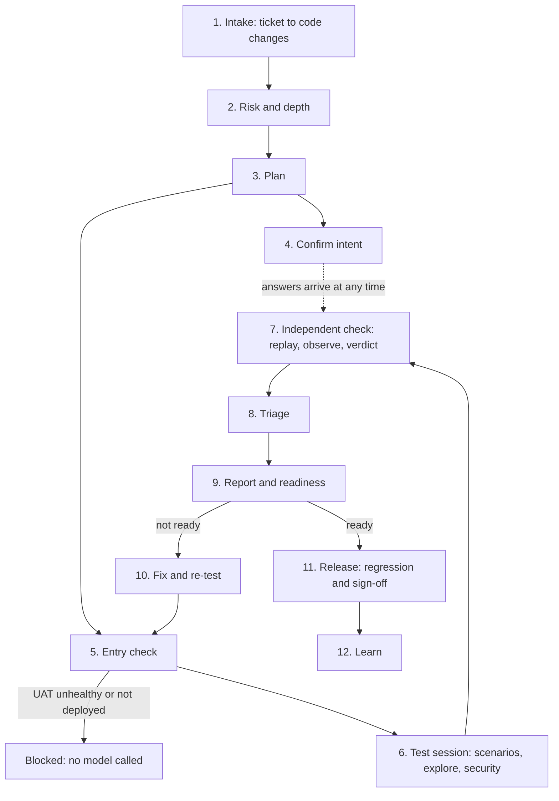

# Semar test workflow

* **Status:** Draft 1. Semar is not built. This document describes the planned flow.
* **Date:** 2026-11-14
* **Related:** [product requirements](PRD.md), [technical requirements](TRD.md), [user scenarios](USER_SCENARIOS.md), [workflow diagram](workflow.html), [the main scenario as a page](scenario.html)

This document explains how one ticket goes from "deployed on UAT" to "ready for sign-off", and why each step is there. The [technical requirements](TRD.md) define each mechanism. This document puts them in order.

## What the workflow has to guarantee

A QA engineer and a security tester follow habits that an agent does not have by default. The workflow turns each habit into a step that code enforces.

| Habit of a good tester | How the workflow enforces it |
| --- | --- |
| Test more where the risk is higher | Code sets a risk level from the change. The level sets the depth of testing |
| Know what was asked for and what was changed | Two coverage tables: the ticket's criteria against scenarios, and the changed code against scenarios |
| Do not test on a broken environment | An entry check runs before any model is called |
| Do not grade your own work | The agent tests. Code replays, checks, and computes each outcome |
| Write down everything you did | The recorder writes the activity log and the list of data touched |
| Test what must never happen, not only what should | Each feature keeps "must never" rules, and security probes check them |
| Stay inside the rules of engagement | Test accounts only, a deny list, request budgets, and read-only data stores |
| Report a defect so that a developer can reproduce it | A defect draft with steps from the activity log, expected, actual, and evidence |
| Say when testing is done | Exit criteria give one readiness line per ticket |
| Re-test the fix and guard against its return | Stored scripts replay with no model, and they join the regression suite |

## Who does what

| Actor | Does | Never does |
| --- | --- | --- |
| Code | Links tickets to code, checks the deploy, signs in, records, replays, checks, computes outcomes and readiness, publishes | Guess |
| Planner, an agent on a strong model | Reads the ticket and the code, and writes the test plan | Run anything on UAT |
| Tester, an agent | Works through scenarios, explores, and tests security, through Semar's tools | Decide an outcome, or see a credential |
| Second reader, an agent from another vendor | Reads the plan and proposes missing scenarios | Change the plan by itself |
| Pilot, a decision model | Picks the next action on a page or a screen for a sub-goal | Type a secret, or act outside the offered options |
| Screener, a decision model | Ranks, scores, and classifies, with a probability | Set an outcome, or confirm a finding |
| People | Confirm new intent, triage findings, accept gaps, sign off | Start runs, collect evidence, or keep lists |

[Model roles](TRD.md#model-roles) says which provider fills each role. Anthropic, OpenAI, and DeepSeek serve the agent roles. A decision model serves the pilot and the screener.

## The flow



| # | Phase | Done by | Uses a model | Output |
| --- | --- | --- | --- | --- |
| 0 | Set up, once per repository | A person, with code | For the feature map | Configuration, feature map, signed-in profiles |
| 1 | Intake | Code | No | Change set per ticket, build view |
| 2 | Risk and depth | Code. The planner can raise the level | Optional screener | Risk level and depth per ticket |
| 3 | Plan | Planner, then code validates | Yes | Test plan: scenarios, both coverage tables, security plan |
| 4 | Confirm intent | People | No | Answers to yes or no questions. Nothing waits for them |
| 5 | Entry check | Code | No | Go, or `blocked` with the reason |
| 6 | Test session | Tester, with the pilot | Yes | Recorded actions, scripts, findings, QA notes |
| 7 | Independent check | Code | No | An outcome per scenario, confirmed findings |
| 8 | Triage | Screener, then people | Optional | Likely causes, merged findings, defect drafts |
| 9 | Report and readiness | Code | No | Report, activity log, Jira comment, readiness line |
| 10 | Fix and re-test | Developer, then code | Only when a script must change | New outcomes on the new build |
| 11 | Release | Code, then people | No | Regression report, sign-off, roll-up |
| 12 | Learn | Code, with people approving | No | Regression scenarios, rules, notes |

## Phase by phase

### 0. Set up

A person does this once per repository. [User scenario 5](USER_SCENARIOS.md#scenario-5-set-up-semar-for-a-repository) walks through it.

* Declare the environment: its hosts, whether tests may change data, and the operations that never run.
* Add test accounts and sign in once where a person is needed. See [Signing in](TRD.md#signing-in).
* Choose the provider for each model role.
* Import existing MCP servers and list the tools that Semar may use. See [MCP configurations](TRD.md#mcp-configurations).
* Draft and correct the feature map, including each feature's "must never" rules.

### 1. Intake

Code finds the merge requests and commits of each ticket, splits the diff into changed pieces, and compares the result with everything that changed on UAT. See [From a ticket to its code changes](TRD.md#from-a-ticket-to-its-code-changes).

Stops here: a change with no ticket, and a ticket with no code that nobody declared as a change without code.

### 2. Risk and depth

Code sets a risk level from facts: the paths touched, the kinds of change, overlaps with other tickets, and the number of entry points. The level sets how deep the testing goes. See [Risk and test depth](TRD.md#risk-and-test-depth).

The planner can raise the level and cannot lower it. A person can set it by hand.

### 3. Plan

The planner reads the ticket, the code as deployed, the feature map, and earlier testing. It produces one plan:

* **The impact map.** Each affected URL, path, and screen, with the code path that leads to it.
* **Functional scenarios** for each entry point: the changed behaviour, the boundary, the refusal, and the neighbour. Each is a Gherkin `.feature` file that product and QA can read, with the source of every expected result in the comment under its `Then` line:

  ```gherkin
  When Request a refund of 150000 for that order
  # step: refund-too-much; POST /v1/orders/{id}/refunds
  Then the status is 422
  # ticket SHOP-482: a refund above the order total must be rejected
  ```

  The request itself is in a script, apart from the file that people confirm.
* **Access checks** and the **security plan**: which probe kinds apply to which entry points, and which "must never" rules are in play.
* **Two coverage tables.** The ticket's criteria against scenarios, and the changed code against scenarios.
* **A double-check list** and recommendations, including what cannot be tested.

Code validates every claim it can: cited lines, listed paths, quoted ticket sentences, and the sources of expected results. An optional second reader from another vendor then proposes missing scenarios as advice.

### 4. Confirm intent

People answer only what is new: an expected result that came from the code alone, a proposed "must never" rule, or a baseline. They read the scenario as Gherkin, `semar confirm` shows it in that form with the cite of each result, and they answer in the merge request or the ticket. No later phase waits for them. A scenario with an open question is tested anyway and stays `inconclusive` until the answer arrives.

### 5. Entry check

Code checks, in this order, and stops at the first failure:

1. Each merge is in the running build, on every replica, and was not reverted.
2. The environment says whether tests may change data.
3. Every needed account is signed in.
4. The health check passes: a few stored scenarios, replayed with no model.

A failure ends the tickets `blocked` with the reason. No model has been called for the session at this point, so a broken UAT costs nothing.

### 6. Test session

The tester works as a QA engineer, in three passes. Every action goes through the recorder.

| Pass | What happens | Who acts |
| --- | --- | --- |
| Scenarios | Each planned scenario is worked through by hand. On a page or a screen, the tester hands sub-goals to the pilot | Tester and pilot |
| Explore | A time-boxed session around the change, with a charter from the plan | Tester and pilot |
| Security | Code builds variations of the recorded requests and sends them. The tester handles business-rule probes and whatever the variations turned up | Code, screener, and tester |

The tester ends with QA notes: what it tested, what it could not test, and what worries it.

### 7. Independent check

Code now repeats the work without the agent:

* It replays each script with no model. The replay must give the recorded results.
* It reads logs and traces for the run's own trace IDs, and reads the data stores where a check needs them. Every data store connection is read-only.
* It computes each outcome from the recorded evidence and the confirmations.
* It confirms a security finding only when the recorded actions meet the probe's condition.

### 8. Triage

* The screener proposes a likely cause for each failed or inconclusive result, and merges findings that describe one defect.
* Code writes a defect draft for each failed scenario and each confirmed finding. See [Defect drafts](TRD.md#defect-drafts).
* A person decides each suspected finding: a defect, a new scenario, or noise.

### 9. Report and readiness

Code publishes the report, the activity log, the list of data touched, and one comment on the ticket. It then computes the readiness line from the exit criteria. See [Readiness of a ticket](TRD.md#readiness-of-a-ticket).

```text
SHOP-482  not ready for sign-off
  1 failed             Refund above the order total is rejected
  1 confirmed finding  GET /v1/orders/{id} returns another user's order
  2 questions open     expected results that came only from the code
  1 gap                criterion AC-3 has no scenario: email leaves the test environment
```

### 10. Fix and re-test

The developer fixes the defect and deploys. Code replays the stored scripts on the new build, starting again at the entry check. The agent is called only when a script no longer fits, for example after a changed request or a moved element.

### 11. Release

* A regression run replays the suite with no model: the scenarios that the change affects first, then all of them on a schedule.
* A person signs off. The sign-off names its builds and stops applying when UAT changes.
* The roll-up shows every ticket of the release with its outcomes.

### 12. Learn

* The scenarios of a signed-off ticket join the regression suite, and so does the script of each fixed security finding.
* A confirmed "must never" rule stays with its feature and is checked on every later ticket.
* The agent can propose a memory note or a feature map change. A person approves it in a merge request.

## Where the fast model helps

A decision model answers in well under a second per question and costs little per request. It cannot write text or drive an agent. The workflow uses it where many small choices would otherwise each cost the tester a full turn:

| Phase | Job | Without it |
| --- | --- | --- |
| 2 | Tell a behaviour change from a refactor, with a probability | The planner decides, and an unsure change counts as behaviour |
| 3 | Order earlier tickets and test cases by relevance | Ordered by date |
| 6 | Pilot: pick the next action on a page or a screen | The tester acts one step at a time, which is slower |
| 6 | Rank probe responses that look unlike the baseline | The tester reads more responses |
| 6 | Notice an error state on a screenshot | Only checks that code can compute |
| 8 | Likely cause of a failure, and merging of duplicate findings | No hint, and findings are not merged |
| 10 | Match a moved element for a repair proposal | The tester repairs it |

No phase requires it. A team that wants the speed can mark a role as required, and Semar then refuses to start that job without it.

## What a person does

| Person | When | Effort |
| --- | --- | --- |
| The author | Never starts a run in pipeline mode. Fixes what failed | Reading the report |
| A reviewer who is not the author | Answers yes or no questions | Target: 2 minutes per ticket |
| Whoever triages | Decides suspected findings and accepts gaps | Only when there are any |
| The release owner | Signs off | One reply per release |

## Where the workflow is weak

* **It tests the change, not the system.** Ten probe kinds on changed entry points are not a security review. A team still needs one at intervals.
* **The plan is as good as the feature map.** A missing entry point is a blind spot for scenarios, access checks, and probes.
* **A wrong expected result that a person confirms will pass.** The workflow shows the source of each expected result. It cannot know the intent.
* **Risk rules are simple.** They read paths and kinds of change. A dangerous change in an ordinary file gets ordinary depth unless the planner or a person raises it.
* **Nothing here has run.** The spikes in the technical requirements test the parts that the flow depends on.

## A first slice

The whole flow is more than a first version can hold. The smallest slice that still follows it:

1. Phases 1, 3, 5, 6 (scenarios pass only), 7, and 9.
2. The API surface only, with one agent provider.
3. The activity log and the readiness line from the start, because they are what people read.

Risk levels, the security pass, the screener, and MCP imports can each be added afterwards without changing the order of the phases.
